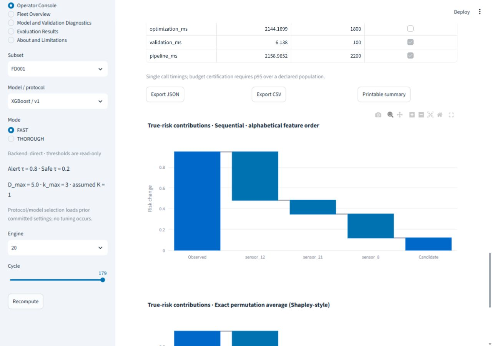
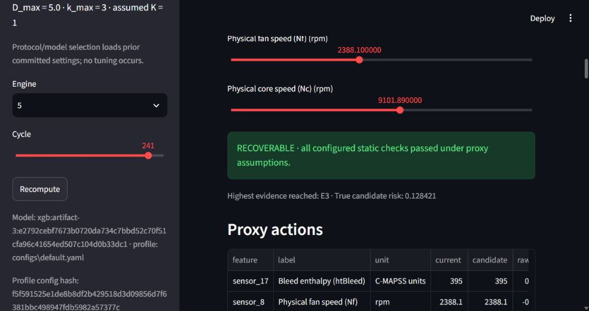
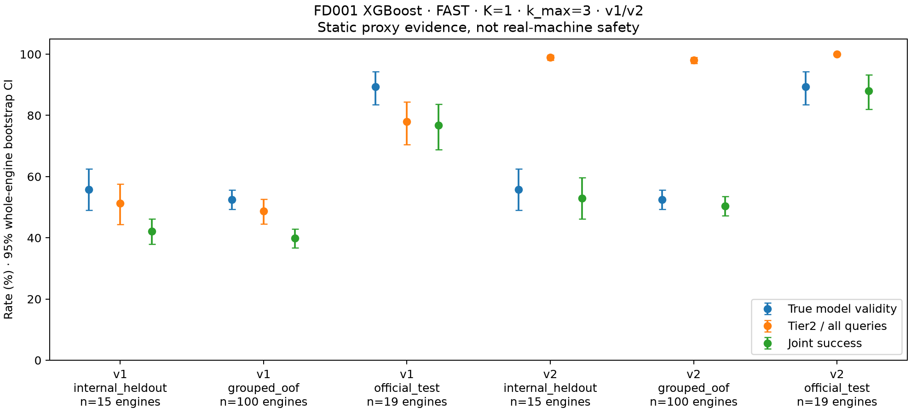

# PrescriptXAI

PrescriptXAI is a research library and operator dashboard for sparse algorithmic recourse on
NASA C-MAPSS. Predictive maintenance estimates **when failure is likely**; diagnostic methods
explain **why a model predicts it**; unconstrained recourse searches for **a prediction change**.
PrescriptXAI restricts changes to configured proxies and checks true calibrated model risk,
statistical plausibility, engineering constraints and learned sensor coupling separately.

**Evidence is at most E3:** C-MAPSS sensor channels are controllable proxies under documented
assumptions, not real actuator commands. Static data cannot establish RUL extension, causal
machine response or deployment safety. Learned coupling is not a physics simulator.

## Quickstart in five commands

Prerequisites: Python 3.11–3.13, internet access for dependencies/NASA data, a trusted local
checkout of this project, and an **empty operator directory** as your current directory.
In command 2 replace the absolute checkout path if yours differs. No PyPI publication is assumed.
These PowerShell commands do not require environment activation:

```powershell
python -m venv .venv
.venv/Scripts/python -m pip install 'C:/Users/chira/OneDrive/Desktop/5thsemEL[api,dashboard]'
.venv/Scripts/prescriptxai init
.venv/Scripts/prescriptxai reproduce
.venv/Scripts/prescriptxai dashboard
```

On Linux/macOS use `.venv/bin/python` and `.venv/bin/prescriptxai`, with your absolute checkout
path in command 2. Open http://localhost:8501. The registered FD001 XGBoost workflow downloads
and verifies data, fits/calibrates the predictor, fits validators, evaluates up to 20 registered
sampled alerts and writes all records plus a manifest. It refuses to replace existing outputs.
Expect about 10–20 minutes after installation on comparable CPU hardware; the verified run took
616.71 s, and a second clean README installation completed it in 479.80 s. These are workflow
durations, not controlled latency comparisons. This demonstrates reproduction on reused engines,
not new generalization.

Choose **THOROUGH** for the [exact demo cases](docs/demo_script.md). For the API, run
`.venv/Scripts/prescriptxai serve` in a second terminal in this same directory; interactive
HTTP documentation is at http://localhost:8000/docs. Python usage:

```python
from prescriptxai import PrescriptXAI
service = PrescriptXAI.from_config('configs/default.yaml')
print(service.info())
```

See [reproduction and Docker instructions](docs/reproducibility.md), including manifest fields,
interruption handling, actual split counts, hardware and build provenance. Only load trusted
artifacts. API authentication and deployment boundaries are described in the
[decision pipeline guide](docs/decision_pipeline.md).

## Architecture

```mermaid
flowchart LR
    A[Observed raw telemetry] --> B[Engine-disjoint preparation]
    B --> C[Train predictor and calibrate]
    C --> D[Risk gate]
    D --> E[Distilled gradient surrogate and sparse bounded search]
    E --> F[True calibrated risk: Tier 1]
    F --> G[Statistical plausibility: Tier 2]
    G --> H[Proxy bounds and rates: Tier 3]
    H --> I[Learned coupling: Tier 4]
    I --> J[RECOVERABLE / PARTIAL / ESCALATE]
    J --> K[CLI / API / operator dashboard]
```



The scaler, covariance validator and coupling model fit training engines only; calibration uses
separate validation engines. The original calibrated predictor, not its distilled surrogate,
determines Tier 1. Full details: [architecture](docs/architecture.md), [math](docs/math.md),
[assumptions](docs/assumptions.md) and [evidence levels](docs/evidence_levels.md).

## Real operator interface



Historical Phase 8 screenshot, with its source, engine/cycle, risks and checks recorded in
[the walkthrough report](docs/phase8_changes.md). The new reproduction has its own model and
[demo instructions](docs/demo_script.md); historical screenshots are not relabeled as new runs.



Fresh Windows reproduction `reproduce-20261026T042558162985Z`, source `8aa18cb`, protocol v1,
assumed K=1, k_max=3, D_max=5: true model risk 0.8833731521 → 0.1284214696, all four static
tiers pass under proxy assumptions. This individual case is not a population success rate.
See the [complete release verification](docs/phase10_changes.md) for config hashes, platform
differences, whole-engine intervals, test counts and retained target misses.

## Measured results

<!-- measured-table:start -->
Run `phase7-20261020T102540Z`; measured source `63c2ed445fba16c73a2771e184f635abf76b4405`.

Study `configs\experiments\phase7-study.yaml`, SHA256 `67094790e414a57b3d6a403f3682bd3ebb1914be74584379c482ddfad1d48c5a`; saved summary SHA256 `e0de87c06b418be761142d259ccad8870b81232217b6d75303ee7a91957082fe`.

FAST/full/all-alert populations; k_max=3, assumed K=1, D_max v1=5 and v2=8. Values are percentages with95% whole-engine bootstrap CIs (2000 draws, seed1729); the engine count beside each row applies to every interval. Five solver seeds repeat fixed predictors, not independent engines. E3 is the maximum available proxy evidence. All outcomes, including failures, remain in all-query denominators. T2 returned has its own denominator in the source data. Config-set identifiers below resolve to every exact committed config path/runtime hash in [results_provenance.json](docs/results_provenance.json).

| Model / protocol / population | Queries / seed observations / engines | Validity | T2 all | T2 returned | T3 | T4 | Joint | Config set |
|---|---:|---:|---:|---:|---:|---:|---:|---|
| FD001 xgb v1 internal_heldout | 378/1890/15 | 55.82 [49.00, 62.50] | 51.32 [44.39, 57.53] | 51.32 [44.39, 57.53] | 100.00 [100.00, 100.00] | 94.44 [92.02, 96.74] | 42.06 [37.92, 46.15] | f24c40c738be |
| FD001 xgb v1 grouped_oof | 2378/11890/100 | 52.52 [49.30, 55.64] | 48.70 [44.59, 52.61] | 51.04 [47.46, 54.46] | 95.12 [92.01, 97.83] | 91.67 [89.45, 93.62] | 39.91 [36.73, 42.91] | a3483e883531 |
| FD001 xgb v1 official_test | 159/795/19 | 89.31 [83.57, 94.36] | 77.99 [70.42, 84.38] | 77.99 [70.42, 84.38] | 100.00 [100.00, 100.00] | 98.74 [96.57, 100.00] | 76.73 [68.75, 83.66] | 0ad569564fa6 |
| FD001 xgb v2 internal_heldout | 378/1890/15 | 55.82 [49.00, 62.50] | 98.94 [98.09, 99.74] | 98.94 [98.09, 99.74] | 100.00 [100.00, 100.00] | 94.44 [92.02, 96.74] | 52.91 [46.13, 59.61] | dace208feedc |
| FD001 xgb v2 grouped_oof | 2378/11890/100 | 52.52 [49.30, 55.64] | 98.07 [97.00, 98.92] | 98.98 [98.45, 99.42] | 95.12 [92.01, 97.83] | 91.67 [89.45, 93.62] | 50.42 [47.29, 53.48] | 432c17f956cc |
| FD001 xgb v2 official_test | 159/795/19 | 89.31 [83.57, 94.36] | 100.00 [100.00, 100.00] | 100.00 [100.00, 100.00] | 100.00 [100.00, 100.00] | 98.74 [96.57, 100.00] | 88.05 [82.03, 93.20] | bf715a849ba3 |
<!-- measured-table:end -->

The complete [results and latency gap tables](docs/results.md) also include MLP, LSTM and FD002,
with exact config identities. Tier 2 is plausibility alone; joint success is stricter and never
compared with the 90% plausibility target. The [Phase 7 report](docs/phase7_changes.md) preserves
failures, constraint ladders, assumed-K curves, unresolved finite reference searches and target
gap diagnoses. Optimization latency misses remain visible; no threshold was relaxed to pass.



## Limits and intended use

This prototype supports research and examiner review. Bounds, rates, proxy control mapping and
intervention horizon K are assumptions. Model validity can be misleading without plausibility
and coupling evidence. No validated emulator or physics simulator is available; the optional
simulator interface is off by default. See [limitations](docs/limitations.md),
[defense questions](docs/defense_qa.md) and the conditional [SDG 9 connection](docs/sdg9.md).

## Development, docs and release artifacts

```powershell
uv sync --all-groups --locked
mingw32-make all-checks
uv run mkdocs build --strict
uv run python -m build
```

Use `make` on Unix. The gate runs Ruff, strict mypy, tests with coverage ratchets and the actual
Material/docstring documentation build. Source distribution and wheel land in ignored `dist/`;
HTML docs in ignored `site/`. [CI](.github/workflows/ci.yml) is configured for Python 3.11/3.12;
hosted execution is not implied by local verification. Public result schemas remain **2.0.0**,
independent of package **0.2.0**. See [CHANGELOG](CHANGELOG.md), [PROGRESS](PROGRESS.md),
[demo and slide outline](docs/demo_script.md), and [paper skeleton](paper/README.md).

## License and citation

Project code uses the [MIT license](LICENSE); data and dependencies retain their own terms.
Cite the software using [CITATION.cff](CITATION.cff). No DOI or publication is asserted.

```bibtex
@software{prescriptxai_2026,
  author = {{PrescriptXAI contributors}},
  title = {PrescriptXAI},
  version = {0.2.0},
  year = {2026}
}
```
