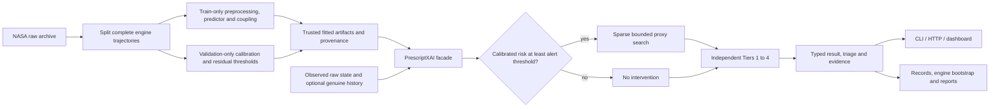

# Architecture

PrescriptXAI is a research decision-support library. Its public facade, `PrescriptXAI`, is shared
by CLI, FastAPI and Streamlit; they do not implement separate risk or validation rules.
RecourseResult and ValidationReport are frozen at schema **2.0.0**. Package release0.2.0 is a
separate version. The highest available evidence is E3 under documented sensor-proxy assumptions.

## Modules and ownership

| Module | Responsibility |
|---|---|
| `data` | Archive integrity, canonical columns, cycle/RUL labels, engine splits, train-only scalers/regimes |
| `models` | XGBoost, MLP and LSTM; validation-only monotone calibration; gradient surrogate; typed registry |
| `constraints` | YAML taxonomy, raw bounds/rates/directions, residual-preserving learned coupling |
| `recourse` | Scaled controls, L-BFGS-B smooth/split L1, support search, bounded true-model grid |
| `validation` | Independent true risk, regime-specific Mahalanobis, proxy engineering and coupling checks |
| `pipeline` | Input/context checks, verified artifact assembly, bounded cache, thread-safe prediction and triage |
| `evaluation` | Declared cohorts, persisted records, both plausibility denominators, whole-engine intervals |
| `api`, `cli`, `dashboard` | Thin consumers, friendly typed errors, current observed telemetry and export |
| `reproduce`, `workspace`, `provenance` | Portable initialization, fresh data-to-report workflow, installed-source identity |

Training partitions contain entire engines. Predictor selection uses predictive/calibration
metrics; recourse outcomes do not tune the predictor. Early stopping and probability calibration
use validation engines drawn from the public training file. Covariance and coupling regressors
fit training engines only; residual limits are calibrated on disjoint validation engines. The
internal holdout is never a fitting set. Official test engine IDs are a separate dataset namespace.

The snapshot models operate on raw named fields through a train-fitted scaler. LSTM training
constructs within-engine windows; early training windows repeat the first observation. Public
sequence recommendations require **real preceding observations** in InputContext. History stays
fixed and only the latest state is changed. Insufficient observed history is an explicit error;
it is not fabricated for a demo. Final true calibrated risk is authoritative even when the
search uses a surrogate gradient.

## Serving and operator flow

The facade validates names/order/types, finite representable measurements, units and history.
Verified model/scaler/covariance/coupling identities and content hashes key a bounded cache.
Predictor/coupling access is locked; each request receives its own mode configuration. Optional
CPU process workers use a configuration snapshot and bounded batch sizes. Manual dashboard
edits call the same validation path and cannot turn a low-risk but implausible state into an
accepted intervention.

HTTP routes are GET `/health`, `/config`, `/version` and POST `/assess`, `/recommend`,
`/recommend/batch`, `/validate-controls`; `/docs` and `/openapi.json` expose the API contract.
Payload limits, sanitized validation errors, configured CORS and optional environment API keys
are enforced. These are local research services, not a complete production security boundary.
Streamlit has Operator Console, Fleet Overview, Model and Validation Diagnostics, Evaluation
Results, and About and Limitations. Source/model switches invalidate stale decisions.

## Persistence and reproducibility

`prescriptxai init` copies bundled YAML templates to a new operator workspace. `reproduce` uses
that configuration to prepare, train/calibrate, fit validators, evaluate and report in a fresh
artifact directory. Configuration, archive, model and report hashes, engine IDs, package source,
versions, stage times and failure checkpoints live in the manifest. A built wheel carries its
source commit and file hashes; an unrelated operator Git repository cannot supply its identity.
A modified source distribution is explicitly marked dirty. The fixed Phase10 sample is a
reused-engine demonstration, not a re-run or replacement of the full Phase7 experiment.

Legacy fitted objects require trusted local artifact roots and byte identity checks. Never load
an uploaded/downloaded pickle. See [artifact security](artifact_security.md). Generated data and
fitted artifacts stay out of Git and distributions. Docker installs the same wheel, runs as
UID10001 and mounts the operator's configs, data and artifacts read-only for serving.

## Extension points

- **Predictor:** implement the `FailureModel`/`RiskEstimator` contract in `models.base`; define
  raw-feature ordering, calibrated probabilities, optional differentiable path and serialization.
  Extend training/registry selection and fit/provenance tests. A surrogate cannot decide validity.
- **Constraint:** add typed YAML settings and a shared `TierResult`/`CheckResult`; use the exact
  validator for final acceptance. A differentiable penalty is an approximation, not a new verdict.
  Add unit/edge/science tests and preregister any changed evaluation protocol before measuring.
- **Emulator:** supply a learned transition adapter with held-out unit and operating-region
  validation, residual/coverage metrics and explicit E4 evidence. Current static coupling is not
  a dynamics emulator. Do not label a learned model physics.
- **Simulator:** implement `DynamicSimulator.validate_candidate` and an independently validated physics
  integration before claiming E5. `NullSimulator` is the default; skipped dynamics never pass.
- **Schema:** after Phase6, any public result/report change needs a version bump, schema changelog
  and agreement of every owner. Package-only changes do not silently change schema2.0.0.
