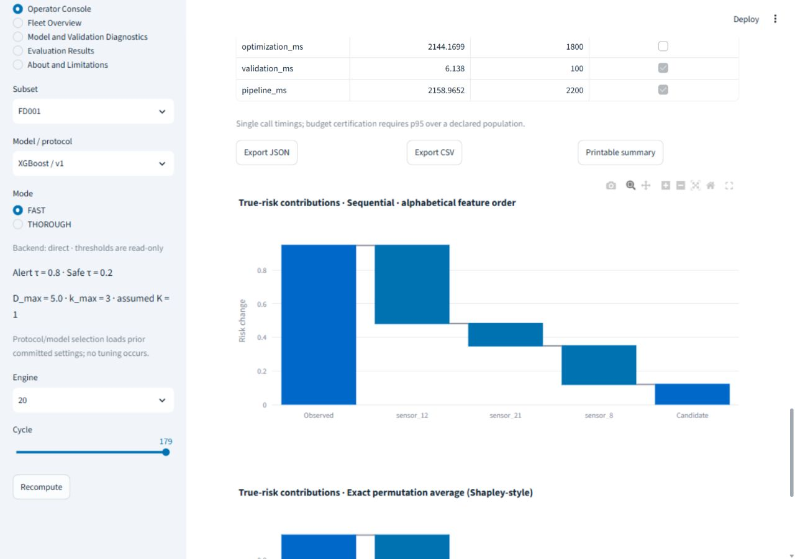

# PrescriptXAI

PrescriptXAI is a research library and operator interface for sparse proxy recourse on
NASA C-MAPSS. A predictor estimates failure risk; a distilled gradient surrogate guides a bounded search;
the original calibrated predictor and four separate validation tiers evaluate the candidate.

Predictive maintenance asks **when failure is likely**. Diagnostic explanations ask **which
features influence a prediction**. Unconstrained recourse asks **what would change that
prediction**. This prototype asks **whether a small change to permitted proxies also passes
statistical and documented engineering checks**. These checks do not establish real actuator
efficacy. Current evidence reaches at most **E3**, with no RUL-extension claim.

Start with the repository README's five commands, then read [reproduction](reproducibility.md)
and the [five-minute demo](demo_script.md). The [measured tables](results.md) preserve target
misses and failed-query denominators. [Evidence levels](evidence_levels.md),
[assumptions](assumptions.md) and [limitations](limitations.md) define the scope of every result.

This screenshot belongs to the preserved Phase 8 run, not the newly fitted reproduction.
Its exact provenance is in [the Phase 8 report](phase8_changes.md).

