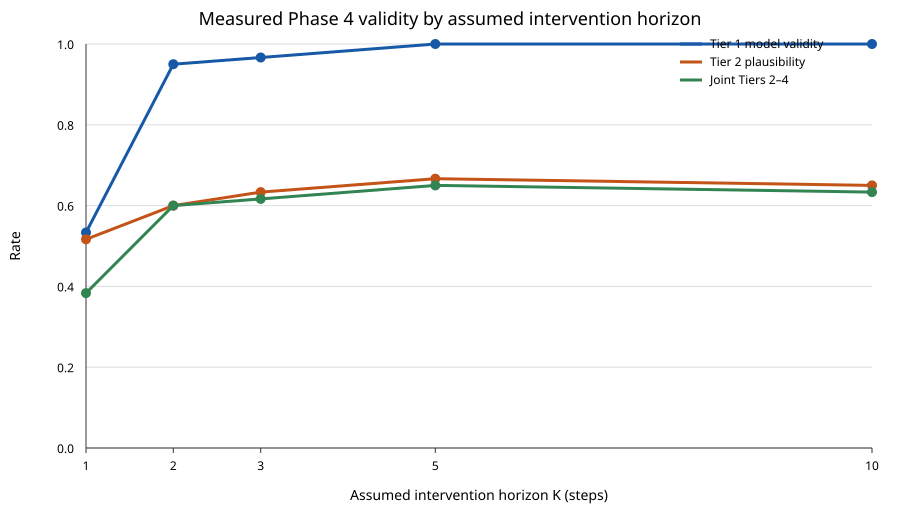

# Phase 4 final evaluation

| Run metadata | Value |
|---|---|
| Run ID | `phase4-20261018T071947Z` |
| Run timestamp UTC | 2026-10-18T08:22:05.576033+00:00 |
| Evaluation/oracle source commit | `d1a6945fa9671beb6c48ebbbf89f0a2c72221488` |
| Protocol v2 freeze commit | `5f88d27b329a3ff673f841e525b154bfc853432c` |
| Protocol document SHA-256 | `e9c4a87f2a9a07ca7f6206cf8b660b6b9f65a6656d157e822394e4dd1dc7362f` |
| Holdout and sensitivity measurement source | `7860fed5a99b6c94eefc2ffd2c8327052ea56b24` |
| Grouped OOF and official-test measurement source | `4a8275a788c9998d80acf07f3e7e9dfe2fcbe179` |

## Design targets and measured values

Confidence intervals are 95% percentile bootstrap intervals resampling whole engines. The engine count and query count are printed per row. Tier 1 model validity and Tiers 2–4 physical checks are reported separately.

### V1 — headline sample

Run ID `phase4-20261018T071947Z`; config SHA-256 `9afbae1dfb168250fd3871589d49ab6609a74f90a0f6479c4c5d75d9216cad37`; protocol v1; `k_max=3`; `K=1`; `D_max=5.0`; population `headline_sample`.

| Metric | Target | Measured | Engine-bootstrap 95% CI | Engines / queries | Gap to target |
|---|---:|---:|---:|---:|---:|
| True calibrated model validity | >= 0.95 | 0.560 | [0.468, 0.636] | 15 / 200 | -0.390 |
| Tier 2 plausibility, all queries | >= 0.9 | 0.530 | [0.432, 0.615] | 15 / 200 | -0.370 |
| Tier 2 plausibility among returned counterfactuals | >= 0.9 | 0.786 | [0.745, 0.830] | 15 / 112 | -0.114 |
| Joint Tiers 2–4 plausibility, all queries | >= 0.9 | 0.435 | [0.362, 0.498] | 15 / 200 | -0.465 |
| Joint Tiers 2–4 among returned counterfactuals | reported separately | 0.777 | [0.738, 0.820] | 15 / 112 | — |
| Mean risk reduction, all queries | >= 0.6 | 0.610 | [0.551, 0.662] | 15 / 200 | +0.010 |
| Mean changed features among joint successes | <= 3 | 2.816 | [2.735, 2.879] | 15 / 87 | +0.184 |
| Optimization p95 ms (attempted queries) | <= 1800 | 1904.5 | [1648.9, 2175.5] | 15 / 200 | -104.503 |

### V1 — all alert states

Run ID `phase4-20261018T071947Z`; config SHA-256 `9afbae1dfb168250fd3871589d49ab6609a74f90a0f6479c4c5d75d9216cad37`; protocol v1; `k_max=3`; `K=1`; `D_max=5.0`; population `all_alert_states`.

| Metric | Target | Measured | Engine-bootstrap 95% CI | Engines / queries | Gap to target |
|---|---:|---:|---:|---:|---:|
| True calibrated model validity | >= 0.95 | 0.558 | [0.489, 0.623] | 15 / 378 | -0.392 |
| Tier 2 plausibility, all queries | >= 0.9 | 0.511 | [0.443, 0.575] | 15 / 378 | -0.389 |
| Tier 2 plausibility among returned counterfactuals | >= 0.9 | 0.754 | [0.711, 0.796] | 15 / 211 | -0.146 |
| Joint Tiers 2–4 plausibility, all queries | >= 0.9 | 0.418 | [0.374, 0.457] | 15 / 378 | -0.482 |
| Joint Tiers 2–4 among returned counterfactuals | reported separately | 0.749 | [0.711, 0.790] | 15 / 211 | — |
| Mean risk reduction, all queries | >= 0.6 | 0.598 | [0.543, 0.650] | 15 / 378 | -0.002 |
| Mean changed features among joint successes | <= 3 | 2.797 | [2.723, 2.866] | 15 / 158 | +0.203 |
| Optimization p95 ms (attempted queries) | <= 1800 | 1917.6 | [1703.9, 2147.1] | 15 / 378 | -117.618 |

### V1 — first alert per engine

Run ID `phase4-20261018T071947Z`; config SHA-256 `9afbae1dfb168250fd3871589d49ab6609a74f90a0f6479c4c5d75d9216cad37`; protocol v1; `k_max=3`; `K=1`; `D_max=5.0`; population `first_alert_per_engine`.

| Metric | Target | Measured | Engine-bootstrap 95% CI | Engines / queries | Gap to target |
|---|---:|---:|---:|---:|---:|
| True calibrated model validity | >= 0.95 | 1.000 | [1.000, 1.000] | 15 / 15 | +0.050 |
| Tier 2 plausibility, all queries | >= 0.9 | 0.933 | [0.800, 1.000] | 15 / 15 | +0.033 |
| Tier 2 plausibility among returned counterfactuals | >= 0.9 | 0.933 | [0.800, 1.000] | 15 / 15 | +0.033 |
| Joint Tiers 2–4 plausibility, all queries | >= 0.9 | 0.933 | [0.800, 1.000] | 15 / 15 | +0.033 |
| Joint Tiers 2–4 among returned counterfactuals | reported separately | 0.933 | [0.800, 1.000] | 15 / 15 | — |
| Mean risk reduction, all queries | >= 0.6 | 0.722 | [0.692, 0.754] | 15 / 15 | +0.122 |
| Mean changed features among joint successes | <= 3 | 2.571 | [2.286, 2.786] | 14 / 14 | +0.429 |
| Optimization p95 ms (attempted queries) | <= 1800 | 2139.3 | [1569.3, 2175.5] | 15 / 15 | -339.301 |

### V2 — headline sample

Run ID `phase4-20261018T071947Z`; config SHA-256 `8dfb12acc6592077c93ba5bfb3149c43200c212c4073bfc2196cfbb151acd22c`; protocol v2; `k_max=3`; `K=1`; `D_max=8.0`; population `headline_sample`.

| Metric | Target | Measured | Engine-bootstrap 95% CI | Engines / queries | Gap to target |
|---|---:|---:|---:|---:|---:|
| True calibrated model validity | >= 0.95 | 0.560 | [0.469, 0.637] | 15 / 200 | -0.390 |
| Tier 2 plausibility, all queries | >= 0.9 | 0.990 | [0.975, 1.000] | 15 / 200 | +0.090 |
| Tier 2 plausibility among returned counterfactuals | >= 0.9 | 1.000 | [1.000, 1.000] | 15 / 112 | +0.100 |
| Joint Tiers 2–4 plausibility, all queries | >= 0.9 | 0.525 | [0.447, 0.592] | 15 / 200 | -0.375 |
| Joint Tiers 2–4 among returned counterfactuals | reported separately | 0.938 | [0.903, 0.979] | 15 / 112 | — |
| Mean risk reduction, all queries | >= 0.6 | 0.611 | [0.553, 0.667] | 15 / 200 | +0.011 |
| Mean changed features among joint successes | <= 3 | 2.781 | [2.739, 2.829] | 15 / 105 | +0.219 |
| Optimization p95 ms (attempted queries) | <= 1800 | 2022.5 | [1679.7, 2514.5] | 15 / 200 | -222.523 |

### V2 — all alert states

Run ID `phase4-20261018T071947Z`; config SHA-256 `8dfb12acc6592077c93ba5bfb3149c43200c212c4073bfc2196cfbb151acd22c`; protocol v2; `k_max=3`; `K=1`; `D_max=8.0`; population `all_alert_states`.

| Metric | Target | Measured | Engine-bootstrap 95% CI | Engines / queries | Gap to target |
|---|---:|---:|---:|---:|---:|
| True calibrated model validity | >= 0.95 | 0.558 | [0.492, 0.623] | 15 / 378 | -0.392 |
| Tier 2 plausibility, all queries | >= 0.9 | 0.989 | [0.980, 0.997] | 15 / 378 | +0.089 |
| Tier 2 plausibility among returned counterfactuals | >= 0.9 | 1.000 | [1.000, 1.000] | 15 / 211 | +0.100 |
| Joint Tiers 2–4 plausibility, all queries | >= 0.9 | 0.521 | [0.454, 0.586] | 15 / 378 | -0.379 |
| Joint Tiers 2–4 among returned counterfactuals | reported separately | 0.934 | [0.904, 0.961] | 15 / 211 | — |
| Mean risk reduction, all queries | >= 0.6 | 0.599 | [0.545, 0.653] | 15 / 378 | -0.001 |
| Mean changed features among joint successes | <= 3 | 2.777 | [2.724, 2.827] | 15 / 197 | +0.223 |
| Optimization p95 ms (attempted queries) | <= 1800 | 2205.4 | [1684.3, 2749.0] | 15 / 378 | -405.407 |

### V2 — first alert per engine

Run ID `phase4-20261018T071947Z`; config SHA-256 `8dfb12acc6592077c93ba5bfb3149c43200c212c4073bfc2196cfbb151acd22c`; protocol v2; `k_max=3`; `K=1`; `D_max=8.0`; population `first_alert_per_engine`.

| Metric | Target | Measured | Engine-bootstrap 95% CI | Engines / queries | Gap to target |
|---|---:|---:|---:|---:|---:|
| True calibrated model validity | >= 0.95 | 1.000 | [1.000, 1.000] | 15 / 15 | +0.050 |
| Tier 2 plausibility, all queries | >= 0.9 | 1.000 | [1.000, 1.000] | 15 / 15 | +0.100 |
| Tier 2 plausibility among returned counterfactuals | >= 0.9 | 1.000 | [1.000, 1.000] | 15 / 15 | +0.100 |
| Joint Tiers 2–4 plausibility, all queries | >= 0.9 | 0.933 | [0.800, 1.000] | 15 / 15 | +0.033 |
| Joint Tiers 2–4 among returned counterfactuals | reported separately | 0.933 | [0.800, 1.000] | 15 / 15 | — |
| Mean risk reduction, all queries | >= 0.6 | 0.718 | [0.691, 0.747] | 15 / 15 | +0.118 |
| Mean changed features among joint successes | <= 3 | 2.571 | [2.286, 2.786] | 14 / 14 | +0.429 |
| Optimization p95 ms (attempted queries) | <= 1800 | 1689.4 | [1466.3, 1720.3] | 15 / 15 | +110.572 |

## Triage, risk-reduction histogram, and end-of-life concentration

All rates below use the named query population; confidence intervals resample whole engines.

### V1 — headline sample

Run `phase4-20261018T071947Z`; config `9afbae1dfb168250fd3871589d49ab6609a74f90a0f6479c4c5d75d9216cad37`; protocol v1; k=3; K=1; Dmax=5.0; queries=200; engines=15.

| Triage group | Count | Rate [engine-bootstrap 95% CI] | Engines / queries |
|---|---:|---:|---:|
| RECOVERABLE | 87 | 0.435 [0.358, 0.503] | 15 / 200 |
| PARTIAL | 13 | 0.065 [0.030, 0.108] | 15 / 200 |
| ESCALATE | 100 | 0.500 [0.417, 0.588] | 15 / 200 |

| Risk reduction bin (risk before − risk after) | Count | Rate [engine-bootstrap 95% CI] | Engines / queries |
|---|---:|---:|---:|
| negative | 0 | 0.000 [0.000, 0.000] | 15 / 200 |
| 0_to_0.10 | 16 | 0.080 [0.018, 0.159] | 15 / 200 |
| 0.10_to_0.30 | 19 | 0.095 [0.060, 0.133] | 15 / 200 |
| 0.30_to_0.60 | 28 | 0.140 [0.100, 0.177] | 15 / 200 |
| 0.60_to_1.00 | 137 | 0.685 [0.596, 0.759] | 15 / 200 |

| Life stage | Queries | Engines | RECOVERABLE [95% CI] | PARTIAL [95% CI] | ESCALATE [95% CI] |
|---|---:|---:|---:|---:|---:|
| RUL<=10 | 83 | 15 | 0.096 [0.025, 0.185] | 0.084 [0.014, 0.161] | 0.819 [0.667, 0.948] |
| RUL>10 | 117 | 15 | 0.675 [0.589, 0.761] | 0.051 [0.022, 0.083] | 0.274 [0.183, 0.365] |

### V1 — all alert states

Run `phase4-20261018T071947Z`; config `9afbae1dfb168250fd3871589d49ab6609a74f90a0f6479c4c5d75d9216cad37`; protocol v1; k=3; K=1; Dmax=5.0; queries=378; engines=15.

| Triage group | Count | Rate [engine-bootstrap 95% CI] | Engines / queries |
|---|---:|---:|---:|
| RECOVERABLE | 158 | 0.418 [0.373, 0.457] | 15 / 378 |
| PARTIAL | 22 | 0.058 [0.032, 0.091] | 15 / 378 |
| ESCALATE | 198 | 0.524 [0.473, 0.579] | 15 / 378 |

| Risk reduction bin (risk before − risk after) | Count | Rate [engine-bootstrap 95% CI] | Engines / queries |
|---|---:|---:|---:|
| negative | 0 | 0.000 [0.000, 0.000] | 15 / 378 |
| 0_to_0.10 | 32 | 0.085 [0.026, 0.153] | 15 / 378 |
| 0.10_to_0.30 | 38 | 0.101 [0.068, 0.139] | 15 / 378 |
| 0.30_to_0.60 | 53 | 0.140 [0.103, 0.175] | 15 / 378 |
| 0.60_to_1.00 | 255 | 0.675 [0.593, 0.750] | 15 / 378 |

| Life stage | Queries | Engines | RECOVERABLE [95% CI] | PARTIAL [95% CI] | ESCALATE [95% CI] |
|---|---:|---:|---:|---:|---:|
| RUL<=10 | 164 | 15 | 0.104 [0.043, 0.170] | 0.085 [0.036, 0.135] | 0.811 [0.713, 0.897] |
| RUL>10 | 214 | 15 | 0.659 [0.602, 0.722] | 0.037 [0.019, 0.059] | 0.304 [0.232, 0.372] |

### V1 — first alert per engine

Run `phase4-20261018T071947Z`; config `9afbae1dfb168250fd3871589d49ab6609a74f90a0f6479c4c5d75d9216cad37`; protocol v1; k=3; K=1; Dmax=5.0; queries=15; engines=15.

| Triage group | Count | Rate [engine-bootstrap 95% CI] | Engines / queries |
|---|---:|---:|---:|
| RECOVERABLE | 14 | 0.933 [0.800, 1.000] | 15 / 15 |
| PARTIAL | 0 | 0.000 [0.000, 0.000] | 15 / 15 |
| ESCALATE | 1 | 0.067 [0.000, 0.200] | 15 / 15 |

| Risk reduction bin (risk before − risk after) | Count | Rate [engine-bootstrap 95% CI] | Engines / queries |
|---|---:|---:|---:|
| negative | 0 | 0.000 [0.000, 0.000] | 15 / 15 |
| 0_to_0.10 | 0 | 0.000 [0.000, 0.000] | 15 / 15 |
| 0.10_to_0.30 | 0 | 0.000 [0.000, 0.000] | 15 / 15 |
| 0.30_to_0.60 | 0 | 0.000 [0.000, 0.000] | 15 / 15 |
| 0.60_to_1.00 | 15 | 1.000 [1.000, 1.000] | 15 / 15 |

| Life stage | Queries | Engines | RECOVERABLE [95% CI] | PARTIAL [95% CI] | ESCALATE [95% CI] |
|---|---:|---:|---:|---:|---:|
| RUL<=10 | 0 | 0 | — | — | — |
| RUL>10 | 15 | 15 | 0.933 [0.800, 1.000] | 0.000 [0.000, 0.000] | 0.067 [0.000, 0.200] |

### V2 — headline sample

Run `phase4-20261018T071947Z`; config `8dfb12acc6592077c93ba5bfb3149c43200c212c4073bfc2196cfbb151acd22c`; protocol v2; k=3; K=1; Dmax=8.0; queries=200; engines=15.

| Triage group | Count | Rate [engine-bootstrap 95% CI] | Engines / queries |
|---|---:|---:|---:|
| RECOVERABLE | 105 | 0.525 [0.448, 0.594] | 15 / 200 |
| PARTIAL | 52 | 0.260 [0.191, 0.327] | 15 / 200 |
| ESCALATE | 43 | 0.215 [0.125, 0.302] | 15 / 200 |

| Risk reduction bin (risk before − risk after) | Count | Rate [engine-bootstrap 95% CI] | Engines / queries |
|---|---:|---:|---:|
| negative | 0 | 0.000 [0.000, 0.000] | 15 / 200 |
| 0_to_0.10 | 16 | 0.080 [0.020, 0.156] | 15 / 200 |
| 0.10_to_0.30 | 19 | 0.095 [0.061, 0.130] | 15 / 200 |
| 0.30_to_0.60 | 28 | 0.140 [0.099, 0.179] | 15 / 200 |
| 0.60_to_1.00 | 137 | 0.685 [0.598, 0.766] | 15 / 200 |

| Life stage | Queries | Engines | RECOVERABLE [95% CI] | PARTIAL [95% CI] | ESCALATE [95% CI] |
|---|---:|---:|---:|---:|---:|
| RUL<=10 | 83 | 15 | 0.205 [0.106, 0.312] | 0.386 [0.267, 0.494] | 0.410 [0.239, 0.598] |
| RUL>10 | 117 | 15 | 0.752 [0.676, 0.820] | 0.171 [0.102, 0.246] | 0.077 [0.031, 0.125] |

### V2 — all alert states

Run `phase4-20261018T071947Z`; config `8dfb12acc6592077c93ba5bfb3149c43200c212c4073bfc2196cfbb151acd22c`; protocol v2; k=3; K=1; Dmax=8.0; queries=378; engines=15.

| Triage group | Count | Rate [engine-bootstrap 95% CI] | Engines / queries |
|---|---:|---:|---:|
| RECOVERABLE | 197 | 0.521 [0.456, 0.585] | 15 / 378 |
| PARTIAL | 93 | 0.246 [0.191, 0.299] | 15 / 378 |
| ESCALATE | 88 | 0.233 [0.147, 0.321] | 15 / 378 |

| Risk reduction bin (risk before − risk after) | Count | Rate [engine-bootstrap 95% CI] | Engines / queries |
|---|---:|---:|---:|
| negative | 0 | 0.000 [0.000, 0.000] | 15 / 378 |
| 0_to_0.10 | 32 | 0.085 [0.026, 0.149] | 15 / 378 |
| 0.10_to_0.30 | 38 | 0.101 [0.069, 0.136] | 15 / 378 |
| 0.30_to_0.60 | 53 | 0.140 [0.104, 0.178] | 15 / 378 |
| 0.60_to_1.00 | 255 | 0.675 [0.596, 0.751] | 15 / 378 |

| Life stage | Queries | Engines | RECOVERABLE [95% CI] | PARTIAL [95% CI] | ESCALATE [95% CI] |
|---|---:|---:|---:|---:|---:|
| RUL<=10 | 164 | 15 | 0.220 [0.128, 0.311] | 0.372 [0.268, 0.466] | 0.409 [0.256, 0.588] |
| RUL>10 | 214 | 15 | 0.752 [0.684, 0.827] | 0.150 [0.092, 0.203] | 0.098 [0.049, 0.160] |

### V2 — first alert per engine

Run `phase4-20261018T071947Z`; config `8dfb12acc6592077c93ba5bfb3149c43200c212c4073bfc2196cfbb151acd22c`; protocol v2; k=3; K=1; Dmax=8.0; queries=15; engines=15.

| Triage group | Count | Rate [engine-bootstrap 95% CI] | Engines / queries |
|---|---:|---:|---:|
| RECOVERABLE | 14 | 0.933 [0.800, 1.000] | 15 / 15 |
| PARTIAL | 0 | 0.000 [0.000, 0.000] | 15 / 15 |
| ESCALATE | 1 | 0.067 [0.000, 0.200] | 15 / 15 |

| Risk reduction bin (risk before − risk after) | Count | Rate [engine-bootstrap 95% CI] | Engines / queries |
|---|---:|---:|---:|
| negative | 0 | 0.000 [0.000, 0.000] | 15 / 15 |
| 0_to_0.10 | 0 | 0.000 [0.000, 0.000] | 15 / 15 |
| 0.10_to_0.30 | 0 | 0.000 [0.000, 0.000] | 15 / 15 |
| 0.30_to_0.60 | 0 | 0.000 [0.000, 0.000] | 15 / 15 |
| 0.60_to_1.00 | 15 | 1.000 [1.000, 1.000] | 15 / 15 |

| Life stage | Queries | Engines | RECOVERABLE [95% CI] | PARTIAL [95% CI] | ESCALATE [95% CI] |
|---|---:|---:|---:|---:|---:|
| RUL<=10 | 0 | 0 | — | — | — |
| RUL>10 | 15 | 15 | 0.933 [0.800, 1.000] | 0.000 [0.000, 0.000] | 0.067 [0.000, 0.200] |

## Protocol v2 fresh-engine checks

| Population | Protocol | Run/config hash | k / K / Dmax | Queries / engines | Tier 1 validity [95% CI] | Tier 2 all queries [95% CI] | Joint Tiers 2–4 [95% CI] |
|---|---|---|---|---:|---:|---:|---:|
| grouped_cv_oof | v1 | `phase4-20261018T071947Z` / `ec065ec7aed1221d61b139038f0dbe5e24abbe4dedb95ba360e2c534c62243ea` | 3 / 1 / 5.0 | 200 / 78 | 0.580 [0.505, 0.654] | 0.510 [0.433, 0.594] | 0.435 [0.362, 0.511] |
| grouped_cv_oof | v2 | `phase4-20261018T071947Z` / `33195fba77b32958f1af188c221af1e9ae69c07f7e38d79954af1c71492ee708` | 3 / 1 / 8.0 | 200 / 78 | 0.580 [0.507, 0.658] | 0.935 [0.886, 0.975] | 0.575 [0.502, 0.648] |
| official_test | v1 | `phase4-20261018T071947Z` / `bd63e4ff7d298e4bdfa3d18156abd62acaa7200cf0a29a18823424529c94683e` | 3 / 1 / 5.0 | 159 / 19 | 0.893 [0.838, 0.943] | 0.780 [0.704, 0.842] | 0.767 [0.688, 0.838] |
| official_test | v2 | `phase4-20261018T071947Z` / `e172de8afc9e5891bed579e8b5a5602faeecb48badd1ad7250a244483fc8ffa1` | 3 / 1 / 8.0 | 159 / 19 | 0.893 [0.835, 0.945] | 1.000 [1.000, 1.000] | 0.881 [0.821, 0.934] |

## K horizon and one-factor sensitivity

K multiplies the observed training-engine one-step telemetry rate limit. K>1 is a horizon assumption, not measured actuator dynamics.

| K | Tier 1 validity | Tier 2 plausibility | Joint Tiers 2–4 | Engines / queries |
|---:|---:|---:|---:|---:|
| 1 | 0.533 | 0.517 | 0.383 | 14 / 60 |
| 2 | 0.950 | 0.600 | 0.600 | 14 / 60 |
| 3 | 0.967 | 0.633 | 0.617 | 14 / 60 |
| 5 | 1.000 | 0.667 | 0.650 | 14 / 60 |
| 10 | 1.000 | 0.650 | 0.633 | 14 / 60 |

| Run ID / variant | Config SHA-256 | Protocol | k_max | K | D_max | Population | Tier 1 [95% CI] | Tier 2 [95% CI] | Joint [95% CI] | Optimization p95 ms [95% CI] | Engines |
|---|---|---|---:|---:|---:|---|---:|---:|---:|---:|---:|
| phase4-20261018T071947Z / baseline-k3-dist4-K1-Dmax5-thorough | 9afbae1dfb168250fd3871589d49ab6609a74f90a0f6479c4c5d75d9216cad37 | v1 | 3 | 1 | 5.0 | seeded saved-state sensitivity subset, n=60 | 0.533 [0.389, 0.661] | 0.517 [0.393, 0.643] | 0.383 [0.246, 0.507] | 1814.8 [1608.8, 2232.0] | 14 |
| phase4-20261018T071947Z / k5-only | 5ad9e5b31f952135fcc1d19ba9bf574ca3b02f621777b9788f5c89a0eaadacb2 | v1 | 5 | 1 | 5.0 | seeded saved-state sensitivity subset, n=60 | 0.833 [0.726, 0.924] | 0.733 [0.636, 0.828] | 0.717 [0.623, 0.810] | 2482.1 [2141.4, 2879.2] | 14 |
| phase4-20261018T071947Z / max-distance-2-only | 1ed74e4ed11102e81d454b81a4c46d974623fb898135485d57133b02362fe5fe | v1 | 3 | 1 | 5.0 | seeded saved-state sensitivity subset, n=60 | 0.533 [0.386, 0.653] | 0.517 [0.386, 0.638] | 0.383 [0.241, 0.508] | 1605.0 [1407.5, 1793.3] | 14 |
| phase4-20261018T071947Z / max-distance-6-only | 50d6d5c6854eebea2c0abaed97d0b81aa9849b2b083aa6b5d77d868c27eea006 | v1 | 3 | 1 | 5.0 | seeded saved-state sensitivity subset, n=60 | 0.533 [0.389, 0.654] | 0.517 [0.381, 0.645] | 0.383 [0.250, 0.500] | 1710.2 [1586.6, 1872.5] | 14 |
| phase4-20261018T071947Z / K2-only | 7f412e992d503517ff55c8850b112bc5b2073c01d9843ada028d02cebe5ed260 | v1 | 3 | 2 | 5.0 | seeded saved-state sensitivity subset, n=60 | 0.950 [0.891, 1.000] | 0.600 [0.526, 0.680] | 0.600 [0.526, 0.680] | 2963.3 [2562.5, 3360.5] | 14 |
| phase4-20261018T071947Z / K3-only | 3e1dc801a5af83d276b95ef4fcdfe011a385eacb0edc3a93c6e6d45faabb71f8 | v1 | 3 | 3 | 5.0 | seeded saved-state sensitivity subset, n=60 | 0.967 [0.917, 1.000] | 0.633 [0.561, 0.707] | 0.617 [0.540, 0.698] | 1969.2 [1819.7, 2328.5] | 14 |
| phase4-20261018T071947Z / K5-only | ff31b7cfdd89f6fc1d53ee4cbb39e1d1bbe02bc4df180342418c81e0e2bd3435 | v1 | 3 | 5 | 5.0 | seeded saved-state sensitivity subset, n=60 | 1.000 [1.000, 1.000] | 0.667 [0.585, 0.754] | 0.650 [0.571, 0.733] | 1790.9 [1729.0, 2110.2] | 14 |
| phase4-20261018T071947Z / K10-only | 433c693a8bb7e2409ba9a2188fb7ea69ee621f8f99c774a9f727fefe3715c6e3 | v1 | 3 | 10 | 5.0 | seeded saved-state sensitivity subset, n=60 | 1.000 [1.000, 1.000] | 0.650 [0.571, 0.733] | 0.633 [0.544, 0.721] | 1815.3 [1742.6, 1963.2] | 14 |
| phase4-20261018T071947Z / Dmax8-only | 58381408f81e0587de5e4b98d9afcd975d1dc82194413b5568067d183c74c920 | v2 | 3 | 1 | 8.0 | seeded saved-state sensitivity subset, n=60 | 0.533 [0.389, 0.667] | 0.983 [0.947, 1.000] | 0.483 [0.357, 0.596] | 1656.9 [1343.8, 1822.8] | 14 |
| phase4-20261018T071947Z / fast-mode-only | 11406ecfbaeaa1d07fec17fab9cb69313d53ae7fe5eb801a0fde81190e7537cb | v1 | 3 | 1 | 5.0 | seeded saved-state sensitivity subset, n=60 | 0.533 [0.390, 0.655] | 0.517 [0.389, 0.647] | 0.383 [0.250, 0.507] | 2435.7 [1964.8, 2521.4] | 14 |

## Diagnostic evidence

### Constraint ladder (headline k≤3 sample, 200 states)

| Stage | Count | Total | Rate | Engine-bootstrap 95% CI | Engines |
|---|---:|---:|---:|---:|---:|
| query has evaluated solver record | 200 | 200 | 1.000 | [1.000, 1.000] | 15 |
| bounds, rate limit and k_max | 200 | 200 | 1.000 | [1.000, 1.000] | 15 |
| true calibrated model safe (Tier 1) | 112 | 200 | 0.560 | [0.470, 0.637] | 15 |
| Tier 2 Mahalanobis plausible | 88 | 200 | 0.440 | [0.359, 0.509] | 15 |
| Tier 3 engineering valid | 88 | 200 | 0.440 | [0.361, 0.503] | 15 |
| Tier 4 sensor coupling valid | 87 | 200 | 0.435 | [0.360, 0.508] | 15 |

Cumulative observed pass counts for the saved k<=3 candidates. This is not a causal constraint-removal experiment; the K sensitivity is reported separately.

### Reference-search classification

Failed headline results: 113; sampled: 60; classifications: `{'no_candidate_found_within_verified_search_superset': 59, 'search_failure_candidate_found': 1}`. No global physical infeasibility is certified because a finite grid plus terminal solver outputs does not cover the continuous action space.

### Coupling residuals

| Dependent sensor | Engine-grouped OOF R² | Residual standard deviation |
|---|---:|---:|
| sensor_11 | 0.6895 | 0.1133 |
| sensor_13 | 0.6685 | 0.033643 |
| sensor_14 | 0.8396 | 4.5046 |
| sensor_2 | 0.4206 | 0.31238 |
| sensor_3 | 0.3469 | 4.1297 |
| sensor_4 | 0.6098 | 4.3449 |
| sensor_6 | 0.0304 | 0.0014109 |
| sensor_7 | 0.6063 | 0.4382 |

### Surrogate fidelity and candidate residual checks

Surrogate holdout diagnostics: `{'available': True, 'count': 3281, 'false_safe_count': 17, 'false_safe_rate_among_surrogate_safe': 0.006374203224596925, 'mae': 0.013378545890953901, 'rank_correlation': 0.9674176955074236, 'agreement_at_tau_safe': 0.9850655288021944, 'agreement_at_tau_danger': 0.9896373056994818}`.
Tier 4 dependent residual threshold exceedances on headline candidates: `{'headline_sample_v1': {'attempted_optimizer_candidates': {'candidate_count': 200, 'any_dependent_over_tier4_threshold': {'count': 11, 'rate': 0.055, 'engine_bootstrap_ci': {'estimate': 0.055, 'lower': 0.023121387283236993, 'upper': 0.08491067844239258, 'engine_count': 15, 'n': 200, 'replicates': 2000, 'seed': 4129, 'method': 'percentile bootstrap resampling engine clusters'}}, 'dependent_sensor_checks_over_threshold': {'count': 12, 'denominator': 1600, 'rate': 0.0075}}, 'returned_counterfactuals': {'candidate_count': 112, 'any_dependent_over_tier4_threshold': {'count': 7, 'rate': 0.0625, 'engine_bootstrap_ci': {'estimate': 0.0625, 'lower': 0.02127659574468085, 'upper': 0.09703316126136226, 'engine_count': 15, 'n': 112, 'replicates': 2000, 'seed': 4130, 'method': 'percentile bootstrap resampling engine clusters'}}, 'dependent_sensor_checks_over_threshold': {'count': 7, 'denominator': 896, 'rate': 0.0078125}}}, 'headline_sample_v2': {'attempted_optimizer_candidates': {'candidate_count': 200, 'any_dependent_over_tier4_threshold': {'count': 11, 'rate': 0.055, 'engine_bootstrap_ci': {'estimate': 0.055, 'lower': 0.023121387283236993, 'upper': 0.08491067844239258, 'engine_count': 15, 'n': 200, 'replicates': 2000, 'seed': 4129, 'method': 'percentile bootstrap resampling engine clusters'}}, 'dependent_sensor_checks_over_threshold': {'count': 12, 'denominator': 1600, 'rate': 0.0075}}, 'returned_counterfactuals': {'candidate_count': 112, 'any_dependent_over_tier4_threshold': {'count': 7, 'rate': 0.0625, 'engine_bootstrap_ci': {'estimate': 0.0625, 'lower': 0.02127659574468085, 'upper': 0.09703316126136226, 'engine_count': 15, 'n': 112, 'replicates': 2000, 'seed': 4130, 'method': 'percentile bootstrap resampling engine clusters'}}, 'dependent_sensor_checks_over_threshold': {'count': 7, 'denominator': 896, 'rate': 0.0078125}}}, 'all_alert_states_v1': {'attempted_optimizer_candidates': {'candidate_count': 378, 'any_dependent_over_tier4_threshold': {'count': 26, 'rate': 0.06878306878306878, 'engine_bootstrap_ci': {'estimate': 0.06878306878306878, 'lower': 0.042249814677538924, 'upper': 0.09744215938303338, 'engine_count': 15, 'n': 378, 'replicates': 2000, 'seed': 4129, 'method': 'percentile bootstrap resampling engine clusters'}}, 'dependent_sensor_checks_over_threshold': {'count': 27, 'denominator': 3024, 'rate': 0.008928571428571428}}, 'returned_counterfactuals': {'candidate_count': 211, 'any_dependent_over_tier4_threshold': {'count': 14, 'rate': 0.06635071090047394, 'engine_bootstrap_ci': {'estimate': 0.06635071090047394, 'lower': 0.039473684210526314, 'upper': 0.09661886493727925, 'engine_count': 15, 'n': 211, 'replicates': 2000, 'seed': 4130, 'method': 'percentile bootstrap resampling engine clusters'}}, 'dependent_sensor_checks_over_threshold': {'count': 14, 'denominator': 1688, 'rate': 0.008293838862559242}}}, 'all_alert_states_v2': {'attempted_optimizer_candidates': {'candidate_count': 378, 'any_dependent_over_tier4_threshold': {'count': 26, 'rate': 0.06878306878306878, 'engine_bootstrap_ci': {'estimate': 0.06878306878306878, 'lower': 0.042249814677538924, 'upper': 0.09744215938303338, 'engine_count': 15, 'n': 378, 'replicates': 2000, 'seed': 4129, 'method': 'percentile bootstrap resampling engine clusters'}}, 'dependent_sensor_checks_over_threshold': {'count': 27, 'denominator': 3024, 'rate': 0.008928571428571428}}, 'returned_counterfactuals': {'candidate_count': 211, 'any_dependent_over_tier4_threshold': {'count': 14, 'rate': 0.06635071090047394, 'engine_bootstrap_ci': {'estimate': 0.06635071090047394, 'lower': 0.039473684210526314, 'upper': 0.09661886493727925, 'engine_count': 15, 'n': 211, 'replicates': 2000, 'seed': 4130, 'method': 'percentile bootstrap resampling engine clusters'}}, 'dependent_sensor_checks_over_threshold': {'count': 14, 'denominator': 1688, 'rate': 0.008293838862559242}}}}`.

### Strata and triage

## Interpretation and evidence level

The measured validity is conditional on observationally derived one-step sensor-proxy rate limits and the sampled population. K>1 results multiply that telemetry rate limit and are assumptions, not validated actuator horizons. The classifier can be driven toward very low predicted risk by changing sensor proxies; Tier 1 alone is weak evidence. C-MAPSS contains no intervention outcomes, actuator commands, or validated counterfactual simulator, so the evidence is E1 (dataset/model and software evaluation) and does not reach E2 validated simulation or E3 operational validation. No RUL-extension claim is supported.

### Headline strata, k≤3

**risk_band**

| Stratum | Queries | Engines | Tier 1 [95% CI] | Tier 2 [95% CI] | Joint [95% CI] |
|---|---:|---:|---:|---:|---:|
| 0.80-0.85 | 8 | 8 | 1.000 [1.000, 1.000] | 0.750 [0.375, 1.000] | 0.750 [0.375, 1.000] |
| 0.85-0.90 | 17 | 10 | 1.000 [1.000, 1.000] | 0.941 [0.833, 1.000] | 0.941 [0.833, 1.000] |
| 0.90-0.95 | 28 | 12 | 0.964 [0.889, 1.000] | 0.929 [0.808, 1.000] | 0.929 [0.808, 1.000] |
| 0.95-1.00 | 147 | 15 | 0.408 [0.316, 0.496] | 0.395 [0.294, 0.496] | 0.265 [0.201, 0.338] |

**rul_bucket**

| Stratum | Queries | Engines | Tier 1 [95% CI] | Tier 2 [95% CI] | Joint [95% CI] |
|---|---:|---:|---:|---:|---:|
| 0-10 | 83 | 15 | 0.241 [0.141, 0.355] | 0.229 [0.115, 0.372] | 0.096 [0.025, 0.190] |
| 11-20 | 69 | 15 | 0.667 [0.536, 0.791] | 0.667 [0.529, 0.800] | 0.551 [0.418, 0.681] |
| 21-30 | 40 | 10 | 0.950 [0.824, 1.000] | 0.850 [0.732, 0.962] | 0.850 [0.737, 0.958] |
| >30 | 8 | 4 | 1.000 [1.000, 1.000] | 0.875 [0.625, 1.000] | 0.875 [0.625, 1.000] |

**life_fraction**

| Stratum | Queries | Engines | Tier 1 [95% CI] | Tier 2 [95% CI] | Joint [95% CI] |
|---|---:|---:|---:|---:|---:|
| <0.70 | 0 | 0 | — | — | — |
| 0.70-0.80 | 0 | 0 | — | — | — |
| 0.80-0.90 | 36 | 11 | 1.000 [1.000, 1.000] | 0.944 [0.882, 1.000] | 0.944 [0.882, 1.000] |
| 0.90-1.00 | 164 | 15 | 0.463 [0.370, 0.555] | 0.439 [0.320, 0.551] | 0.323 [0.247, 0.401] |

### k≤5 one-factor sensitivity strata

**risk_band**

| Stratum | Queries | Engines | Tier 1 [95% CI] | Tier 2 [95% CI] | Joint [95% CI] |
|---|---:|---:|---:|---:|---:|
| 0.80-0.85 | 5 | 5 | 1.000 [1.000, 1.000] | 0.600 [0.200, 1.000] | 0.600 [0.200, 1.000] |
| 0.85-0.90 | 4 | 3 | 1.000 [1.000, 1.000] | 1.000 [1.000, 1.000] | 1.000 [1.000, 1.000] |
| 0.90-0.95 | 4 | 4 | 1.000 [1.000, 1.000] | 1.000 [1.000, 1.000] | 1.000 [1.000, 1.000] |
| 0.95-1.00 | 47 | 14 | 0.787 [0.660, 0.896] | 0.702 [0.571, 0.826] | 0.681 [0.550, 0.809] |

**rul_bucket**

| Stratum | Queries | Engines | Tier 1 [95% CI] | Tier 2 [95% CI] | Joint [95% CI] |
|---|---:|---:|---:|---:|---:|
| 0-10 | 30 | 13 | 0.700 [0.444, 0.879] | 0.600 [0.400, 0.758] | 0.567 [0.346, 0.742] |
| 11-20 | 17 | 14 | 0.941 [0.812, 1.000] | 0.882 [0.706, 1.000] | 0.882 [0.688, 1.000] |
| 21-30 | 11 | 7 | 1.000 [1.000, 1.000] | 0.818 [0.688, 1.000] | 0.818 [0.667, 1.000] |
| >30 | 2 | 2 | 1.000 [1.000, 1.000] | 1.000 [1.000, 1.000] | 1.000 [1.000, 1.000] |

**life_fraction**

| Stratum | Queries | Engines | Tier 1 [95% CI] | Tier 2 [95% CI] | Joint [95% CI] |
|---|---:|---:|---:|---:|---:|
| <0.70 | 0 | 0 | — | — | — |
| 0.70-0.80 | 0 | 0 | — | — | — |
| 0.80-0.90 | 9 | 5 | 1.000 [1.000, 1.000] | 0.889 [0.786, 1.000] | 0.889 [0.786, 1.000] |
| 0.90-1.00 | 51 | 14 | 0.804 [0.686, 0.904] | 0.706 [0.593, 0.818] | 0.686 [0.566, 0.800] |

The full risk-reduction histograms, per-population triage rates, effective runtime settings, and historical count audit are also stored in the JSON run artifact.

### Historical count-collision audit

The archived diagnosis table reported 112/200 Tier 1, 106/200 Tier 2, and 87/200 joint. Its stated runtime settings were `k_max=5`, `max_scaled_distance=6`, 3 restarts, 100 iterations, and a 10-point true-model grid. The matching saved per-query run is unavailable, so the cause of that table cannot be established.

The saved k3 artifact used `k_max=3`, `max_scaled_distance=4`, 1 restart, 25 iterations, and a 5-point grid; it records 135/200 Tier 1, 158/200 Tier 2, and 127/200 joint. The saved k5 artifact used the expanded settings above and records 174/200, 161/200, and 156/200. These saved artifacts do not show identical outcomes.

`max_scaled_distance` is a per-feature scaled movement radius, not the Mahalanobis `D_max`; the archived expanded run retained Mahalanobis `D_max=5`. In the fresh one-factor experiment, changing only `k_max` from 3 to 5 changed Tier 1/Tier 2/joint rates from 0.533/0.517/0.383 to 0.833/0.733/0.717. Changing only the movement radius to 2 or 6 left those rates at 0.533/0.517/0.383. All successful headline actions obey `k_max=3`; the report records bound, rate, and support checks separately.

The saved k3 and k5 JSON artifacts do not support the claimed identical counts. The archived diagnosis table is not backed by a matching saved per-query run artifact, so the historical cause cannot be established. Current closure counts are freshly recomputed from the committed runtime settings.
