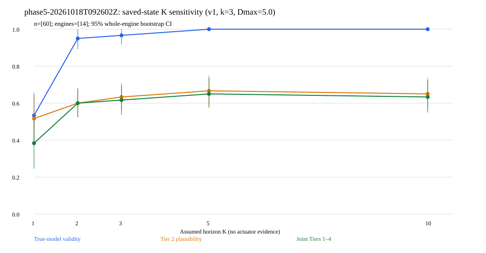

# Phase 5 validation changes and measured funnels

Source commit: `8b1a206fc1800a0674019b6e0527c2a31a5159df`; preregistration: `d64826c5c1bd69dc6310c7c2d11506a7add11822`.

Mahalanobis now uses train-only Ledoit-Wolf shrinkage and Cholesky solves, with unchanged fixed D_max v1=5/v2=8. Tier 4 thresholds use held-out validation-engine residuals; propagation regressors, physical bounds and rate limits are unchanged.

Plausibility means Tier 2 only. Each static tier, physical conjunction, and all-four joint is reported separately. Phase 4's `tiers2_to4_joint` summary included Tier 1 and feasibility; the paired before columns below recompute the correct definitions from saved records.

Returned diagnostic candidate means a saved/generated state exists, including failed attempts. Accepted counterfactual means the historical Phase 4 return convention before, and all checks plus sparse feasibility after. Returned-counterfactual plausibility can therefore be 100% by construction after; all-query rates remain visible.

All intervals resample whole engines (2000 replicates). C-MAPSS controllables, bounds, proxy rate limits, and K are assumptions. Highest possible evidence here is E3 proxy engineering, not validated control efficacy; E4/E5 are unavailable. No RUL extension is claimed.

## Integrated headline targets and gaps

Phase5 integrated solver: run `phase5-20261018T092602Z`; config `configs\experiments\phase5-validation-v1.yaml` SHA-256 `a9a32d9d0623db1038a58389b4624c5255c939b4a9ad32f38ef92293c65bd661`; git `8b1a206fc1800a0674019b6e0527c2a31a5159df`; protocol `v1`; k_max=3; K=1; D_max version `v1`=5.0; population `internal_headline_integrated`.

| Metric (all queries) | Measured [95% engine CI] | Target | Gap | Result |
|---|---:|---:|---:|---|
| tier1_all_queries | 112/200 = 0.560 [0.473, 0.638]; 15 engines | >= 0.95 | -0.390 | Fail |
| tier2_all_queries | 106/200 = 0.530 [0.437, 0.616]; 15 engines | >= 0.90 | -0.370 | Fail |
| Joint Tiers 1–4 | 87/200 = 0.435 [0.364, 0.502]; 15 engines | No synopsis joint target | — | Reported separately |

Phase5 integrated solver: run `phase5-20261018T092602Z`; config `configs\experiments\phase5-validation-v2.yaml` SHA-256 `7c74cabf0f2b8347c116a29cf03dfae16184f39066a46e441c42479f985b8bae`; git `8b1a206fc1800a0674019b6e0527c2a31a5159df`; protocol `v2`; k_max=3; K=1; D_max version `v2`=8.0; population `internal_headline_integrated`.

| Metric (all queries) | Measured [95% engine CI] | Target | Gap | Result |
|---|---:|---:|---:|---|
| tier1_all_queries | 112/200 = 0.560 [0.473, 0.638]; 15 engines | >= 0.95 | -0.390 | Fail |
| tier2_all_queries | 198/200 = 0.990 [0.977, 1.000]; 15 engines | >= 0.90 | +0.090 | Pass |
| Joint Tiers 1–4 | 106/200 = 0.530 [0.452, 0.600]; 15 engines | No synopsis joint target | — | Reported separately |

Target gaps are measured against the frozen configuration. A paired joint-count difference is descriptive, not a claim of general improvement. Returned-counterfactual plausibility is conditional on acceptance.

Latency budget pass/fail is measured below. In-loop constraint checks are charged to optimization, not hidden in the final-validation stage. Residual-preserving propagation leaves absolute learned residual violations invariant, so repeated search cannot repair those violations. Any performance work must be developed and frozen on validation engines before a future test run.

## Coupling calibration evidence

Phase5 calibration diagnostic: run `phase5-20261018T092602Z`; config `configs\experiments\phase5-validation-v1.yaml` SHA-256 `a9a32d9d0623db1038a58389b4624c5255c939b4a9ad32f38ef92293c65bd661`; git `8b1a206fc1800a0674019b6e0527c2a31a5159df`; protocol `v1`; k_max=3; K=1; D_max version `v1`=5.0; population `validation calibration: healthy_to_moderate`.

Reference: 2649 rows from 16 validation engines; RUL > 30; fixed multiplier 3.0. The same residual calibration is used for v1 and v2. R² here is a calibration-reference diagnostic, not an independent test-fit score. Propagation regressors were not refitted.

| Sensor | R² | Residual mean | Residual std (raw units) | Absolute limit | Share beyond limit |
|---|---:|---:|---:|---:|---:|
| sensor_11 | 0.695448 | -0.00283335 | 0.114326 | 0.342978 | 0.002643 |
| sensor_13 | 0.699543 | -0.00110905 | 0.0352023 | 0.105607 | 0.002643 |
| sensor_14 | 0.895774 | 0.247751 | 4.72452 | 14.1736 | 0.003775 |
| sensor_2 | 0.432981 | -0.00989393 | 0.311562 | 0.934687 | 0.003398 |
| sensor_3 | 0.353130 | 0.0483685 | 4.11105 | 12.3332 | 0.003020 |
| sensor_4 | 0.608206 | -0.199181 | 4.44748 | 13.3424 | 0.003020 |
| sensor_6 | 0.031962 | -3.9666e-05 | 0.00165273 | 0.00495819 | 0.029068 |
| sensor_7 | 0.597431 | 0.00419682 | 0.458173 | 1.37452 | 0.001510 |

Below the configured diagnostic R² floor (0.35): ['sensor_6']. Historical engine-grouped fit-floor warnings remain in Phase 4 evidence; calibration does not replace them.

## Covariance evidence

Phase5 covariance diagnostic: run `phase5-20261018T092602Z`; config `configs\experiments\phase5-validation-v1.yaml` SHA-256 `a9a32d9d0623db1038a58389b4624c5255c939b4a9ad32f38ef92293c65bd661`; git `8b1a206fc1800a0674019b6e0527c2a31a5159df`; protocol `v1`; k_max=3; K=1; D_max version `v1`=5.0; population `fitting telemetry: all_cycles`.

Fitting engines: 69; method: fixed; reference: all_cycles. The fixed quantile setting is unused for D_max=5/8. Both quantile methods and healthy-reference selection are tested; real method/reference comparisons are reserved for Phase 7.

| Regime | Rows | Shrinkage | Condition number | Unregularized rank |
|---|---:|---:|---:|---:|
| 0 | 14205 | 0.000480684 | 19766.1 | 17 |

Covariance factors and calibrated coupling artifacts have SHA-256 fingerprints in the JSON provenance. Mean/p50/p95 D_M distributions and per-query signed margins are also retained there. No inverse matrix is computed or persisted.

## Schema and migration notes

Result/report schema 1.1.0 adds independent verdicts, tier status (including skipped), signed margins, per-rule checks, surrogate warnings, evidence and assumptions. Legacy precision-only validators require a train-engine refit. Config/validator mismatches fail clearly. No validated emulator or simulator is installed; E4/E5 are unavailable.

## internal_headline_saved_200 / v1 / K=1

Phase4 saved before: run `phase4-20261018T071947Z`; config `configs\experiments\phase4-historical-v1.yaml` SHA-256 `31e98529975d9e84429757f0cfafc8122697193efe95ed5180c6f924a9af0dc0`; git `7860fed5a99b6c94eefc2ffd2c8327052ea56b24`; protocol `v1`; k_max=3; K=1; D_max version `v1`=5.0; population `internal_headline_saved_200`.

Historical effective configuration SHA-256 `9afbae1dfb168250fd3871589d49ab6609a74f90a0f6479c4c5d75d9216cad37`; per-fold hashes: `None`. Committed historical mirror; not retroactive preregistration. Original source config paths and canonical effective hashes remain in the Phase 4 report.

Phase5 paired validation after: run `phase5-20261018T092602Z`; config `configs\experiments\phase5-validation-v1.yaml` SHA-256 `a9a32d9d0623db1038a58389b4624c5255c939b4a9ad32f38ef92293c65bd661`; git `8b1a206fc1800a0674019b6e0527c2a31a5159df`; protocol `v1`; k_max=3; K=1; D_max version `v1`=5.0; population `internal_headline_saved_200`.

| Metric / denominator | Phase4 saved before | Phase5 paired validation after |
|---|---:|---:|
| tier1_all_queries | 112/200 = 0.560 [0.473, 0.638]; 15 engines | 112/200 = 0.560 [0.473, 0.638]; 15 engines |
| tier2_all_queries | 106/200 = 0.530 [0.437, 0.616]; 15 engines | 106/200 = 0.530 [0.437, 0.616]; 15 engines |
| tier3_all_queries | 200/200 = 1.000 [1.000, 1.000]; 15 engines | 200/200 = 1.000 [1.000, 1.000]; 15 engines |
| tier4_all_queries | 189/200 = 0.945 [0.916, 0.977]; 15 engines | 190/200 = 0.950 [0.923, 0.979]; 15 engines |
| tier2_returned_counterfactuals | 88/112 = 0.786 [0.746, 0.828]; 15 engines | 87/87 = 1.000 [1.000, 1.000]; 15 engines |
| tier2_diagnostic_candidates | 106/200 = 0.530 [0.439, 0.614]; 15 engines | 106/200 = 0.530 [0.439, 0.614]; 15 engines |
| physical_tiers2_to4_all_queries | 105/200 = 0.525 [0.432, 0.609]; 15 engines | 105/200 = 0.525 [0.432, 0.609]; 15 engines |
| joint_tiers1_to4_all_queries | 87/200 = 0.435 [0.364, 0.502]; 15 engines | 87/200 = 0.435 [0.364, 0.502]; 15 engines |
| accepted_counterfactuals | 112/200 = 0.560 [0.471, 0.644]; 15 engines | 87/200 = 0.435 [0.358, 0.503]; 15 engines |
| funnel: alerts | 200/200 = 1.000 [1.000, 1.000]; 15 engines | 200/200 = 1.000 [1.000, 1.000]; 15 engines |
| funnel: candidate_returned | 200/200 = 1.000 [1.000, 1.000]; 15 engines | 200/200 = 1.000 [1.000, 1.000]; 15 engines |
| funnel: tier1_cumulative | 112/200 = 0.560 [0.465, 0.642]; 15 engines | 112/200 = 0.560 [0.465, 0.642]; 15 engines |
| funnel: tier2_cumulative | 88/200 = 0.440 [0.368, 0.503]; 15 engines | 88/200 = 0.440 [0.368, 0.503]; 15 engines |
| funnel: tier3_cumulative | 88/200 = 0.440 [0.367, 0.505]; 15 engines | 88/200 = 0.440 [0.367, 0.505]; 15 engines |
| funnel: tier4_cumulative | 87/200 = 0.435 [0.364, 0.505]; 15 engines | 87/200 = 0.435 [0.364, 0.505]; 15 engines |
| funnel: joint_success | 87/200 = 0.435 [0.360, 0.500]; 15 engines | 87/200 = 0.435 [0.360, 0.500]; 15 engines |

## internal_all_alerts / v1 / K=1

Phase4 saved before: run `phase4-20261018T071947Z`; config `configs\experiments\phase4-historical-v1.yaml` SHA-256 `31e98529975d9e84429757f0cfafc8122697193efe95ed5180c6f924a9af0dc0`; git `7860fed5a99b6c94eefc2ffd2c8327052ea56b24`; protocol `v1`; k_max=3; K=1; D_max version `v1`=5.0; population `internal_all_alerts`.

Historical effective configuration SHA-256 `9afbae1dfb168250fd3871589d49ab6609a74f90a0f6479c4c5d75d9216cad37`; per-fold hashes: `None`. Committed historical mirror; not retroactive preregistration. Original source config paths and canonical effective hashes remain in the Phase 4 report.

Phase5 paired validation after: run `phase5-20261018T092602Z`; config `configs\experiments\phase5-validation-v1.yaml` SHA-256 `a9a32d9d0623db1038a58389b4624c5255c939b4a9ad32f38ef92293c65bd661`; git `8b1a206fc1800a0674019b6e0527c2a31a5159df`; protocol `v1`; k_max=3; K=1; D_max version `v1`=5.0; population `internal_all_alerts`.

| Metric / denominator | Phase4 saved before | Phase5 paired validation after |
|---|---:|---:|
| tier1_all_queries | 211/378 = 0.558 [0.490, 0.624]; 15 engines | 211/378 = 0.558 [0.490, 0.624]; 15 engines |
| tier2_all_queries | 193/378 = 0.511 [0.444, 0.575]; 15 engines | 193/378 = 0.511 [0.444, 0.575]; 15 engines |
| tier3_all_queries | 378/378 = 1.000 [1.000, 1.000]; 15 engines | 378/378 = 1.000 [1.000, 1.000]; 15 engines |
| tier4_all_queries | 352/378 = 0.931 [0.902, 0.958]; 15 engines | 357/378 = 0.944 [0.922, 0.967]; 15 engines |
| tier2_returned_counterfactuals | 159/211 = 0.754 [0.712, 0.794]; 15 engines | 158/158 = 1.000 [1.000, 1.000]; 15 engines |
| tier2_diagnostic_candidates | 193/378 = 0.511 [0.444, 0.576]; 15 engines | 193/378 = 0.511 [0.444, 0.576]; 15 engines |
| physical_tiers2_to4_all_queries | 192/378 = 0.508 [0.443, 0.570]; 15 engines | 192/378 = 0.508 [0.443, 0.570]; 15 engines |
| joint_tiers1_to4_all_queries | 158/378 = 0.418 [0.377, 0.458]; 15 engines | 158/378 = 0.418 [0.377, 0.458]; 15 engines |
| accepted_counterfactuals | 211/378 = 0.558 [0.492, 0.626]; 15 engines | 158/378 = 0.418 [0.375, 0.458]; 15 engines |
| funnel: alerts | 378/378 = 1.000 [1.000, 1.000]; 15 engines | 378/378 = 1.000 [1.000, 1.000]; 15 engines |
| funnel: candidate_returned | 378/378 = 1.000 [1.000, 1.000]; 15 engines | 378/378 = 1.000 [1.000, 1.000]; 15 engines |
| funnel: tier1_cumulative | 211/378 = 0.558 [0.492, 0.622]; 15 engines | 211/378 = 0.558 [0.492, 0.622]; 15 engines |
| funnel: tier2_cumulative | 159/378 = 0.421 [0.375, 0.461]; 15 engines | 159/378 = 0.421 [0.375, 0.461]; 15 engines |
| funnel: tier3_cumulative | 159/378 = 0.421 [0.377, 0.463]; 15 engines | 159/378 = 0.421 [0.377, 0.463]; 15 engines |
| funnel: tier4_cumulative | 158/378 = 0.418 [0.375, 0.460]; 15 engines | 158/378 = 0.418 [0.375, 0.460]; 15 engines |
| funnel: joint_success | 158/378 = 0.418 [0.376, 0.459]; 15 engines | 158/378 = 0.418 [0.376, 0.459]; 15 engines |

## internal_first_alert_per_engine / v1 / K=1

Phase4 saved before: run `phase4-20261018T071947Z`; config `configs\experiments\phase4-historical-v1.yaml` SHA-256 `31e98529975d9e84429757f0cfafc8122697193efe95ed5180c6f924a9af0dc0`; git `7860fed5a99b6c94eefc2ffd2c8327052ea56b24`; protocol `v1`; k_max=3; K=1; D_max version `v1`=5.0; population `internal_first_alert_per_engine`.

Historical effective configuration SHA-256 `9afbae1dfb168250fd3871589d49ab6609a74f90a0f6479c4c5d75d9216cad37`; per-fold hashes: `None`. Committed historical mirror; not retroactive preregistration. Original source config paths and canonical effective hashes remain in the Phase 4 report.

Phase5 paired validation after: run `phase5-20261018T092602Z`; config `configs\experiments\phase5-validation-v1.yaml` SHA-256 `a9a32d9d0623db1038a58389b4624c5255c939b4a9ad32f38ef92293c65bd661`; git `8b1a206fc1800a0674019b6e0527c2a31a5159df`; protocol `v1`; k_max=3; K=1; D_max version `v1`=5.0; population `internal_first_alert_per_engine`.

| Metric / denominator | Phase4 saved before | Phase5 paired validation after |
|---|---:|---:|
| tier1_all_queries | 15/15 = 1.000 [1.000, 1.000]; 15 engines | 15/15 = 1.000 [1.000, 1.000]; 15 engines |
| tier2_all_queries | 14/15 = 0.933 [0.800, 1.000]; 15 engines | 14/15 = 0.933 [0.800, 1.000]; 15 engines |
| tier3_all_queries | 15/15 = 1.000 [1.000, 1.000]; 15 engines | 15/15 = 1.000 [1.000, 1.000]; 15 engines |
| tier4_all_queries | 14/15 = 0.933 [0.800, 1.000]; 15 engines | 15/15 = 1.000 [1.000, 1.000]; 15 engines |
| tier2_returned_counterfactuals | 14/15 = 0.933 [0.800, 1.000]; 15 engines | 14/14 = 1.000 [1.000, 1.000]; 14 engines |
| tier2_diagnostic_candidates | 14/15 = 0.933 [0.800, 1.000]; 15 engines | 14/15 = 0.933 [0.800, 1.000]; 15 engines |
| physical_tiers2_to4_all_queries | 14/15 = 0.933 [0.800, 1.000]; 15 engines | 14/15 = 0.933 [0.800, 1.000]; 15 engines |
| joint_tiers1_to4_all_queries | 14/15 = 0.933 [0.800, 1.000]; 15 engines | 14/15 = 0.933 [0.800, 1.000]; 15 engines |
| accepted_counterfactuals | 15/15 = 1.000 [1.000, 1.000]; 15 engines | 14/15 = 0.933 [0.800, 1.000]; 15 engines |
| funnel: alerts | 15/15 = 1.000 [1.000, 1.000]; 15 engines | 15/15 = 1.000 [1.000, 1.000]; 15 engines |
| funnel: candidate_returned | 15/15 = 1.000 [1.000, 1.000]; 15 engines | 15/15 = 1.000 [1.000, 1.000]; 15 engines |
| funnel: tier1_cumulative | 15/15 = 1.000 [1.000, 1.000]; 15 engines | 15/15 = 1.000 [1.000, 1.000]; 15 engines |
| funnel: tier2_cumulative | 14/15 = 0.933 [0.800, 1.000]; 15 engines | 14/15 = 0.933 [0.800, 1.000]; 15 engines |
| funnel: tier3_cumulative | 14/15 = 0.933 [0.800, 1.000]; 15 engines | 14/15 = 0.933 [0.800, 1.000]; 15 engines |
| funnel: tier4_cumulative | 14/15 = 0.933 [0.800, 1.000]; 15 engines | 14/15 = 0.933 [0.800, 1.000]; 15 engines |
| funnel: joint_success | 14/15 = 0.933 [0.800, 1.000]; 15 engines | 14/15 = 0.933 [0.800, 1.000]; 15 engines |

## development_sample / v1 / K=1

Phase5 integrated solver: run `phase5-20261018T092602Z`; config `configs\experiments\phase5-validation-v1.yaml` SHA-256 `a9a32d9d0623db1038a58389b4624c5255c939b4a9ad32f38ef92293c65bd661`; git `8b1a206fc1800a0674019b6e0527c2a31a5159df`; protocol `v1`; k_max=3; K=1; D_max version `v1`=5.0; population `development_sample`.

| Metric / denominator | Phase5 integrated solver |
|---|---:|
| tier1_all_queries | 29/60 = 0.483 [0.351, 0.619]; 14 engines |
| tier2_all_queries | 25/60 = 0.417 [0.259, 0.603]; 14 engines |
| tier3_all_queries | 50/60 = 0.833 [0.661, 1.000]; 14 engines |
| tier4_all_queries | 51/60 = 0.850 [0.717, 0.966]; 14 engines |
| tier2_returned_counterfactuals | 22/22 = 1.000 [1.000, 1.000]; 11 engines |
| tier2_diagnostic_candidates | 25/60 = 0.417 [0.258, 0.610]; 14 engines |
| physical_tiers2_to4_all_queries | 25/60 = 0.417 [0.250, 0.593]; 14 engines |
| joint_tiers1_to4_all_queries | 22/60 = 0.367 [0.222, 0.541]; 14 engines |
| accepted_counterfactuals | 22/60 = 0.367 [0.226, 0.543]; 14 engines |
| funnel: alerts | 60/60 = 1.000 [1.000, 1.000]; 14 engines |
| funnel: candidate_returned | 60/60 = 1.000 [1.000, 1.000]; 14 engines |
| funnel: tier1_cumulative | 29/60 = 0.483 [0.354, 0.617]; 14 engines |
| funnel: tier2_cumulative | 22/60 = 0.367 [0.211, 0.533]; 14 engines |
| funnel: tier3_cumulative | 22/60 = 0.367 [0.216, 0.538]; 14 engines |
| funnel: tier4_cumulative | 22/60 = 0.367 [0.217, 0.529]; 14 engines |
| funnel: joint_success | 22/60 = 0.367 [0.220, 0.535]; 14 engines |

## development_first_alert_per_engine / v1 / K=1

Phase5 integrated solver: run `phase5-20261018T092602Z`; config `configs\experiments\phase5-validation-v1.yaml` SHA-256 `a9a32d9d0623db1038a58389b4624c5255c939b4a9ad32f38ef92293c65bd661`; git `8b1a206fc1800a0674019b6e0527c2a31a5159df`; protocol `v1`; k_max=3; K=1; D_max version `v1`=5.0; population `development_first_alert_per_engine`.

| Metric / denominator | Phase5 integrated solver |
|---|---:|
| tier1_all_queries | 16/16 = 1.000 [1.000, 1.000]; 16 engines |
| tier2_all_queries | 14/16 = 0.875 [0.688, 1.000]; 16 engines |
| tier3_all_queries | 16/16 = 1.000 [1.000, 1.000]; 16 engines |
| tier4_all_queries | 14/16 = 0.875 [0.688, 1.000]; 16 engines |
| tier2_returned_counterfactuals | 14/14 = 1.000 [1.000, 1.000]; 14 engines |
| tier2_diagnostic_candidates | 14/16 = 0.875 [0.688, 1.000]; 16 engines |
| physical_tiers2_to4_all_queries | 14/16 = 0.875 [0.688, 1.000]; 16 engines |
| joint_tiers1_to4_all_queries | 14/16 = 0.875 [0.688, 1.000]; 16 engines |
| accepted_counterfactuals | 14/16 = 0.875 [0.688, 1.000]; 16 engines |
| funnel: alerts | 16/16 = 1.000 [1.000, 1.000]; 16 engines |
| funnel: candidate_returned | 16/16 = 1.000 [1.000, 1.000]; 16 engines |
| funnel: tier1_cumulative | 16/16 = 1.000 [1.000, 1.000]; 16 engines |
| funnel: tier2_cumulative | 14/16 = 0.875 [0.688, 1.000]; 16 engines |
| funnel: tier3_cumulative | 14/16 = 0.875 [0.688, 1.000]; 16 engines |
| funnel: tier4_cumulative | 14/16 = 0.875 [0.688, 1.000]; 16 engines |
| funnel: joint_success | 14/16 = 0.875 [0.688, 1.000]; 16 engines |

## internal_headline_integrated / v1 / K=1

Phase5 integrated solver: run `phase5-20261018T092602Z`; config `configs\experiments\phase5-validation-v1.yaml` SHA-256 `a9a32d9d0623db1038a58389b4624c5255c939b4a9ad32f38ef92293c65bd661`; git `8b1a206fc1800a0674019b6e0527c2a31a5159df`; protocol `v1`; k_max=3; K=1; D_max version `v1`=5.0; population `internal_headline_integrated`.

| Metric / denominator | Phase5 integrated solver |
|---|---:|
| tier1_all_queries | 112/200 = 0.560 [0.473, 0.638]; 15 engines |
| tier2_all_queries | 106/200 = 0.530 [0.437, 0.616]; 15 engines |
| tier3_all_queries | 200/200 = 1.000 [1.000, 1.000]; 15 engines |
| tier4_all_queries | 190/200 = 0.950 [0.923, 0.979]; 15 engines |
| tier2_returned_counterfactuals | 87/87 = 1.000 [1.000, 1.000]; 15 engines |
| tier2_diagnostic_candidates | 106/200 = 0.530 [0.439, 0.614]; 15 engines |
| physical_tiers2_to4_all_queries | 105/200 = 0.525 [0.432, 0.609]; 15 engines |
| joint_tiers1_to4_all_queries | 87/200 = 0.435 [0.364, 0.502]; 15 engines |
| accepted_counterfactuals | 87/200 = 0.435 [0.358, 0.503]; 15 engines |
| funnel: alerts | 200/200 = 1.000 [1.000, 1.000]; 15 engines |
| funnel: candidate_returned | 200/200 = 1.000 [1.000, 1.000]; 15 engines |
| funnel: tier1_cumulative | 112/200 = 0.560 [0.465, 0.642]; 15 engines |
| funnel: tier2_cumulative | 88/200 = 0.440 [0.368, 0.503]; 15 engines |
| funnel: tier3_cumulative | 88/200 = 0.440 [0.367, 0.505]; 15 engines |
| funnel: tier4_cumulative | 87/200 = 0.435 [0.364, 0.505]; 15 engines |
| funnel: joint_success | 87/200 = 0.435 [0.360, 0.500]; 15 engines |

## internal_headline_saved_200 / v2 / K=1

Phase4 saved before: run `phase4-20261018T071947Z`; config `configs\experiments\phase4-historical-v2.yaml` SHA-256 `8ff5f67109df068da2646303988eb27354a8988f4c5625f9a5a6f7660c0c18dc`; git `7860fed5a99b6c94eefc2ffd2c8327052ea56b24`; protocol `v2`; k_max=3; K=1; D_max version `v2`=8.0; population `internal_headline_saved_200`.

Historical effective configuration SHA-256 `8dfb12acc6592077c93ba5bfb3149c43200c212c4073bfc2196cfbb151acd22c`; per-fold hashes: `None`. Committed historical mirror; not retroactive preregistration. Original source config paths and canonical effective hashes remain in the Phase 4 report.

Phase5 paired validation after: run `phase5-20261018T092602Z`; config `configs\experiments\phase5-validation-v2.yaml` SHA-256 `7c74cabf0f2b8347c116a29cf03dfae16184f39066a46e441c42479f985b8bae`; git `8b1a206fc1800a0674019b6e0527c2a31a5159df`; protocol `v2`; k_max=3; K=1; D_max version `v2`=8.0; population `internal_headline_saved_200`.

| Metric / denominator | Phase4 saved before | Phase5 paired validation after |
|---|---:|---:|
| tier1_all_queries | 112/200 = 0.560 [0.473, 0.638]; 15 engines | 112/200 = 0.560 [0.473, 0.638]; 15 engines |
| tier2_all_queries | 198/200 = 0.990 [0.977, 1.000]; 15 engines | 198/200 = 0.990 [0.977, 1.000]; 15 engines |
| tier3_all_queries | 200/200 = 1.000 [1.000, 1.000]; 15 engines | 200/200 = 1.000 [1.000, 1.000]; 15 engines |
| tier4_all_queries | 189/200 = 0.945 [0.916, 0.977]; 15 engines | 190/200 = 0.950 [0.923, 0.979]; 15 engines |
| tier2_returned_counterfactuals | 112/112 = 1.000 [1.000, 1.000]; 15 engines | 106/106 = 1.000 [1.000, 1.000]; 15 engines |
| tier2_diagnostic_candidates | 198/200 = 0.990 [0.976, 1.000]; 15 engines | 198/200 = 0.990 [0.976, 1.000]; 15 engines |
| physical_tiers2_to4_all_queries | 187/200 = 0.935 [0.900, 0.969]; 15 engines | 188/200 = 0.940 [0.906, 0.972]; 15 engines |
| joint_tiers1_to4_all_queries | 105/200 = 0.525 [0.448, 0.593]; 15 engines | 106/200 = 0.530 [0.452, 0.600]; 15 engines |
| accepted_counterfactuals | 112/200 = 0.560 [0.471, 0.644]; 15 engines | 106/200 = 0.530 [0.454, 0.605]; 15 engines |
| funnel: alerts | 200/200 = 1.000 [1.000, 1.000]; 15 engines | 200/200 = 1.000 [1.000, 1.000]; 15 engines |
| funnel: candidate_returned | 200/200 = 1.000 [1.000, 1.000]; 15 engines | 200/200 = 1.000 [1.000, 1.000]; 15 engines |
| funnel: tier1_cumulative | 112/200 = 0.560 [0.465, 0.642]; 15 engines | 112/200 = 0.560 [0.465, 0.642]; 15 engines |
| funnel: tier2_cumulative | 112/200 = 0.560 [0.472, 0.637]; 15 engines | 112/200 = 0.560 [0.472, 0.637]; 15 engines |
| funnel: tier3_cumulative | 112/200 = 0.560 [0.471, 0.641]; 15 engines | 112/200 = 0.560 [0.471, 0.641]; 15 engines |
| funnel: tier4_cumulative | 105/200 = 0.525 [0.452, 0.597]; 15 engines | 106/200 = 0.530 [0.454, 0.605]; 15 engines |
| funnel: joint_success | 105/200 = 0.525 [0.448, 0.593]; 15 engines | 106/200 = 0.530 [0.449, 0.601]; 15 engines |

## internal_all_alerts / v2 / K=1

Phase4 saved before: run `phase4-20261018T071947Z`; config `configs\experiments\phase4-historical-v2.yaml` SHA-256 `8ff5f67109df068da2646303988eb27354a8988f4c5625f9a5a6f7660c0c18dc`; git `7860fed5a99b6c94eefc2ffd2c8327052ea56b24`; protocol `v2`; k_max=3; K=1; D_max version `v2`=8.0; population `internal_all_alerts`.

Historical effective configuration SHA-256 `8dfb12acc6592077c93ba5bfb3149c43200c212c4073bfc2196cfbb151acd22c`; per-fold hashes: `None`. Committed historical mirror; not retroactive preregistration. Original source config paths and canonical effective hashes remain in the Phase 4 report.

Phase5 paired validation after: run `phase5-20261018T092602Z`; config `configs\experiments\phase5-validation-v2.yaml` SHA-256 `7c74cabf0f2b8347c116a29cf03dfae16184f39066a46e441c42479f985b8bae`; git `8b1a206fc1800a0674019b6e0527c2a31a5159df`; protocol `v2`; k_max=3; K=1; D_max version `v2`=8.0; population `internal_all_alerts`.

| Metric / denominator | Phase4 saved before | Phase5 paired validation after |
|---|---:|---:|
| tier1_all_queries | 211/378 = 0.558 [0.490, 0.624]; 15 engines | 211/378 = 0.558 [0.490, 0.624]; 15 engines |
| tier2_all_queries | 374/378 = 0.989 [0.981, 0.997]; 15 engines | 374/378 = 0.989 [0.981, 0.997]; 15 engines |
| tier3_all_queries | 378/378 = 1.000 [1.000, 1.000]; 15 engines | 378/378 = 1.000 [1.000, 1.000]; 15 engines |
| tier4_all_queries | 352/378 = 0.931 [0.902, 0.958]; 15 engines | 357/378 = 0.944 [0.922, 0.967]; 15 engines |
| tier2_returned_counterfactuals | 211/211 = 1.000 [1.000, 1.000]; 15 engines | 200/200 = 1.000 [1.000, 1.000]; 15 engines |
| tier2_diagnostic_candidates | 374/378 = 0.989 [0.981, 0.997]; 15 engines | 374/378 = 0.989 [0.981, 0.997]; 15 engines |
| physical_tiers2_to4_all_queries | 348/378 = 0.921 [0.889, 0.949]; 15 engines | 353/378 = 0.934 [0.907, 0.959]; 15 engines |
| joint_tiers1_to4_all_queries | 197/378 = 0.521 [0.457, 0.585]; 15 engines | 200/378 = 0.529 [0.463, 0.594]; 15 engines |
| accepted_counterfactuals | 211/378 = 0.558 [0.492, 0.626]; 15 engines | 200/378 = 0.529 [0.464, 0.598]; 15 engines |
| funnel: alerts | 378/378 = 1.000 [1.000, 1.000]; 15 engines | 378/378 = 1.000 [1.000, 1.000]; 15 engines |
| funnel: candidate_returned | 378/378 = 1.000 [1.000, 1.000]; 15 engines | 378/378 = 1.000 [1.000, 1.000]; 15 engines |
| funnel: tier1_cumulative | 211/378 = 0.558 [0.492, 0.622]; 15 engines | 211/378 = 0.558 [0.492, 0.622]; 15 engines |
| funnel: tier2_cumulative | 211/378 = 0.558 [0.490, 0.621]; 15 engines | 211/378 = 0.558 [0.490, 0.621]; 15 engines |
| funnel: tier3_cumulative | 211/378 = 0.558 [0.490, 0.626]; 15 engines | 211/378 = 0.558 [0.490, 0.626]; 15 engines |
| funnel: tier4_cumulative | 197/378 = 0.521 [0.456, 0.588]; 15 engines | 200/378 = 0.529 [0.462, 0.599]; 15 engines |
| funnel: joint_success | 197/378 = 0.521 [0.457, 0.586]; 15 engines | 200/378 = 0.529 [0.462, 0.595]; 15 engines |

## internal_first_alert_per_engine / v2 / K=1

Phase4 saved before: run `phase4-20261018T071947Z`; config `configs\experiments\phase4-historical-v2.yaml` SHA-256 `8ff5f67109df068da2646303988eb27354a8988f4c5625f9a5a6f7660c0c18dc`; git `7860fed5a99b6c94eefc2ffd2c8327052ea56b24`; protocol `v2`; k_max=3; K=1; D_max version `v2`=8.0; population `internal_first_alert_per_engine`.

Historical effective configuration SHA-256 `8dfb12acc6592077c93ba5bfb3149c43200c212c4073bfc2196cfbb151acd22c`; per-fold hashes: `None`. Committed historical mirror; not retroactive preregistration. Original source config paths and canonical effective hashes remain in the Phase 4 report.

Phase5 paired validation after: run `phase5-20261018T092602Z`; config `configs\experiments\phase5-validation-v2.yaml` SHA-256 `7c74cabf0f2b8347c116a29cf03dfae16184f39066a46e441c42479f985b8bae`; git `8b1a206fc1800a0674019b6e0527c2a31a5159df`; protocol `v2`; k_max=3; K=1; D_max version `v2`=8.0; population `internal_first_alert_per_engine`.

| Metric / denominator | Phase4 saved before | Phase5 paired validation after |
|---|---:|---:|
| tier1_all_queries | 15/15 = 1.000 [1.000, 1.000]; 15 engines | 15/15 = 1.000 [1.000, 1.000]; 15 engines |
| tier2_all_queries | 15/15 = 1.000 [1.000, 1.000]; 15 engines | 15/15 = 1.000 [1.000, 1.000]; 15 engines |
| tier3_all_queries | 15/15 = 1.000 [1.000, 1.000]; 15 engines | 15/15 = 1.000 [1.000, 1.000]; 15 engines |
| tier4_all_queries | 14/15 = 0.933 [0.800, 1.000]; 15 engines | 15/15 = 1.000 [1.000, 1.000]; 15 engines |
| tier2_returned_counterfactuals | 15/15 = 1.000 [1.000, 1.000]; 15 engines | 15/15 = 1.000 [1.000, 1.000]; 15 engines |
| tier2_diagnostic_candidates | 15/15 = 1.000 [1.000, 1.000]; 15 engines | 15/15 = 1.000 [1.000, 1.000]; 15 engines |
| physical_tiers2_to4_all_queries | 14/15 = 0.933 [0.800, 1.000]; 15 engines | 15/15 = 1.000 [1.000, 1.000]; 15 engines |
| joint_tiers1_to4_all_queries | 14/15 = 0.933 [0.800, 1.000]; 15 engines | 15/15 = 1.000 [1.000, 1.000]; 15 engines |
| accepted_counterfactuals | 15/15 = 1.000 [1.000, 1.000]; 15 engines | 15/15 = 1.000 [1.000, 1.000]; 15 engines |
| funnel: alerts | 15/15 = 1.000 [1.000, 1.000]; 15 engines | 15/15 = 1.000 [1.000, 1.000]; 15 engines |
| funnel: candidate_returned | 15/15 = 1.000 [1.000, 1.000]; 15 engines | 15/15 = 1.000 [1.000, 1.000]; 15 engines |
| funnel: tier1_cumulative | 15/15 = 1.000 [1.000, 1.000]; 15 engines | 15/15 = 1.000 [1.000, 1.000]; 15 engines |
| funnel: tier2_cumulative | 15/15 = 1.000 [1.000, 1.000]; 15 engines | 15/15 = 1.000 [1.000, 1.000]; 15 engines |
| funnel: tier3_cumulative | 15/15 = 1.000 [1.000, 1.000]; 15 engines | 15/15 = 1.000 [1.000, 1.000]; 15 engines |
| funnel: tier4_cumulative | 14/15 = 0.933 [0.800, 1.000]; 15 engines | 15/15 = 1.000 [1.000, 1.000]; 15 engines |
| funnel: joint_success | 14/15 = 0.933 [0.800, 1.000]; 15 engines | 15/15 = 1.000 [1.000, 1.000]; 15 engines |

## development_sample / v2 / K=1

Phase5 integrated solver: run `phase5-20261018T092602Z`; config `configs\experiments\phase5-validation-v2.yaml` SHA-256 `7c74cabf0f2b8347c116a29cf03dfae16184f39066a46e441c42479f985b8bae`; git `8b1a206fc1800a0674019b6e0527c2a31a5159df`; protocol `v2`; k_max=3; K=1; D_max version `v2`=8.0; population `development_sample`.

| Metric / denominator | Phase5 integrated solver |
|---|---:|
| tier1_all_queries | 29/60 = 0.483 [0.351, 0.619]; 14 engines |
| tier2_all_queries | 54/60 = 0.900 [0.793, 1.000]; 14 engines |
| tier3_all_queries | 50/60 = 0.833 [0.661, 1.000]; 14 engines |
| tier4_all_queries | 51/60 = 0.850 [0.717, 0.966]; 14 engines |
| tier2_returned_counterfactuals | 28/28 = 1.000 [1.000, 1.000]; 12 engines |
| tier2_diagnostic_candidates | 54/60 = 0.900 [0.789, 1.000]; 14 engines |
| physical_tiers2_to4_all_queries | 47/60 = 0.783 [0.586, 0.961]; 14 engines |
| joint_tiers1_to4_all_queries | 28/60 = 0.467 [0.311, 0.615]; 14 engines |
| accepted_counterfactuals | 28/60 = 0.467 [0.318, 0.618]; 14 engines |
| funnel: alerts | 60/60 = 1.000 [1.000, 1.000]; 14 engines |
| funnel: candidate_returned | 60/60 = 1.000 [1.000, 1.000]; 14 engines |
| funnel: tier1_cumulative | 29/60 = 0.483 [0.354, 0.617]; 14 engines |
| funnel: tier2_cumulative | 29/60 = 0.483 [0.353, 0.619]; 14 engines |
| funnel: tier3_cumulative | 29/60 = 0.483 [0.352, 0.621]; 14 engines |
| funnel: tier4_cumulative | 28/60 = 0.467 [0.309, 0.610]; 14 engines |
| funnel: joint_success | 28/60 = 0.467 [0.313, 0.611]; 14 engines |

## development_first_alert_per_engine / v2 / K=1

Phase5 integrated solver: run `phase5-20261018T092602Z`; config `configs\experiments\phase5-validation-v2.yaml` SHA-256 `7c74cabf0f2b8347c116a29cf03dfae16184f39066a46e441c42479f985b8bae`; git `8b1a206fc1800a0674019b6e0527c2a31a5159df`; protocol `v2`; k_max=3; K=1; D_max version `v2`=8.0; population `development_first_alert_per_engine`.

| Metric / denominator | Phase5 integrated solver |
|---|---:|
| tier1_all_queries | 16/16 = 1.000 [1.000, 1.000]; 16 engines |
| tier2_all_queries | 16/16 = 1.000 [1.000, 1.000]; 16 engines |
| tier3_all_queries | 16/16 = 1.000 [1.000, 1.000]; 16 engines |
| tier4_all_queries | 14/16 = 0.875 [0.688, 1.000]; 16 engines |
| tier2_returned_counterfactuals | 14/14 = 1.000 [1.000, 1.000]; 14 engines |
| tier2_diagnostic_candidates | 16/16 = 1.000 [1.000, 1.000]; 16 engines |
| physical_tiers2_to4_all_queries | 14/16 = 0.875 [0.688, 1.000]; 16 engines |
| joint_tiers1_to4_all_queries | 14/16 = 0.875 [0.688, 1.000]; 16 engines |
| accepted_counterfactuals | 14/16 = 0.875 [0.688, 1.000]; 16 engines |
| funnel: alerts | 16/16 = 1.000 [1.000, 1.000]; 16 engines |
| funnel: candidate_returned | 16/16 = 1.000 [1.000, 1.000]; 16 engines |
| funnel: tier1_cumulative | 16/16 = 1.000 [1.000, 1.000]; 16 engines |
| funnel: tier2_cumulative | 16/16 = 1.000 [1.000, 1.000]; 16 engines |
| funnel: tier3_cumulative | 16/16 = 1.000 [1.000, 1.000]; 16 engines |
| funnel: tier4_cumulative | 14/16 = 0.875 [0.688, 1.000]; 16 engines |
| funnel: joint_success | 14/16 = 0.875 [0.688, 1.000]; 16 engines |

## internal_headline_integrated / v2 / K=1

Phase5 integrated solver: run `phase5-20261018T092602Z`; config `configs\experiments\phase5-validation-v2.yaml` SHA-256 `7c74cabf0f2b8347c116a29cf03dfae16184f39066a46e441c42479f985b8bae`; git `8b1a206fc1800a0674019b6e0527c2a31a5159df`; protocol `v2`; k_max=3; K=1; D_max version `v2`=8.0; population `internal_headline_integrated`.

| Metric / denominator | Phase5 integrated solver |
|---|---:|
| tier1_all_queries | 112/200 = 0.560 [0.473, 0.638]; 15 engines |
| tier2_all_queries | 198/200 = 0.990 [0.977, 1.000]; 15 engines |
| tier3_all_queries | 200/200 = 1.000 [1.000, 1.000]; 15 engines |
| tier4_all_queries | 190/200 = 0.950 [0.923, 0.979]; 15 engines |
| tier2_returned_counterfactuals | 106/106 = 1.000 [1.000, 1.000]; 15 engines |
| tier2_diagnostic_candidates | 198/200 = 0.990 [0.976, 1.000]; 15 engines |
| physical_tiers2_to4_all_queries | 188/200 = 0.940 [0.906, 0.972]; 15 engines |
| joint_tiers1_to4_all_queries | 106/200 = 0.530 [0.452, 0.600]; 15 engines |
| accepted_counterfactuals | 106/200 = 0.530 [0.454, 0.605]; 15 engines |
| funnel: alerts | 200/200 = 1.000 [1.000, 1.000]; 15 engines |
| funnel: candidate_returned | 200/200 = 1.000 [1.000, 1.000]; 15 engines |
| funnel: tier1_cumulative | 112/200 = 0.560 [0.465, 0.642]; 15 engines |
| funnel: tier2_cumulative | 112/200 = 0.560 [0.472, 0.637]; 15 engines |
| funnel: tier3_cumulative | 112/200 = 0.560 [0.471, 0.641]; 15 engines |
| funnel: tier4_cumulative | 106/200 = 0.530 [0.454, 0.605]; 15 engines |
| funnel: joint_success | 106/200 = 0.530 [0.449, 0.601]; 15 engines |

## grouped_oof_saved_sample / v1 / K=1

Phase4 saved before: run `phase4-20261018T071947Z`; config `configs\experiments\phase4-historical-v1.yaml` SHA-256 `31e98529975d9e84429757f0cfafc8122697193efe95ed5180c6f924a9af0dc0`; git `4a8275a788c9998d80acf07f3e7e9dfe2fcbe179`; protocol `v1`; k_max=3; K=1; D_max version `v1`=5.0; population `grouped_oof_saved_sample`.

Historical effective configuration SHA-256 `ec065ec7aed1221d61b139038f0dbe5e24abbe4dedb95ba360e2c534c62243ea`; per-fold hashes: `{'1': '44cede857d323ebdd7b561d2b3627382547124152b2b1fb052be3e2e23c1474a', '2': '3e58258ba09e8492c1f845005dcc076dc72f1142594d55251821344c611aaac4', '3': '0b93bbd9704f537210a6f9e7891861376ee86493364163dc5cd71851eefb20bd', '4': 'dce84af48d6d2a6b609164886fe6fe1c54ddcfd43f502af8ac9dc47e3e5691bf', '5': '7e197538ebc51f5ee659d1fa6feeffbf0c030f13b8b38391132d4eff8d602325'}`. Committed historical mirror; not retroactive preregistration. Original source config paths and canonical effective hashes remain in the Phase 4 report.

Phase5 paired validation after: run `phase5-20261018T092602Z`; config `configs\experiments\phase5-validation-v1.yaml` SHA-256 `a9a32d9d0623db1038a58389b4624c5255c939b4a9ad32f38ef92293c65bd661`; git `8b1a206fc1800a0674019b6e0527c2a31a5159df`; protocol `v1`; k_max=3; K=1; D_max version `v1`=5.0; population `grouped_oof_saved_sample`.

| Metric / denominator | Phase4 saved before | Phase5 paired validation after |
|---|---:|---:|
| tier1_all_queries | 116/200 = 0.580 [0.505, 0.656]; 78 engines | 116/200 = 0.580 [0.505, 0.656]; 78 engines |
| tier2_all_queries | 102/200 = 0.510 [0.430, 0.593]; 78 engines | 102/200 = 0.510 [0.430, 0.593]; 78 engines |
| tier3_all_queries | 189/200 = 0.945 [0.899, 0.984]; 78 engines | 189/200 = 0.945 [0.899, 0.984]; 78 engines |
| tier4_all_queries | 181/200 = 0.905 [0.855, 0.951]; 78 engines | 180/200 = 0.900 [0.853, 0.946]; 78 engines |
| tier2_returned_counterfactuals | 87/116 = 0.750 [0.661, 0.832]; 67 engines | 87/87 = 1.000 [1.000, 1.000]; 55 engines |
| tier2_diagnostic_candidates | 102/189 = 0.540 [0.462, 0.618]; 76 engines | 102/189 = 0.540 [0.462, 0.618]; 76 engines |
| physical_tiers2_to4_all_queries | 102/200 = 0.510 [0.430, 0.585]; 78 engines | 101/200 = 0.505 [0.425, 0.580]; 78 engines |
| joint_tiers1_to4_all_queries | 87/200 = 0.435 [0.356, 0.512]; 78 engines | 87/200 = 0.435 [0.356, 0.512]; 78 engines |
| accepted_counterfactuals | 116/200 = 0.580 [0.503, 0.656]; 78 engines | 87/200 = 0.435 [0.357, 0.515]; 78 engines |
| funnel: alerts | 200/200 = 1.000 [1.000, 1.000]; 78 engines | 200/200 = 1.000 [1.000, 1.000]; 78 engines |
| funnel: candidate_returned | 189/200 = 0.945 [0.898, 0.985]; 78 engines | 189/200 = 0.945 [0.898, 0.985]; 78 engines |
| funnel: tier1_cumulative | 116/200 = 0.580 [0.509, 0.653]; 78 engines | 116/200 = 0.580 [0.509, 0.653]; 78 engines |
| funnel: tier2_cumulative | 87/200 = 0.435 [0.360, 0.510]; 78 engines | 87/200 = 0.435 [0.360, 0.510]; 78 engines |
| funnel: tier3_cumulative | 87/200 = 0.435 [0.360, 0.513]; 78 engines | 87/200 = 0.435 [0.360, 0.513]; 78 engines |
| funnel: tier4_cumulative | 87/200 = 0.435 [0.361, 0.512]; 78 engines | 87/200 = 0.435 [0.361, 0.512]; 78 engines |
| funnel: joint_success | 87/200 = 0.435 [0.360, 0.513]; 78 engines | 87/200 = 0.435 [0.360, 0.513]; 78 engines |

## grouped_oof_first_alert_per_engine / v1 / K=1

Phase5 integrated solver: run `phase5-20261018T092602Z`; config `configs\experiments\phase5-validation-v1.yaml` SHA-256 `a9a32d9d0623db1038a58389b4624c5255c939b4a9ad32f38ef92293c65bd661`; git `8b1a206fc1800a0674019b6e0527c2a31a5159df`; protocol `v1`; k_max=3; K=1; D_max version `v1`=5.0; population `grouped_oof_first_alert_per_engine`.

| Metric / denominator | Phase5 integrated solver |
|---|---:|
| tier1_all_queries | 99/100 = 0.990 [0.970, 1.000]; 100 engines |
| tier2_all_queries | 90/100 = 0.900 [0.840, 0.950]; 100 engines |
| tier3_all_queries | 100/100 = 1.000 [1.000, 1.000]; 100 engines |
| tier4_all_queries | 96/100 = 0.960 [0.920, 0.990]; 100 engines |
| tier2_returned_counterfactuals | 90/90 = 1.000 [1.000, 1.000]; 90 engines |
| tier2_diagnostic_candidates | 90/100 = 0.900 [0.840, 0.950]; 100 engines |
| physical_tiers2_to4_all_queries | 90/100 = 0.900 [0.840, 0.950]; 100 engines |
| joint_tiers1_to4_all_queries | 90/100 = 0.900 [0.840, 0.960]; 100 engines |
| accepted_counterfactuals | 90/100 = 0.900 [0.830, 0.960]; 100 engines |
| funnel: alerts | 100/100 = 1.000 [1.000, 1.000]; 100 engines |
| funnel: candidate_returned | 100/100 = 1.000 [1.000, 1.000]; 100 engines |
| funnel: tier1_cumulative | 99/100 = 0.990 [0.970, 1.000]; 100 engines |
| funnel: tier2_cumulative | 90/100 = 0.900 [0.840, 0.950]; 100 engines |
| funnel: tier3_cumulative | 90/100 = 0.900 [0.840, 0.950]; 100 engines |
| funnel: tier4_cumulative | 90/100 = 0.900 [0.840, 0.950]; 100 engines |
| funnel: joint_success | 90/100 = 0.900 [0.840, 0.950]; 100 engines |

## grouped_oof_saved_sample / v2 / K=1

Phase4 saved before: run `phase4-20261018T071947Z`; config `configs\experiments\phase4-historical-v2.yaml` SHA-256 `8ff5f67109df068da2646303988eb27354a8988f4c5625f9a5a6f7660c0c18dc`; git `4a8275a788c9998d80acf07f3e7e9dfe2fcbe179`; protocol `v2`; k_max=3; K=1; D_max version `v2`=8.0; population `grouped_oof_saved_sample`.

Historical effective configuration SHA-256 `33195fba77b32958f1af188c221af1e9ae69c07f7e38d79954af1c71492ee708`; per-fold hashes: `{'1': '44cede857d323ebdd7b561d2b3627382547124152b2b1fb052be3e2e23c1474a', '2': '3e58258ba09e8492c1f845005dcc076dc72f1142594d55251821344c611aaac4', '3': '0b93bbd9704f537210a6f9e7891861376ee86493364163dc5cd71851eefb20bd', '4': 'dce84af48d6d2a6b609164886fe6fe1c54ddcfd43f502af8ac9dc47e3e5691bf', '5': '7e197538ebc51f5ee659d1fa6feeffbf0c030f13b8b38391132d4eff8d602325'}`. Committed historical mirror; not retroactive preregistration. Original source config paths and canonical effective hashes remain in the Phase 4 report.

Phase5 paired validation after: run `phase5-20261018T092602Z`; config `configs\experiments\phase5-validation-v2.yaml` SHA-256 `7c74cabf0f2b8347c116a29cf03dfae16184f39066a46e441c42479f985b8bae`; git `8b1a206fc1800a0674019b6e0527c2a31a5159df`; protocol `v2`; k_max=3; K=1; D_max version `v2`=8.0; population `grouped_oof_saved_sample`.

| Metric / denominator | Phase4 saved before | Phase5 paired validation after |
|---|---:|---:|
| tier1_all_queries | 116/200 = 0.580 [0.505, 0.656]; 78 engines | 116/200 = 0.580 [0.505, 0.656]; 78 engines |
| tier2_all_queries | 187/200 = 0.935 [0.889, 0.977]; 78 engines | 188/200 = 0.940 [0.895, 0.980]; 78 engines |
| tier3_all_queries | 189/200 = 0.945 [0.899, 0.984]; 78 engines | 189/200 = 0.945 [0.899, 0.984]; 78 engines |
| tier4_all_queries | 181/200 = 0.905 [0.855, 0.951]; 78 engines | 180/200 = 0.900 [0.853, 0.946]; 78 engines |
| tier2_returned_counterfactuals | 116/116 = 1.000 [1.000, 1.000]; 67 engines | 115/115 = 1.000 [1.000, 1.000]; 67 engines |
| tier2_diagnostic_candidates | 187/189 = 0.989 [0.973, 1.000]; 76 engines | 188/189 = 0.995 [0.983, 1.000]; 76 engines |
| physical_tiers2_to4_all_queries | 181/200 = 0.905 [0.851, 0.950]; 78 engines | 180/200 = 0.900 [0.848, 0.945]; 78 engines |
| joint_tiers1_to4_all_queries | 115/200 = 0.575 [0.506, 0.645]; 78 engines | 115/200 = 0.575 [0.506, 0.645]; 78 engines |
| accepted_counterfactuals | 116/200 = 0.580 [0.503, 0.656]; 78 engines | 115/200 = 0.575 [0.500, 0.647]; 78 engines |
| funnel: alerts | 200/200 = 1.000 [1.000, 1.000]; 78 engines | 200/200 = 1.000 [1.000, 1.000]; 78 engines |
| funnel: candidate_returned | 189/200 = 0.945 [0.898, 0.985]; 78 engines | 189/200 = 0.945 [0.898, 0.985]; 78 engines |
| funnel: tier1_cumulative | 116/200 = 0.580 [0.509, 0.653]; 78 engines | 116/200 = 0.580 [0.509, 0.653]; 78 engines |
| funnel: tier2_cumulative | 116/200 = 0.580 [0.510, 0.655]; 78 engines | 116/200 = 0.580 [0.510, 0.655]; 78 engines |
| funnel: tier3_cumulative | 116/200 = 0.580 [0.510, 0.657]; 78 engines | 116/200 = 0.580 [0.510, 0.657]; 78 engines |
| funnel: tier4_cumulative | 115/200 = 0.575 [0.503, 0.647]; 78 engines | 115/200 = 0.575 [0.503, 0.647]; 78 engines |
| funnel: joint_success | 115/200 = 0.575 [0.502, 0.650]; 78 engines | 115/200 = 0.575 [0.502, 0.650]; 78 engines |

## grouped_oof_first_alert_per_engine / v2 / K=1

Phase5 integrated solver: run `phase5-20261018T092602Z`; config `configs\experiments\phase5-validation-v2.yaml` SHA-256 `7c74cabf0f2b8347c116a29cf03dfae16184f39066a46e441c42479f985b8bae`; git `8b1a206fc1800a0674019b6e0527c2a31a5159df`; protocol `v2`; k_max=3; K=1; D_max version `v2`=8.0; population `grouped_oof_first_alert_per_engine`.

| Metric / denominator | Phase5 integrated solver |
|---|---:|
| tier1_all_queries | 99/100 = 0.990 [0.970, 1.000]; 100 engines |
| tier2_all_queries | 100/100 = 1.000 [1.000, 1.000]; 100 engines |
| tier3_all_queries | 100/100 = 1.000 [1.000, 1.000]; 100 engines |
| tier4_all_queries | 96/100 = 0.960 [0.920, 0.990]; 100 engines |
| tier2_returned_counterfactuals | 95/95 = 1.000 [1.000, 1.000]; 95 engines |
| tier2_diagnostic_candidates | 100/100 = 1.000 [1.000, 1.000]; 100 engines |
| physical_tiers2_to4_all_queries | 96/100 = 0.960 [0.920, 0.990]; 100 engines |
| joint_tiers1_to4_all_queries | 95/100 = 0.950 [0.900, 0.990]; 100 engines |
| accepted_counterfactuals | 95/100 = 0.950 [0.900, 0.990]; 100 engines |
| funnel: alerts | 100/100 = 1.000 [1.000, 1.000]; 100 engines |
| funnel: candidate_returned | 100/100 = 1.000 [1.000, 1.000]; 100 engines |
| funnel: tier1_cumulative | 99/100 = 0.990 [0.970, 1.000]; 100 engines |
| funnel: tier2_cumulative | 99/100 = 0.990 [0.970, 1.000]; 100 engines |
| funnel: tier3_cumulative | 99/100 = 0.990 [0.970, 1.000]; 100 engines |
| funnel: tier4_cumulative | 95/100 = 0.950 [0.900, 0.990]; 100 engines |
| funnel: joint_success | 95/100 = 0.950 [0.900, 0.990]; 100 engines |

## official_all_alerts / v1 / K=1

Phase4 saved before: run `phase4-20261018T071947Z`; config `configs\experiments\phase4-historical-v1.yaml` SHA-256 `31e98529975d9e84429757f0cfafc8122697193efe95ed5180c6f924a9af0dc0`; git `4a8275a788c9998d80acf07f3e7e9dfe2fcbe179`; protocol `v1`; k_max=3; K=1; D_max version `v1`=5.0; population `official_all_alerts`.

Historical effective configuration SHA-256 `bd63e4ff7d298e4bdfa3d18156abd62acaa7200cf0a29a18823424529c94683e`; per-fold hashes: `None`. Committed historical mirror; not retroactive preregistration. Original source config paths and canonical effective hashes remain in the Phase 4 report.

Phase5 paired validation after: run `phase5-20261018T092602Z`; config `configs\experiments\phase5-validation-v1.yaml` SHA-256 `a9a32d9d0623db1038a58389b4624c5255c939b4a9ad32f38ef92293c65bd661`; git `8b1a206fc1800a0674019b6e0527c2a31a5159df`; protocol `v1`; k_max=3; K=1; D_max version `v1`=5.0; population `official_all_alerts`.

| Metric / denominator | Phase4 saved before | Phase5 paired validation after |
|---|---:|---:|
| tier1_all_queries | 142/159 = 0.893 [0.838, 0.945]; 19 engines | 142/159 = 0.893 [0.838, 0.945]; 19 engines |
| tier2_all_queries | 124/159 = 0.780 [0.703, 0.842]; 19 engines | 124/159 = 0.780 [0.703, 0.842]; 19 engines |
| tier3_all_queries | 159/159 = 1.000 [1.000, 1.000]; 19 engines | 159/159 = 1.000 [1.000, 1.000]; 19 engines |
| tier4_all_queries | 157/159 = 0.987 [0.964, 1.000]; 19 engines | 157/159 = 0.987 [0.964, 1.000]; 19 engines |
| tier2_returned_counterfactuals | 122/142 = 0.859 [0.792, 0.914]; 19 engines | 122/122 = 1.000 [1.000, 1.000]; 18 engines |
| tier2_diagnostic_candidates | 124/159 = 0.780 [0.703, 0.844]; 19 engines | 124/159 = 0.780 [0.703, 0.844]; 19 engines |
| physical_tiers2_to4_all_queries | 124/159 = 0.780 [0.706, 0.843]; 19 engines | 124/159 = 0.780 [0.706, 0.843]; 19 engines |
| joint_tiers1_to4_all_queries | 122/159 = 0.767 [0.684, 0.834]; 19 engines | 122/159 = 0.767 [0.684, 0.834]; 19 engines |
| accepted_counterfactuals | 142/159 = 0.893 [0.837, 0.943]; 19 engines | 122/159 = 0.767 [0.683, 0.835]; 19 engines |
| funnel: alerts | 159/159 = 1.000 [1.000, 1.000]; 19 engines | 159/159 = 1.000 [1.000, 1.000]; 19 engines |
| funnel: candidate_returned | 159/159 = 1.000 [1.000, 1.000]; 19 engines | 159/159 = 1.000 [1.000, 1.000]; 19 engines |
| funnel: tier1_cumulative | 142/159 = 0.893 [0.838, 0.946]; 19 engines | 142/159 = 0.893 [0.838, 0.946]; 19 engines |
| funnel: tier2_cumulative | 122/159 = 0.767 [0.686, 0.837]; 19 engines | 122/159 = 0.767 [0.686, 0.837]; 19 engines |
| funnel: tier3_cumulative | 122/159 = 0.767 [0.681, 0.836]; 19 engines | 122/159 = 0.767 [0.681, 0.836]; 19 engines |
| funnel: tier4_cumulative | 122/159 = 0.767 [0.684, 0.837]; 19 engines | 122/159 = 0.767 [0.684, 0.837]; 19 engines |
| funnel: joint_success | 122/159 = 0.767 [0.685, 0.835]; 19 engines | 122/159 = 0.767 [0.685, 0.835]; 19 engines |

## official_first_alert_per_engine / v1 / K=1

Phase4 saved before: run `phase4-20261018T071947Z`; config `configs\experiments\phase4-historical-v1.yaml` SHA-256 `31e98529975d9e84429757f0cfafc8122697193efe95ed5180c6f924a9af0dc0`; git `4a8275a788c9998d80acf07f3e7e9dfe2fcbe179`; protocol `v1`; k_max=3; K=1; D_max version `v1`=5.0; population `official_first_alert_per_engine`.

Historical effective configuration SHA-256 `bd63e4ff7d298e4bdfa3d18156abd62acaa7200cf0a29a18823424529c94683e`; per-fold hashes: `None`. Committed historical mirror; not retroactive preregistration. Original source config paths and canonical effective hashes remain in the Phase 4 report.

Phase5 paired validation after: run `phase5-20261018T092602Z`; config `configs\experiments\phase5-validation-v1.yaml` SHA-256 `a9a32d9d0623db1038a58389b4624c5255c939b4a9ad32f38ef92293c65bd661`; git `8b1a206fc1800a0674019b6e0527c2a31a5159df`; protocol `v1`; k_max=3; K=1; D_max version `v1`=5.0; population `official_first_alert_per_engine`.

| Metric / denominator | Phase4 saved before | Phase5 paired validation after |
|---|---:|---:|
| tier1_all_queries | 19/19 = 1.000 [1.000, 1.000]; 19 engines | 19/19 = 1.000 [1.000, 1.000]; 19 engines |
| tier2_all_queries | 18/19 = 0.947 [0.842, 1.000]; 19 engines | 18/19 = 0.947 [0.842, 1.000]; 19 engines |
| tier3_all_queries | 19/19 = 1.000 [1.000, 1.000]; 19 engines | 19/19 = 1.000 [1.000, 1.000]; 19 engines |
| tier4_all_queries | 18/19 = 0.947 [0.842, 1.000]; 19 engines | 18/19 = 0.947 [0.842, 1.000]; 19 engines |
| tier2_returned_counterfactuals | 18/19 = 0.947 [0.842, 1.000]; 19 engines | 18/18 = 1.000 [1.000, 1.000]; 18 engines |
| tier2_diagnostic_candidates | 18/19 = 0.947 [0.842, 1.000]; 19 engines | 18/19 = 0.947 [0.842, 1.000]; 19 engines |
| physical_tiers2_to4_all_queries | 18/19 = 0.947 [0.842, 1.000]; 19 engines | 18/19 = 0.947 [0.842, 1.000]; 19 engines |
| joint_tiers1_to4_all_queries | 18/19 = 0.947 [0.842, 1.000]; 19 engines | 18/19 = 0.947 [0.842, 1.000]; 19 engines |
| accepted_counterfactuals | 19/19 = 1.000 [1.000, 1.000]; 19 engines | 18/19 = 0.947 [0.842, 1.000]; 19 engines |
| funnel: alerts | 19/19 = 1.000 [1.000, 1.000]; 19 engines | 19/19 = 1.000 [1.000, 1.000]; 19 engines |
| funnel: candidate_returned | 19/19 = 1.000 [1.000, 1.000]; 19 engines | 19/19 = 1.000 [1.000, 1.000]; 19 engines |
| funnel: tier1_cumulative | 19/19 = 1.000 [1.000, 1.000]; 19 engines | 19/19 = 1.000 [1.000, 1.000]; 19 engines |
| funnel: tier2_cumulative | 18/19 = 0.947 [0.842, 1.000]; 19 engines | 18/19 = 0.947 [0.842, 1.000]; 19 engines |
| funnel: tier3_cumulative | 18/19 = 0.947 [0.842, 1.000]; 19 engines | 18/19 = 0.947 [0.842, 1.000]; 19 engines |
| funnel: tier4_cumulative | 18/19 = 0.947 [0.842, 1.000]; 19 engines | 18/19 = 0.947 [0.842, 1.000]; 19 engines |
| funnel: joint_success | 18/19 = 0.947 [0.842, 1.000]; 19 engines | 18/19 = 0.947 [0.842, 1.000]; 19 engines |

## official_all_alerts / v2 / K=1

Phase4 saved before: run `phase4-20261018T071947Z`; config `configs\experiments\phase4-historical-v2.yaml` SHA-256 `8ff5f67109df068da2646303988eb27354a8988f4c5625f9a5a6f7660c0c18dc`; git `4a8275a788c9998d80acf07f3e7e9dfe2fcbe179`; protocol `v2`; k_max=3; K=1; D_max version `v2`=8.0; population `official_all_alerts`.

Historical effective configuration SHA-256 `e172de8afc9e5891bed579e8b5a5602faeecb48badd1ad7250a244483fc8ffa1`; per-fold hashes: `None`. Committed historical mirror; not retroactive preregistration. Original source config paths and canonical effective hashes remain in the Phase 4 report.

Phase5 paired validation after: run `phase5-20261018T092602Z`; config `configs\experiments\phase5-validation-v2.yaml` SHA-256 `7c74cabf0f2b8347c116a29cf03dfae16184f39066a46e441c42479f985b8bae`; git `8b1a206fc1800a0674019b6e0527c2a31a5159df`; protocol `v2`; k_max=3; K=1; D_max version `v2`=8.0; population `official_all_alerts`.

| Metric / denominator | Phase4 saved before | Phase5 paired validation after |
|---|---:|---:|
| tier1_all_queries | 142/159 = 0.893 [0.838, 0.945]; 19 engines | 142/159 = 0.893 [0.838, 0.945]; 19 engines |
| tier2_all_queries | 159/159 = 1.000 [1.000, 1.000]; 19 engines | 159/159 = 1.000 [1.000, 1.000]; 19 engines |
| tier3_all_queries | 159/159 = 1.000 [1.000, 1.000]; 19 engines | 159/159 = 1.000 [1.000, 1.000]; 19 engines |
| tier4_all_queries | 157/159 = 0.987 [0.964, 1.000]; 19 engines | 157/159 = 0.987 [0.964, 1.000]; 19 engines |
| tier2_returned_counterfactuals | 142/142 = 1.000 [1.000, 1.000]; 19 engines | 140/140 = 1.000 [1.000, 1.000]; 18 engines |
| tier2_diagnostic_candidates | 159/159 = 1.000 [1.000, 1.000]; 19 engines | 159/159 = 1.000 [1.000, 1.000]; 19 engines |
| physical_tiers2_to4_all_queries | 157/159 = 0.987 [0.966, 1.000]; 19 engines | 157/159 = 0.987 [0.966, 1.000]; 19 engines |
| joint_tiers1_to4_all_queries | 140/159 = 0.881 [0.819, 0.934]; 19 engines | 140/159 = 0.881 [0.819, 0.934]; 19 engines |
| accepted_counterfactuals | 142/159 = 0.893 [0.837, 0.943]; 19 engines | 140/159 = 0.881 [0.819, 0.934]; 19 engines |
| funnel: alerts | 159/159 = 1.000 [1.000, 1.000]; 19 engines | 159/159 = 1.000 [1.000, 1.000]; 19 engines |
| funnel: candidate_returned | 159/159 = 1.000 [1.000, 1.000]; 19 engines | 159/159 = 1.000 [1.000, 1.000]; 19 engines |
| funnel: tier1_cumulative | 142/159 = 0.893 [0.838, 0.946]; 19 engines | 142/159 = 0.893 [0.838, 0.946]; 19 engines |
| funnel: tier2_cumulative | 142/159 = 0.893 [0.837, 0.946]; 19 engines | 142/159 = 0.893 [0.837, 0.946]; 19 engines |
| funnel: tier3_cumulative | 142/159 = 0.893 [0.834, 0.944]; 19 engines | 142/159 = 0.893 [0.834, 0.944]; 19 engines |
| funnel: tier4_cumulative | 140/159 = 0.881 [0.820, 0.935]; 19 engines | 140/159 = 0.881 [0.820, 0.935]; 19 engines |
| funnel: joint_success | 140/159 = 0.881 [0.821, 0.932]; 19 engines | 140/159 = 0.881 [0.821, 0.932]; 19 engines |

## official_first_alert_per_engine / v2 / K=1

Phase4 saved before: run `phase4-20261018T071947Z`; config `configs\experiments\phase4-historical-v2.yaml` SHA-256 `8ff5f67109df068da2646303988eb27354a8988f4c5625f9a5a6f7660c0c18dc`; git `4a8275a788c9998d80acf07f3e7e9dfe2fcbe179`; protocol `v2`; k_max=3; K=1; D_max version `v2`=8.0; population `official_first_alert_per_engine`.

Historical effective configuration SHA-256 `e172de8afc9e5891bed579e8b5a5602faeecb48badd1ad7250a244483fc8ffa1`; per-fold hashes: `None`. Committed historical mirror; not retroactive preregistration. Original source config paths and canonical effective hashes remain in the Phase 4 report.

Phase5 paired validation after: run `phase5-20261018T092602Z`; config `configs\experiments\phase5-validation-v2.yaml` SHA-256 `7c74cabf0f2b8347c116a29cf03dfae16184f39066a46e441c42479f985b8bae`; git `8b1a206fc1800a0674019b6e0527c2a31a5159df`; protocol `v2`; k_max=3; K=1; D_max version `v2`=8.0; population `official_first_alert_per_engine`.

| Metric / denominator | Phase4 saved before | Phase5 paired validation after |
|---|---:|---:|
| tier1_all_queries | 19/19 = 1.000 [1.000, 1.000]; 19 engines | 19/19 = 1.000 [1.000, 1.000]; 19 engines |
| tier2_all_queries | 19/19 = 1.000 [1.000, 1.000]; 19 engines | 19/19 = 1.000 [1.000, 1.000]; 19 engines |
| tier3_all_queries | 19/19 = 1.000 [1.000, 1.000]; 19 engines | 19/19 = 1.000 [1.000, 1.000]; 19 engines |
| tier4_all_queries | 18/19 = 0.947 [0.842, 1.000]; 19 engines | 18/19 = 0.947 [0.842, 1.000]; 19 engines |
| tier2_returned_counterfactuals | 19/19 = 1.000 [1.000, 1.000]; 19 engines | 18/18 = 1.000 [1.000, 1.000]; 18 engines |
| tier2_diagnostic_candidates | 19/19 = 1.000 [1.000, 1.000]; 19 engines | 19/19 = 1.000 [1.000, 1.000]; 19 engines |
| physical_tiers2_to4_all_queries | 18/19 = 0.947 [0.842, 1.000]; 19 engines | 18/19 = 0.947 [0.842, 1.000]; 19 engines |
| joint_tiers1_to4_all_queries | 18/19 = 0.947 [0.842, 1.000]; 19 engines | 18/19 = 0.947 [0.842, 1.000]; 19 engines |
| accepted_counterfactuals | 19/19 = 1.000 [1.000, 1.000]; 19 engines | 18/19 = 0.947 [0.842, 1.000]; 19 engines |
| funnel: alerts | 19/19 = 1.000 [1.000, 1.000]; 19 engines | 19/19 = 1.000 [1.000, 1.000]; 19 engines |
| funnel: candidate_returned | 19/19 = 1.000 [1.000, 1.000]; 19 engines | 19/19 = 1.000 [1.000, 1.000]; 19 engines |
| funnel: tier1_cumulative | 19/19 = 1.000 [1.000, 1.000]; 19 engines | 19/19 = 1.000 [1.000, 1.000]; 19 engines |
| funnel: tier2_cumulative | 19/19 = 1.000 [1.000, 1.000]; 19 engines | 19/19 = 1.000 [1.000, 1.000]; 19 engines |
| funnel: tier3_cumulative | 19/19 = 1.000 [1.000, 1.000]; 19 engines | 19/19 = 1.000 [1.000, 1.000]; 19 engines |
| funnel: tier4_cumulative | 18/19 = 0.947 [0.842, 1.000]; 19 engines | 18/19 = 0.947 [0.842, 1.000]; 19 engines |
| funnel: joint_success | 18/19 = 0.947 [0.842, 1.000]; 19 engines | 18/19 = 0.947 [0.842, 1.000]; 19 engines |

## saved_K_sensitivity / v1 / K=1

Phase4 saved before: run `phase4-20261018T071947Z`; config `configs\experiments\phase4-historical-v1.yaml` SHA-256 `31e98529975d9e84429757f0cfafc8122697193efe95ed5180c6f924a9af0dc0`; git `7860fed5a99b6c94eefc2ffd2c8327052ea56b24`; protocol `v1`; k_max=3; K=1; D_max version `v1`=5.0; population `saved_K_sensitivity`.

Historical effective configuration SHA-256 `9afbae1dfb168250fd3871589d49ab6609a74f90a0f6479c4c5d75d9216cad37`; per-fold hashes: `None`. Committed historical mirror; not retroactive preregistration. Original source config paths and canonical effective hashes remain in the Phase 4 report.

Phase5 paired validation after: run `phase5-20261018T092602Z`; config `configs\experiments\phase5-validation-v1.yaml` SHA-256 `a9a32d9d0623db1038a58389b4624c5255c939b4a9ad32f38ef92293c65bd661`; git `8b1a206fc1800a0674019b6e0527c2a31a5159df`; protocol `v1`; k_max=3; K=1; D_max version `v1`=5.0; population `saved_K_sensitivity`.

| Metric / denominator | Phase4 saved before | Phase5 paired validation after |
|---|---:|---:|
| tier1_all_queries | 32/60 = 0.533 [0.389, 0.656]; 14 engines | 32/60 = 0.533 [0.389, 0.656]; 14 engines |
| tier2_all_queries | 31/60 = 0.517 [0.385, 0.645]; 14 engines | 31/60 = 0.517 [0.385, 0.645]; 14 engines |
| tier3_all_queries | 60/60 = 1.000 [1.000, 1.000]; 14 engines | 60/60 = 1.000 [1.000, 1.000]; 14 engines |
| tier4_all_queries | 55/60 = 0.917 [0.848, 0.981]; 14 engines | 55/60 = 0.917 [0.848, 0.981]; 14 engines |
| tier2_returned_counterfactuals | 23/32 = 0.719 [0.583, 0.828]; 13 engines | 23/23 = 1.000 [1.000, 1.000]; 11 engines |
| tier2_diagnostic_candidates | 31/60 = 0.517 [0.390, 0.648]; 14 engines | 31/60 = 0.517 [0.390, 0.648]; 14 engines |
| physical_tiers2_to4_all_queries | 31/60 = 0.517 [0.383, 0.646]; 14 engines | 31/60 = 0.517 [0.383, 0.646]; 14 engines |
| joint_tiers1_to4_all_queries | 23/60 = 0.383 [0.246, 0.508]; 14 engines | 23/60 = 0.383 [0.246, 0.508]; 14 engines |
| accepted_counterfactuals | 32/60 = 0.533 [0.392, 0.656]; 14 engines | 23/60 = 0.383 [0.254, 0.507]; 14 engines |
| funnel: alerts | 60/60 = 1.000 [1.000, 1.000]; 14 engines | 60/60 = 1.000 [1.000, 1.000]; 14 engines |
| funnel: candidate_returned | 60/60 = 1.000 [1.000, 1.000]; 14 engines | 60/60 = 1.000 [1.000, 1.000]; 14 engines |
| funnel: tier1_cumulative | 32/60 = 0.533 [0.396, 0.656]; 14 engines | 32/60 = 0.533 [0.396, 0.656]; 14 engines |
| funnel: tier2_cumulative | 23/60 = 0.383 [0.250, 0.508]; 14 engines | 23/60 = 0.383 [0.250, 0.508]; 14 engines |
| funnel: tier3_cumulative | 23/60 = 0.383 [0.250, 0.508]; 14 engines | 23/60 = 0.383 [0.250, 0.508]; 14 engines |
| funnel: tier4_cumulative | 23/60 = 0.383 [0.250, 0.507]; 14 engines | 23/60 = 0.383 [0.250, 0.507]; 14 engines |
| funnel: joint_success | 23/60 = 0.383 [0.245, 0.508]; 14 engines | 23/60 = 0.383 [0.245, 0.508]; 14 engines |

## saved_K_sensitivity / v1 / K=2

Phase4 saved before: run `phase4-20261018T071947Z`; config `configs\experiments\phase4-historical-v1-K2.yaml` SHA-256 `eb51cf32ec3bd6f2d00a8ffec739c0946f26b5a976d5ea8c337d5b6f3d90e52a`; git `7860fed5a99b6c94eefc2ffd2c8327052ea56b24`; protocol `v1`; k_max=3; K=2; D_max version `v1`=5.0; population `saved_K_sensitivity`.

Historical effective configuration SHA-256 `7f412e992d503517ff55c8850b112bc5b2073c01d9843ada028d02cebe5ed260`; per-fold hashes: `None`. Committed historical mirror; not retroactive preregistration. Original source config paths and canonical effective hashes remain in the Phase 4 report.

Phase5 paired validation after: run `phase5-20261018T092602Z`; config `configs\experiments\phase5-validation-v1-K2.yaml` SHA-256 `09088aeb8d0dd30b44012cb8cbc29251ff96ced8c6ac7b8e945ec5747c59970d`; git `8b1a206fc1800a0674019b6e0527c2a31a5159df`; protocol `v1`; k_max=3; K=2; D_max version `v1`=5.0; population `saved_K_sensitivity`.

| Metric / denominator | Phase4 saved before | Phase5 paired validation after |
|---|---:|---:|
| tier1_all_queries | 57/60 = 0.950 [0.892, 1.000]; 14 engines | 57/60 = 0.950 [0.892, 1.000]; 14 engines |
| tier2_all_queries | 36/60 = 0.600 [0.525, 0.684]; 14 engines | 36/60 = 0.600 [0.525, 0.684]; 14 engines |
| tier3_all_queries | 60/60 = 1.000 [1.000, 1.000]; 14 engines | 60/60 = 1.000 [1.000, 1.000]; 14 engines |
| tier4_all_queries | 55/60 = 0.917 [0.848, 0.981]; 14 engines | 55/60 = 0.917 [0.848, 0.981]; 14 engines |
| tier2_returned_counterfactuals | 36/57 = 0.632 [0.564, 0.707]; 14 engines | 36/36 = 1.000 [1.000, 1.000]; 14 engines |
| tier2_diagnostic_candidates | 36/60 = 0.600 [0.529, 0.686]; 14 engines | 36/60 = 0.600 [0.529, 0.686]; 14 engines |
| physical_tiers2_to4_all_queries | 36/60 = 0.600 [0.525, 0.683]; 14 engines | 36/60 = 0.600 [0.525, 0.683]; 14 engines |
| joint_tiers1_to4_all_queries | 36/60 = 0.600 [0.525, 0.677]; 14 engines | 36/60 = 0.600 [0.525, 0.677]; 14 engines |
| accepted_counterfactuals | 57/60 = 0.950 [0.893, 1.000]; 14 engines | 36/60 = 0.600 [0.525, 0.679]; 14 engines |
| funnel: alerts | 60/60 = 1.000 [1.000, 1.000]; 14 engines | 60/60 = 1.000 [1.000, 1.000]; 14 engines |
| funnel: candidate_returned | 60/60 = 1.000 [1.000, 1.000]; 14 engines | 60/60 = 1.000 [1.000, 1.000]; 14 engines |
| funnel: tier1_cumulative | 57/60 = 0.950 [0.895, 1.000]; 14 engines | 57/60 = 0.950 [0.895, 1.000]; 14 engines |
| funnel: tier2_cumulative | 36/60 = 0.600 [0.525, 0.679]; 14 engines | 36/60 = 0.600 [0.525, 0.679]; 14 engines |
| funnel: tier3_cumulative | 36/60 = 0.600 [0.526, 0.684]; 14 engines | 36/60 = 0.600 [0.526, 0.684]; 14 engines |
| funnel: tier4_cumulative | 36/60 = 0.600 [0.524, 0.681]; 14 engines | 36/60 = 0.600 [0.524, 0.681]; 14 engines |
| funnel: joint_success | 36/60 = 0.600 [0.531, 0.679]; 14 engines | 36/60 = 0.600 [0.531, 0.679]; 14 engines |

## saved_K_sensitivity / v1 / K=3

Phase4 saved before: run `phase4-20261018T071947Z`; config `configs\experiments\phase4-historical-v1-K3.yaml` SHA-256 `7b8206665192ae004e5a4cb314903ca4f54682c09282a8b9c85aa421eb2bbbf2`; git `7860fed5a99b6c94eefc2ffd2c8327052ea56b24`; protocol `v1`; k_max=3; K=3; D_max version `v1`=5.0; population `saved_K_sensitivity`.

Historical effective configuration SHA-256 `3e1dc801a5af83d276b95ef4fcdfe011a385eacb0edc3a93c6e6d45faabb71f8`; per-fold hashes: `None`. Committed historical mirror; not retroactive preregistration. Original source config paths and canonical effective hashes remain in the Phase 4 report.

Phase5 paired validation after: run `phase5-20261018T092602Z`; config `configs\experiments\phase5-validation-v1-K3.yaml` SHA-256 `88a609cbd8ea9aa7d0c6100ae3f4b4526b4898d1120db5e029a4e97cba79ac6f`; git `8b1a206fc1800a0674019b6e0527c2a31a5159df`; protocol `v1`; k_max=3; K=3; D_max version `v1`=5.0; population `saved_K_sensitivity`.

| Metric / denominator | Phase4 saved before | Phase5 paired validation after |
|---|---:|---:|
| tier1_all_queries | 58/60 = 0.967 [0.917, 1.000]; 14 engines | 58/60 = 0.967 [0.917, 1.000]; 14 engines |
| tier2_all_queries | 38/60 = 0.633 [0.561, 0.708]; 14 engines | 38/60 = 0.633 [0.561, 0.708]; 14 engines |
| tier3_all_queries | 60/60 = 1.000 [1.000, 1.000]; 14 engines | 60/60 = 1.000 [1.000, 1.000]; 14 engines |
| tier4_all_queries | 55/60 = 0.917 [0.848, 0.981]; 14 engines | 55/60 = 0.917 [0.848, 0.981]; 14 engines |
| tier2_returned_counterfactuals | 38/58 = 0.655 [0.585, 0.729]; 14 engines | 37/37 = 1.000 [1.000, 1.000]; 14 engines |
| tier2_diagnostic_candidates | 38/60 = 0.633 [0.561, 0.709]; 14 engines | 38/60 = 0.633 [0.561, 0.709]; 14 engines |
| physical_tiers2_to4_all_queries | 37/60 = 0.617 [0.538, 0.700]; 14 engines | 37/60 = 0.617 [0.538, 0.700]; 14 engines |
| joint_tiers1_to4_all_queries | 37/60 = 0.617 [0.537, 0.696]; 14 engines | 37/60 = 0.617 [0.537, 0.696]; 14 engines |
| accepted_counterfactuals | 58/60 = 0.967 [0.915, 1.000]; 14 engines | 37/60 = 0.617 [0.536, 0.698]; 14 engines |
| funnel: alerts | 60/60 = 1.000 [1.000, 1.000]; 14 engines | 60/60 = 1.000 [1.000, 1.000]; 14 engines |
| funnel: candidate_returned | 60/60 = 1.000 [1.000, 1.000]; 14 engines | 60/60 = 1.000 [1.000, 1.000]; 14 engines |
| funnel: tier1_cumulative | 58/60 = 0.967 [0.918, 1.000]; 14 engines | 58/60 = 0.967 [0.918, 1.000]; 14 engines |
| funnel: tier2_cumulative | 38/60 = 0.633 [0.561, 0.710]; 14 engines | 38/60 = 0.633 [0.561, 0.710]; 14 engines |
| funnel: tier3_cumulative | 38/60 = 0.633 [0.560, 0.709]; 14 engines | 38/60 = 0.633 [0.560, 0.709]; 14 engines |
| funnel: tier4_cumulative | 37/60 = 0.617 [0.533, 0.696]; 14 engines | 37/60 = 0.617 [0.533, 0.696]; 14 engines |
| funnel: joint_success | 37/60 = 0.617 [0.541, 0.696]; 14 engines | 37/60 = 0.617 [0.541, 0.696]; 14 engines |

## saved_K_sensitivity / v1 / K=5

Phase4 saved before: run `phase4-20261018T071947Z`; config `configs\experiments\phase4-historical-v1-K5.yaml` SHA-256 `aa2828433ab0ffb29c827a9c2f83e5f253e14e340371c59c0a4341a52cddac74`; git `7860fed5a99b6c94eefc2ffd2c8327052ea56b24`; protocol `v1`; k_max=3; K=5; D_max version `v1`=5.0; population `saved_K_sensitivity`.

Historical effective configuration SHA-256 `ff31b7cfdd89f6fc1d53ee4cbb39e1d1bbe02bc4df180342418c81e0e2bd3435`; per-fold hashes: `None`. Committed historical mirror; not retroactive preregistration. Original source config paths and canonical effective hashes remain in the Phase 4 report.

Phase5 paired validation after: run `phase5-20261018T092602Z`; config `configs\experiments\phase5-validation-v1-K5.yaml` SHA-256 `5b01ab2f4656e27bef843d14c516a8593c6cb45b8e7b48a047a997f8ec8bd1a7`; git `8b1a206fc1800a0674019b6e0527c2a31a5159df`; protocol `v1`; k_max=3; K=5; D_max version `v1`=5.0; population `saved_K_sensitivity`.

| Metric / denominator | Phase4 saved before | Phase5 paired validation after |
|---|---:|---:|
| tier1_all_queries | 60/60 = 1.000 [1.000, 1.000]; 14 engines | 60/60 = 1.000 [1.000, 1.000]; 14 engines |
| tier2_all_queries | 40/60 = 0.667 [0.585, 0.750]; 14 engines | 40/60 = 0.667 [0.585, 0.750]; 14 engines |
| tier3_all_queries | 60/60 = 1.000 [1.000, 1.000]; 14 engines | 60/60 = 1.000 [1.000, 1.000]; 14 engines |
| tier4_all_queries | 55/60 = 0.917 [0.848, 0.981]; 14 engines | 55/60 = 0.917 [0.848, 0.981]; 14 engines |
| tier2_returned_counterfactuals | 40/60 = 0.667 [0.586, 0.755]; 14 engines | 39/39 = 1.000 [1.000, 1.000]; 14 engines |
| tier2_diagnostic_candidates | 40/60 = 0.667 [0.582, 0.754]; 14 engines | 40/60 = 0.667 [0.582, 0.754]; 14 engines |
| physical_tiers2_to4_all_queries | 39/60 = 0.650 [0.571, 0.735]; 14 engines | 39/60 = 0.650 [0.571, 0.735]; 14 engines |
| joint_tiers1_to4_all_queries | 39/60 = 0.650 [0.574, 0.736]; 14 engines | 39/60 = 0.650 [0.574, 0.736]; 14 engines |
| accepted_counterfactuals | 60/60 = 1.000 [1.000, 1.000]; 14 engines | 39/60 = 0.650 [0.574, 0.732]; 14 engines |
| funnel: alerts | 60/60 = 1.000 [1.000, 1.000]; 14 engines | 60/60 = 1.000 [1.000, 1.000]; 14 engines |
| funnel: candidate_returned | 60/60 = 1.000 [1.000, 1.000]; 14 engines | 60/60 = 1.000 [1.000, 1.000]; 14 engines |
| funnel: tier1_cumulative | 60/60 = 1.000 [1.000, 1.000]; 14 engines | 60/60 = 1.000 [1.000, 1.000]; 14 engines |
| funnel: tier2_cumulative | 40/60 = 0.667 [0.585, 0.755]; 14 engines | 40/60 = 0.667 [0.585, 0.755]; 14 engines |
| funnel: tier3_cumulative | 40/60 = 0.667 [0.585, 0.754]; 14 engines | 40/60 = 0.667 [0.585, 0.754]; 14 engines |
| funnel: tier4_cumulative | 39/60 = 0.650 [0.567, 0.737]; 14 engines | 39/60 = 0.650 [0.567, 0.737]; 14 engines |
| funnel: joint_success | 39/60 = 0.650 [0.574, 0.731]; 14 engines | 39/60 = 0.650 [0.574, 0.731]; 14 engines |

## saved_K_sensitivity / v1 / K=10

Phase4 saved before: run `phase4-20261018T071947Z`; config `configs\experiments\phase4-historical-v1-K10.yaml` SHA-256 `93d194817e821d5ef8acd76e83c5e533c6ab4cba37615c237d4fe35ce576b91e`; git `7860fed5a99b6c94eefc2ffd2c8327052ea56b24`; protocol `v1`; k_max=3; K=10; D_max version `v1`=5.0; population `saved_K_sensitivity`.

Historical effective configuration SHA-256 `433c693a8bb7e2409ba9a2188fb7ea69ee621f8f99c774a9f727fefe3715c6e3`; per-fold hashes: `None`. Committed historical mirror; not retroactive preregistration. Original source config paths and canonical effective hashes remain in the Phase 4 report.

Phase5 paired validation after: run `phase5-20261018T092602Z`; config `configs\experiments\phase5-validation-v1-K10.yaml` SHA-256 `2c499c467a720fc015e329198997aa3fe36a1005a5764077d03ddb67f4d78b5a`; git `8b1a206fc1800a0674019b6e0527c2a31a5159df`; protocol `v1`; k_max=3; K=10; D_max version `v1`=5.0; population `saved_K_sensitivity`.

| Metric / denominator | Phase4 saved before | Phase5 paired validation after |
|---|---:|---:|
| tier1_all_queries | 60/60 = 1.000 [1.000, 1.000]; 14 engines | 60/60 = 1.000 [1.000, 1.000]; 14 engines |
| tier2_all_queries | 39/60 = 0.650 [0.571, 0.737]; 14 engines | 39/60 = 0.650 [0.571, 0.737]; 14 engines |
| tier3_all_queries | 60/60 = 1.000 [1.000, 1.000]; 14 engines | 60/60 = 1.000 [1.000, 1.000]; 14 engines |
| tier4_all_queries | 55/60 = 0.917 [0.848, 0.981]; 14 engines | 55/60 = 0.917 [0.848, 0.981]; 14 engines |
| tier2_returned_counterfactuals | 39/60 = 0.650 [0.569, 0.732]; 14 engines | 38/38 = 1.000 [1.000, 1.000]; 14 engines |
| tier2_diagnostic_candidates | 39/60 = 0.650 [0.569, 0.736]; 14 engines | 39/60 = 0.650 [0.569, 0.736]; 14 engines |
| physical_tiers2_to4_all_queries | 38/60 = 0.633 [0.541, 0.725]; 14 engines | 38/60 = 0.633 [0.541, 0.725]; 14 engines |
| joint_tiers1_to4_all_queries | 38/60 = 0.633 [0.549, 0.725]; 14 engines | 38/60 = 0.633 [0.549, 0.725]; 14 engines |
| accepted_counterfactuals | 60/60 = 1.000 [1.000, 1.000]; 14 engines | 38/60 = 0.633 [0.547, 0.725]; 14 engines |
| funnel: alerts | 60/60 = 1.000 [1.000, 1.000]; 14 engines | 60/60 = 1.000 [1.000, 1.000]; 14 engines |
| funnel: candidate_returned | 60/60 = 1.000 [1.000, 1.000]; 14 engines | 60/60 = 1.000 [1.000, 1.000]; 14 engines |
| funnel: tier1_cumulative | 60/60 = 1.000 [1.000, 1.000]; 14 engines | 60/60 = 1.000 [1.000, 1.000]; 14 engines |
| funnel: tier2_cumulative | 39/60 = 0.650 [0.571, 0.733]; 14 engines | 39/60 = 0.650 [0.571, 0.733]; 14 engines |
| funnel: tier3_cumulative | 39/60 = 0.650 [0.574, 0.735]; 14 engines | 39/60 = 0.650 [0.574, 0.735]; 14 engines |
| funnel: tier4_cumulative | 38/60 = 0.633 [0.542, 0.727]; 14 engines | 38/60 = 0.633 [0.542, 0.727]; 14 engines |
| funnel: joint_success | 38/60 = 0.633 [0.547, 0.721]; 14 engines | 38/60 = 0.633 [0.547, 0.721]; 14 engines |

## Population comparison

### v1 / Phase4 saved before

Phase4 saved before: run `phase4-20261018T071947Z`; config `configs\experiments\phase4-historical-v1.yaml` SHA-256 `31e98529975d9e84429757f0cfafc8122697193efe95ed5180c6f924a9af0dc0`; git `7860fed5a99b6c94eefc2ffd2c8327052ea56b24`; protocol `v1`; k_max=3; K=1; D_max version `v1`=5.0; population `internal_all_alerts`.

Phase4 saved before: run `phase4-20261018T071947Z`; config `configs\experiments\phase4-historical-v1.yaml` SHA-256 `31e98529975d9e84429757f0cfafc8122697193efe95ed5180c6f924a9af0dc0`; git `4a8275a788c9998d80acf07f3e7e9dfe2fcbe179`; protocol `v1`; k_max=3; K=1; D_max version `v1`=5.0; population `grouped_oof_saved_sample`.

Phase4 saved before: run `phase4-20261018T071947Z`; config `configs\experiments\phase4-historical-v1.yaml` SHA-256 `31e98529975d9e84429757f0cfafc8122697193efe95ed5180c6f924a9af0dc0`; git `4a8275a788c9998d80acf07f3e7e9dfe2fcbe179`; protocol `v1`; k_max=3; K=1; D_max version `v1`=5.0; population `official_all_alerts`.

| Metric | internal_all_alerts | grouped_oof_saved_sample | official_all_alerts |
|---|---:|---:|---:|
| tier1_all_queries | 211/378 = 0.558 [0.490, 0.624]; 15 engines | 116/200 = 0.580 [0.505, 0.656]; 78 engines | 142/159 = 0.893 [0.838, 0.945]; 19 engines |
| tier2_all_queries | 193/378 = 0.511 [0.444, 0.575]; 15 engines | 102/200 = 0.510 [0.430, 0.593]; 78 engines | 124/159 = 0.780 [0.703, 0.842]; 19 engines |
| tier2_returned_counterfactuals | 159/211 = 0.754 [0.712, 0.794]; 15 engines | 87/116 = 0.750 [0.661, 0.832]; 67 engines | 122/142 = 0.859 [0.792, 0.914]; 19 engines |
| tier3_all_queries | 378/378 = 1.000 [1.000, 1.000]; 15 engines | 189/200 = 0.945 [0.899, 0.984]; 78 engines | 159/159 = 1.000 [1.000, 1.000]; 19 engines |
| tier4_all_queries | 352/378 = 0.931 [0.902, 0.958]; 15 engines | 181/200 = 0.905 [0.855, 0.951]; 78 engines | 157/159 = 0.987 [0.964, 1.000]; 19 engines |
| joint_tiers1_to4_all_queries | 158/378 = 0.418 [0.377, 0.458]; 15 engines | 87/200 = 0.435 [0.356, 0.512]; 78 engines | 122/159 = 0.767 [0.684, 0.834]; 19 engines |

### v1 / Phase5 paired validation after

Phase5 paired validation after: run `phase5-20261018T092602Z`; config `configs\experiments\phase5-validation-v1.yaml` SHA-256 `a9a32d9d0623db1038a58389b4624c5255c939b4a9ad32f38ef92293c65bd661`; git `8b1a206fc1800a0674019b6e0527c2a31a5159df`; protocol `v1`; k_max=3; K=1; D_max version `v1`=5.0; population `internal_all_alerts`.

Phase5 paired validation after: run `phase5-20261018T092602Z`; config `configs\experiments\phase5-validation-v1.yaml` SHA-256 `a9a32d9d0623db1038a58389b4624c5255c939b4a9ad32f38ef92293c65bd661`; git `8b1a206fc1800a0674019b6e0527c2a31a5159df`; protocol `v1`; k_max=3; K=1; D_max version `v1`=5.0; population `grouped_oof_saved_sample`.

Phase5 paired validation after: run `phase5-20261018T092602Z`; config `configs\experiments\phase5-validation-v1.yaml` SHA-256 `a9a32d9d0623db1038a58389b4624c5255c939b4a9ad32f38ef92293c65bd661`; git `8b1a206fc1800a0674019b6e0527c2a31a5159df`; protocol `v1`; k_max=3; K=1; D_max version `v1`=5.0; population `official_all_alerts`.

| Metric | internal_all_alerts | grouped_oof_saved_sample | official_all_alerts |
|---|---:|---:|---:|
| tier1_all_queries | 211/378 = 0.558 [0.490, 0.624]; 15 engines | 116/200 = 0.580 [0.505, 0.656]; 78 engines | 142/159 = 0.893 [0.838, 0.945]; 19 engines |
| tier2_all_queries | 193/378 = 0.511 [0.444, 0.575]; 15 engines | 102/200 = 0.510 [0.430, 0.593]; 78 engines | 124/159 = 0.780 [0.703, 0.842]; 19 engines |
| tier2_returned_counterfactuals | 158/158 = 1.000 [1.000, 1.000]; 15 engines | 87/87 = 1.000 [1.000, 1.000]; 55 engines | 122/122 = 1.000 [1.000, 1.000]; 18 engines |
| tier3_all_queries | 378/378 = 1.000 [1.000, 1.000]; 15 engines | 189/200 = 0.945 [0.899, 0.984]; 78 engines | 159/159 = 1.000 [1.000, 1.000]; 19 engines |
| tier4_all_queries | 357/378 = 0.944 [0.922, 0.967]; 15 engines | 180/200 = 0.900 [0.853, 0.946]; 78 engines | 157/159 = 0.987 [0.964, 1.000]; 19 engines |
| joint_tiers1_to4_all_queries | 158/378 = 0.418 [0.377, 0.458]; 15 engines | 87/200 = 0.435 [0.356, 0.512]; 78 engines | 122/159 = 0.767 [0.684, 0.834]; 19 engines |

### v2 / Phase4 saved before

Phase4 saved before: run `phase4-20261018T071947Z`; config `configs\experiments\phase4-historical-v2.yaml` SHA-256 `8ff5f67109df068da2646303988eb27354a8988f4c5625f9a5a6f7660c0c18dc`; git `7860fed5a99b6c94eefc2ffd2c8327052ea56b24`; protocol `v2`; k_max=3; K=1; D_max version `v2`=8.0; population `internal_all_alerts`.

Phase4 saved before: run `phase4-20261018T071947Z`; config `configs\experiments\phase4-historical-v2.yaml` SHA-256 `8ff5f67109df068da2646303988eb27354a8988f4c5625f9a5a6f7660c0c18dc`; git `4a8275a788c9998d80acf07f3e7e9dfe2fcbe179`; protocol `v2`; k_max=3; K=1; D_max version `v2`=8.0; population `grouped_oof_saved_sample`.

Phase4 saved before: run `phase4-20261018T071947Z`; config `configs\experiments\phase4-historical-v2.yaml` SHA-256 `8ff5f67109df068da2646303988eb27354a8988f4c5625f9a5a6f7660c0c18dc`; git `4a8275a788c9998d80acf07f3e7e9dfe2fcbe179`; protocol `v2`; k_max=3; K=1; D_max version `v2`=8.0; population `official_all_alerts`.

| Metric | internal_all_alerts | grouped_oof_saved_sample | official_all_alerts |
|---|---:|---:|---:|
| tier1_all_queries | 211/378 = 0.558 [0.490, 0.624]; 15 engines | 116/200 = 0.580 [0.505, 0.656]; 78 engines | 142/159 = 0.893 [0.838, 0.945]; 19 engines |
| tier2_all_queries | 374/378 = 0.989 [0.981, 0.997]; 15 engines | 187/200 = 0.935 [0.889, 0.977]; 78 engines | 159/159 = 1.000 [1.000, 1.000]; 19 engines |
| tier2_returned_counterfactuals | 211/211 = 1.000 [1.000, 1.000]; 15 engines | 116/116 = 1.000 [1.000, 1.000]; 67 engines | 142/142 = 1.000 [1.000, 1.000]; 19 engines |
| tier3_all_queries | 378/378 = 1.000 [1.000, 1.000]; 15 engines | 189/200 = 0.945 [0.899, 0.984]; 78 engines | 159/159 = 1.000 [1.000, 1.000]; 19 engines |
| tier4_all_queries | 352/378 = 0.931 [0.902, 0.958]; 15 engines | 181/200 = 0.905 [0.855, 0.951]; 78 engines | 157/159 = 0.987 [0.964, 1.000]; 19 engines |
| joint_tiers1_to4_all_queries | 197/378 = 0.521 [0.457, 0.585]; 15 engines | 115/200 = 0.575 [0.506, 0.645]; 78 engines | 140/159 = 0.881 [0.819, 0.934]; 19 engines |

### v2 / Phase5 paired validation after

Phase5 paired validation after: run `phase5-20261018T092602Z`; config `configs\experiments\phase5-validation-v2.yaml` SHA-256 `7c74cabf0f2b8347c116a29cf03dfae16184f39066a46e441c42479f985b8bae`; git `8b1a206fc1800a0674019b6e0527c2a31a5159df`; protocol `v2`; k_max=3; K=1; D_max version `v2`=8.0; population `internal_all_alerts`.

Phase5 paired validation after: run `phase5-20261018T092602Z`; config `configs\experiments\phase5-validation-v2.yaml` SHA-256 `7c74cabf0f2b8347c116a29cf03dfae16184f39066a46e441c42479f985b8bae`; git `8b1a206fc1800a0674019b6e0527c2a31a5159df`; protocol `v2`; k_max=3; K=1; D_max version `v2`=8.0; population `grouped_oof_saved_sample`.

Phase5 paired validation after: run `phase5-20261018T092602Z`; config `configs\experiments\phase5-validation-v2.yaml` SHA-256 `7c74cabf0f2b8347c116a29cf03dfae16184f39066a46e441c42479f985b8bae`; git `8b1a206fc1800a0674019b6e0527c2a31a5159df`; protocol `v2`; k_max=3; K=1; D_max version `v2`=8.0; population `official_all_alerts`.

| Metric | internal_all_alerts | grouped_oof_saved_sample | official_all_alerts |
|---|---:|---:|---:|
| tier1_all_queries | 211/378 = 0.558 [0.490, 0.624]; 15 engines | 116/200 = 0.580 [0.505, 0.656]; 78 engines | 142/159 = 0.893 [0.838, 0.945]; 19 engines |
| tier2_all_queries | 374/378 = 0.989 [0.981, 0.997]; 15 engines | 188/200 = 0.940 [0.895, 0.980]; 78 engines | 159/159 = 1.000 [1.000, 1.000]; 19 engines |
| tier2_returned_counterfactuals | 200/200 = 1.000 [1.000, 1.000]; 15 engines | 115/115 = 1.000 [1.000, 1.000]; 67 engines | 140/140 = 1.000 [1.000, 1.000]; 18 engines |
| tier3_all_queries | 378/378 = 1.000 [1.000, 1.000]; 15 engines | 189/200 = 0.945 [0.899, 0.984]; 78 engines | 159/159 = 1.000 [1.000, 1.000]; 19 engines |
| tier4_all_queries | 357/378 = 0.944 [0.922, 0.967]; 15 engines | 180/200 = 0.900 [0.853, 0.946]; 78 engines | 157/159 = 0.987 [0.964, 1.000]; 19 engines |
| joint_tiers1_to4_all_queries | 200/378 = 0.529 [0.463, 0.594]; 15 engines | 115/200 = 0.575 [0.506, 0.645]; 78 engines | 140/159 = 0.881 [0.819, 0.934]; 19 engines |

## Assumed K sensitivity beside K=1

The curve uses the paired-after saved K sensitivity tables above, with engine-bootstrap intervals. Only K changes; these are assumed horizons, with no new optimization timing or physical-dynamics claim.

## Measured integrated latency

Phase5 integrated solver: run `phase5-20261018T092602Z`; config `configs\experiments\phase5-validation-v1.yaml` SHA-256 `a9a32d9d0623db1038a58389b4624c5255c939b4a9ad32f38ef92293c65bd661`; git `8b1a206fc1800a0674019b6e0527c2a31a5159df`; protocol `v1`; k_max=3; K=1; D_max version `v1`=5.0; population `development_sample`.

| Stage | p95 ms [engine-bootstrap 95% CI] | Engines | Budget ms | Result |
|---|---:|---:|---:|---|
| optimization_ms | 5065.51 [4342.63, 5752.76] | 14 | 1800.0 | Fail |
| validation_ms | 12.66 [9.69, 15.01] | 14 | 100.0 | Pass |

Phase5 integrated solver: run `phase5-20261018T092602Z`; config `configs\experiments\phase5-validation-v1.yaml` SHA-256 `a9a32d9d0623db1038a58389b4624c5255c939b4a9ad32f38ef92293c65bd661`; git `8b1a206fc1800a0674019b6e0527c2a31a5159df`; protocol `v1`; k_max=3; K=1; D_max version `v1`=5.0; population `development_first_alert_per_engine`.

| Stage | p95 ms [engine-bootstrap 95% CI] | Engines | Budget ms | Result |
|---|---:|---:|---:|---|
| optimization_ms | 4520.68 [3932.40, 4627.63] | 16 | 1800.0 | Fail |
| validation_ms | 9.64 [7.94, 12.66] | 16 | 100.0 | Pass |

Phase5 integrated solver: run `phase5-20261018T092602Z`; config `configs\experiments\phase5-validation-v1.yaml` SHA-256 `a9a32d9d0623db1038a58389b4624c5255c939b4a9ad32f38ef92293c65bd661`; git `8b1a206fc1800a0674019b6e0527c2a31a5159df`; protocol `v1`; k_max=3; K=1; D_max version `v1`=5.0; population `internal_headline_integrated`.

| Stage | p95 ms [engine-bootstrap 95% CI] | Engines | Budget ms | Result |
|---|---:|---:|---:|---|
| optimization_ms | 4618.75 [4163.33, 4900.59] | 15 | 1800.0 | Fail |
| validation_ms | 10.92 [10.16, 11.70] | 15 | 100.0 | Pass |

Phase5 integrated solver: run `phase5-20261018T092602Z`; config `configs\experiments\phase5-validation-v2.yaml` SHA-256 `7c74cabf0f2b8347c116a29cf03dfae16184f39066a46e441c42479f985b8bae`; git `8b1a206fc1800a0674019b6e0527c2a31a5159df`; protocol `v2`; k_max=3; K=1; D_max version `v2`=8.0; population `development_sample`.

| Stage | p95 ms [engine-bootstrap 95% CI] | Engines | Budget ms | Result |
|---|---:|---:|---:|---|
| optimization_ms | 5827.08 [4181.71, 6118.89] | 14 | 1800.0 | Fail |
| validation_ms | 12.72 [12.46, 14.50] | 14 | 100.0 | Pass |

Phase5 integrated solver: run `phase5-20261018T092602Z`; config `configs\experiments\phase5-validation-v2.yaml` SHA-256 `7c74cabf0f2b8347c116a29cf03dfae16184f39066a46e441c42479f985b8bae`; git `8b1a206fc1800a0674019b6e0527c2a31a5159df`; protocol `v2`; k_max=3; K=1; D_max version `v2`=8.0; population `development_first_alert_per_engine`.

| Stage | p95 ms [engine-bootstrap 95% CI] | Engines | Budget ms | Result |
|---|---:|---:|---:|---|
| optimization_ms | 6655.19 [5364.14, 8177.43] | 16 | 1800.0 | Fail |
| validation_ms | 14.13 [12.23, 14.50] | 16 | 100.0 | Pass |

Phase5 integrated solver: run `phase5-20261018T092602Z`; config `configs\experiments\phase5-validation-v2.yaml` SHA-256 `7c74cabf0f2b8347c116a29cf03dfae16184f39066a46e441c42479f985b8bae`; git `8b1a206fc1800a0674019b6e0527c2a31a5159df`; protocol `v2`; k_max=3; K=1; D_max version `v2`=8.0; population `internal_headline_integrated`.

| Stage | p95 ms [engine-bootstrap 95% CI] | Engines | Budget ms | Result |
|---|---:|---:|---:|---|
| optimization_ms | 6735.16 [5939.54, 7188.56] | 15 | 1800.0 | Fail |
| validation_ms | 16.46 [15.51, 16.83] | 15 | 100.0 | Pass |

Phase5 integrated solver: run `phase5-20261018T092602Z`; config `configs\experiments\phase5-validation-v1.yaml` SHA-256 `a9a32d9d0623db1038a58389b4624c5255c939b4a9ad32f38ef92293c65bd661`; git `8b1a206fc1800a0674019b6e0527c2a31a5159df`; protocol `v1`; k_max=3; K=1; D_max version `v1`=5.0; population `grouped_oof_first_alert_per_engine`.

| Stage | p95 ms [engine-bootstrap 95% CI] | Engines | Budget ms | Result |
|---|---:|---:|---:|---|
| optimization_ms | 4279.02 [3920.85, 4462.00] | 100 | 1800.0 | Fail |
| validation_ms | 11.64 [11.24, 12.13] | 100 | 100.0 | Pass |

Phase5 integrated solver: run `phase5-20261018T092602Z`; config `configs\experiments\phase5-validation-v2.yaml` SHA-256 `7c74cabf0f2b8347c116a29cf03dfae16184f39066a46e441c42479f985b8bae`; git `8b1a206fc1800a0674019b6e0527c2a31a5159df`; protocol `v2`; k_max=3; K=1; D_max version `v2`=8.0; population `grouped_oof_first_alert_per_engine`.

| Stage | p95 ms [engine-bootstrap 95% CI] | Engines | Budget ms | Result |
|---|---:|---:|---:|---|
| optimization_ms | 4408.37 [3940.27, 5070.89] | 100 | 1800.0 | Fail |
| validation_ms | 12.56 [11.75, 13.51] | 100 | 100.0 | Pass |

## Limitations and remaining evidence

- Saved-state replay is not fresh independent generalization evidence.
- OOF saved sample contains 11 missing records, retained in all-query denominators.
- Full 2,378-alert OOF paired coverage is Partial: only the saved 200-query sample and separately named true first alerts are available/evaluated.
- No Phase4 before candidates exist for every true OOF first alert; integrated after is labeled unpaired.
- C-MAPSS sensor proxies, bounds/rates and K are assumptions; no RUL extension or E4/E5 evidence.

Detailed per-query checks/margins, effective solver settings, measured timings, residual calibration metrics, covariance diagnostics and artifact hashes are saved in `artifacts/phase5/funnel.json`.
