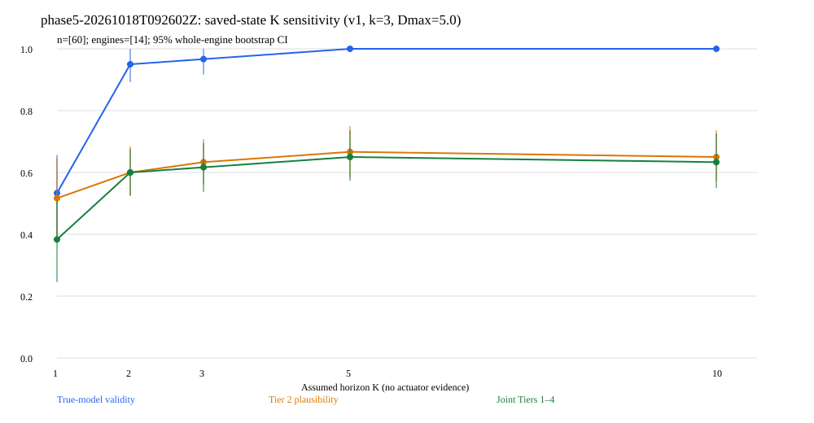

# Phase 6: public decision support pipeline

Library, CLI and API share schema **2.0.0**. Model safety, Tier 2 plausibility and Tiers 3-4 remain separate. All numbers below are saved real FD001 measurements.

Run `phase6-20261018T114827Z`; measured source git `a72832c271015a2391ed452a9dca7776a5131a98`; preregistration git `a72832c271015a2391ed452a9dca7776a5131a98`. Detailed ignored evidence: `artifacts/phase6/pipeline.json`, SHA-256 `7b2b8d5719c9848bc5504f5277967a3d9d75526718fdbf208f5f6ad7fca1f0b6`.

Bounds, rates, proxy mapping, risk thresholds, predictor/calibrator, K=1, k_max=3 and D_max v1=5/v2=8 were frozen before this run. No target was changed after measurement. The first-alert populations differ from Phase 5's mixed-cycle 200-state headline; these results are not an improvement comparison or fresh-engine generalization.

Every interval is a 95% percentile bootstrap over whole engines, 2000 replicates. Returned counterfactual/diagnostic candidates are nonzero sparse feasible returned states regardless of tier outcomes; failed candidates remain in that denominator. All queries, including unchanged/infeasible diagnostics, remain in the all-query denominator.

The C-MAPSS control mapping, bounds, one-step rates and intervention horizon K are assumptions. Evidence is at most E3; no validated actuator efficacy, dynamic safety or RUL extension is established. The [historical assumed-K sensitivity curve](phase5_changes.md) remains next to this K=1 headline; it is not a new FAST/THOROUGH K experiment.

The main measurement predates final interface corrections: invalid-input handling, configured mode defaults, request-local process configuration, LSTM CLI history, and authoritative final singleton scoring. The population benchmark used the frozen XGBoost predictors. Final delivery checks below identify their own source commit. No population result is relabeled as measured on a later source revision.

The original benchmark's CLI demonstration reset its logging context. Individual request IDs therefore differ from the enclosing report run ID in later rows; both are retained. The subsequent harness isolates CLI subprocesses and saves each run in its own directory. Shared base coupling artifact serialization matches the Phase 5 v2 copy; the frozen v1/v2 calibration diagnostics are numerically identical. This is not a calibration refit.

## v1 / FAST / K=1

Run `phase6-20261018T114827Z`; git `a72832c271015a2391ed452a9dca7776a5131a98`; mode FAST; protocol/D_max version v1; D_max=5; k_max=3; K=1.
Population `development_first_alert`: committed config `configs\experiments\phase6-pipeline-v1.yaml`, file SHA-256 `b2eb7759b241e686d7e9e15c879c2bee0bfef67a3d63e272ecfdfb8dc1f8572a`, base config SHA-256 `101f900831696ae79c4641bd9eaf36d53cd6920fe9cd9bb6d097cbcba23e34d1`; runtime FAST config SHA-256 `101f900831696ae79c4641bd9eaf36d53cd6920fe9cd9bb6d097cbcba23e34d1`.
Population `internal_heldout_first_alert`: committed config `configs\experiments\phase6-pipeline-v1.yaml`, file SHA-256 `b2eb7759b241e686d7e9e15c879c2bee0bfef67a3d63e272ecfdfb8dc1f8572a`, base config SHA-256 `101f900831696ae79c4641bd9eaf36d53cd6920fe9cd9bb6d097cbcba23e34d1`; runtime FAST config SHA-256 `101f900831696ae79c4641bd9eaf36d53cd6920fe9cd9bb6d097cbcba23e34d1`.
Population `official_test_first_alert`: committed config `configs\experiments\phase6-pipeline-v1.yaml`, file SHA-256 `b2eb7759b241e686d7e9e15c879c2bee0bfef67a3d63e272ecfdfb8dc1f8572a`, base config SHA-256 `101f900831696ae79c4641bd9eaf36d53cd6920fe9cd9bb6d097cbcba23e34d1`; runtime FAST config SHA-256 `101f900831696ae79c4641bd9eaf36d53cd6920fe9cd9bb6d097cbcba23e34d1`.
Population `grouped_oof_fold_1_first_alert`: committed config `configs\experiments\phase6-fold-1-v1.yaml`, file SHA-256 `6306c3535df7655e626e7b37d586c9a5fba897b8a808bd3e3d43b811dbe06670`, base config SHA-256 `e5b1c85c44cfede1fc284eb3be990fc26046a5f5f2f83b309364178e216fd3b7`; runtime FAST config SHA-256 `e5b1c85c44cfede1fc284eb3be990fc26046a5f5f2f83b309364178e216fd3b7`.
Population `grouped_oof_fold_2_first_alert`: committed config `configs\experiments\phase6-fold-2-v1.yaml`, file SHA-256 `db8fd1ab1fd8a12dc7c2977bb146964702e71a58b5dd8fc52d5a7efcda1b11cd`, base config SHA-256 `015e64ca4104d14d054220916b582bcf6f8d1a62896cf3bee44be0572a09a81d`; runtime FAST config SHA-256 `015e64ca4104d14d054220916b582bcf6f8d1a62896cf3bee44be0572a09a81d`.
Population `grouped_oof_fold_3_first_alert`: committed config `configs\experiments\phase6-fold-3-v1.yaml`, file SHA-256 `c1f7b94506762c786321bc0f568b0a5510a3e143332cf91d57c56aad72812f11`, base config SHA-256 `d5c9602a6d985a4787e04b4ee5e8b887cbf0035556a9cfa373cff113589b46e9`; runtime FAST config SHA-256 `d5c9602a6d985a4787e04b4ee5e8b887cbf0035556a9cfa373cff113589b46e9`.
Population `grouped_oof_fold_4_first_alert`: committed config `configs\experiments\phase6-fold-4-v1.yaml`, file SHA-256 `ba4321e5664d3d22576b5d37effa0a696b15e958bf2d4eb2b705a8ab35fd3d16`, base config SHA-256 `751ced8f742a51c83fab17f99c660197b13997f0c824b80dbc72aadeafff3aca`; runtime FAST config SHA-256 `751ced8f742a51c83fab17f99c660197b13997f0c824b80dbc72aadeafff3aca`.
Population `grouped_oof_fold_5_first_alert`: committed config `configs\experiments\phase6-fold-5-v1.yaml`, file SHA-256 `edb8f36572c70e88e0b6f61402a6c021e7f071d87d3d53e059cf1bb5479544dc`, base config SHA-256 `23c1da72029a7cd4c42d519b5b584863677fb700ebcde052e930e7514d229b63`; runtime FAST config SHA-256 `23c1da72029a7cd4c42d519b5b584863677fb700ebcde052e930e7514d229b63`.
The base config hash identifies the committed YAML configuration; the actual per-mode hashes are carried in every saved RecourseResult. Pooled grouped OOF uses all five listed fold configs; model/validator/coupling hashes are preserved under input_fingerprints.artifacts in the detailed JSON. Every query uses only its held-out fold predictor and validator. No fold percentiles are averaged.

Tables below carry the run/config/git/protocol/mode/k_max/K/D_max/population labels above.

| Quality metric | development_first_alert | internal_heldout_first_alert | official_test_first_alert | grouped_oof_first_alert |
|---|---|---|---|---|
| validity | 16/16 = 1.000 [1.000, 1.000]; 16 engines | 15/15 = 1.000 [1.000, 1.000]; 15 engines | 19/19 = 1.000 [1.000, 1.000]; 19 engines | 99/100 = 0.990 [0.970, 1.000]; 100 engines |
| plausibility_all_queries | 14/16 = 0.875 [0.688, 1.000]; 16 engines | 15/15 = 1.000 [1.000, 1.000]; 15 engines | 18/19 = 0.947 [0.842, 1.000]; 19 engines | 90/100 = 0.900 [0.840, 0.950]; 100 engines |
| plausibility_returned_counterfactuals | 14/16 = 0.875 [0.688, 1.000]; 16 engines | 15/15 = 1.000 [1.000, 1.000]; 15 engines | 18/19 = 0.947 [0.842, 1.000]; 19 engines | 90/100 = 0.900 [0.840, 0.950]; 100 engines |
| tier3 | 16/16 = 1.000 [1.000, 1.000]; 16 engines | 15/15 = 1.000 [1.000, 1.000]; 15 engines | 19/19 = 1.000 [1.000, 1.000]; 19 engines | 100/100 = 1.000 [1.000, 1.000]; 100 engines |
| tier4 | 14/16 = 0.875 [0.688, 1.000]; 16 engines | 15/15 = 1.000 [1.000, 1.000]; 15 engines | 18/19 = 0.947 [0.842, 1.000]; 19 engines | 96/100 = 0.960 [0.920, 0.990]; 100 engines |
| joint | 14/16 = 0.875 [0.688, 1.000]; 16 engines | 15/15 = 1.000 [1.000, 1.000]; 15 engines | 18/19 = 0.947 [0.842, 1.000]; 19 engines | 90/100 = 0.900 [0.840, 0.950]; 100 engines |
| RECOVERABLE | 14/16 = 0.875 [0.688, 1.000]; 16 engines | 15/15 = 1.000 [1.000, 1.000]; 15 engines | 18/19 = 0.947 [0.842, 1.000]; 19 engines | 90/100 = 0.900 [0.840, 0.950]; 100 engines |
| PARTIAL | 0/16 = 0.000 [0.000, 0.000]; 16 engines | 0/15 = 0.000 [0.000, 0.000]; 15 engines | 0/19 = 0.000 [0.000, 0.000]; 19 engines | 0/100 = 0.000 [0.000, 0.000]; 100 engines |
| ESCALATE | 2/16 = 0.125 [0.000, 0.312]; 16 engines | 0/15 = 0.000 [0.000, 0.000]; 15 engines | 1/19 = 0.053 [0.000, 0.158]; 19 engines | 10/100 = 0.100 [0.050, 0.160]; 100 engines |

Tables below carry the run/config/git/protocol/mode/k_max/K/D_max/population labels above.

| Stage (p50 / p95 / p99) | development_first_alert | internal_heldout_first_alert | official_test_first_alert | grouped_oof_first_alert |
|---|---|---|---|---|
| ingestion_ms | 0.37 / 0.53 / 0.61 ms; p95 CI [0.43, 0.63], 16 engines; PASS (p95 <= 10 ms) | 0.36 / 0.55 / 0.62 ms; p95 CI [0.39, 0.63], 15 engines; PASS (p95 <= 10 ms) | 0.34 / 0.51 / 0.93 ms; p95 CI [0.41, 1.04], 19 engines; PASS (p95 <= 10 ms) | 0.38 / 0.57 / 0.74 ms; p95 CI [0.49, 0.72], 100 engines; PASS (p95 <= 10 ms) |
| inference_ms | 4.25 / 5.98 / 6.24 ms; p95 CI [4.63, 6.30], 16 engines; PASS (p95 <= 15 ms) | 3.87 / 5.84 / 5.86 ms; p95 CI [4.40, 5.87], 15 engines; PASS (p95 <= 15 ms) | 4.24 / 5.30 / 5.40 ms; p95 CI [4.65, 5.42], 19 engines; PASS (p95 <= 15 ms) | 4.47 / 7.06 / 10.87 ms; p95 CI [5.73, 9.63], 100 engines; PASS (p95 <= 15 ms) |
| optimization_ms | 4073.75 / 4777.90 / 5045.45 ms; p95 CI [4424.66, 5112.34], 16 engines; NOT MET (p95 <= 1800 ms) | 3415.21 / 4448.58 / 4457.67 ms; p95 CI [3841.18, 4459.95], 15 engines; NOT MET (p95 <= 1800 ms) | 3802.14 / 4533.82 / 4535.82 ms; p95 CI [4120.39, 4536.32], 19 engines; NOT MET (p95 <= 1800 ms) | 4944.51 / 6838.64 / 7246.43 ms; p95 CI [6602.22, 7175.84], 100 engines; NOT MET (p95 <= 1800 ms) |
| validation_ms | 8.27 / 11.86 / 11.97 ms; p95 CI [9.47, 11.99], 16 engines; PASS (p95 <= 100 ms) | 7.59 / 11.95 / 12.06 ms; p95 CI [10.64, 12.08], 15 engines; PASS (p95 <= 100 ms) | 8.39 / 10.48 / 11.54 ms; p95 CI [9.49, 11.80], 19 engines; PASS (p95 <= 100 ms) | 11.63 / 14.52 / 18.79 ms; p95 CI [13.64, 16.77], 100 engines; PASS (p95 <= 100 ms) |
| pipeline_ms | 4094.08 / 4795.28 / 5066.72 ms; p95 CI [4442.90, 5134.59], 16 engines; NOT MET (p95 <= 2200 ms) | 3430.35 / 4465.88 / 4477.70 ms; p95 CI [3857.75, 4480.66], 15 engines; NOT MET (p95 <= 2200 ms) | 3821.01 / 4551.34 / 4557.08 ms; p95 CI [4140.24, 4558.52], 19 engines; NOT MET (p95 <= 2200 ms) | 4965.33 / 6858.13 / 7271.82 ms; p95 CI [6624.21, 7199.68], 100 engines; NOT MET (p95 <= 2200 ms) |

This long-running execution was interrupted across calendar dates; all recorded outliers are retained. Latency is not a controlled steady-state estimate. UI and startup are unmeasured. Backend calls run serially after artifact loading; 32 disclosed validation-engine warmups were excluded overall. No timing is padded.

Tables below carry the run/config/git/protocol/mode/k_max/K/D_max/population labels above.

| Evidence/error diagnostic | development_first_alert | internal_heldout_first_alert | official_test_first_alert | grouped_oof_first_alert |
|---|---|---|---|---|
| D_M p50 / p95 / p99 | 4.405 / 5.964 / 6.074 | 4.164 / 4.917 / 4.962 | 4.528 / 5.078 / 5.925 | 4.574 / 5.735 / 6.436 |
| Highest achieved evidence counts | none=0, E1=2, E2=0, E3=14, E4=0, E5=0 | none=0, E1=0, E2=0, E3=15, E4=0, E5=0 | none=0, E1=1, E2=0, E3=18, E4=0, E5=0 | none=1, E1=9, E2=0, E3=90, E4=0, E5=0 |

## v1 / THOROUGH / K=1

Run `phase6-20261018T114827Z`; git `a72832c271015a2391ed452a9dca7776a5131a98`; mode THOROUGH; protocol/D_max version v1; D_max=5; k_max=3; K=1.
Population `development_first_alert`: committed config `configs\experiments\phase6-pipeline-v1.yaml`, file SHA-256 `b2eb7759b241e686d7e9e15c879c2bee0bfef67a3d63e272ecfdfb8dc1f8572a`, base config SHA-256 `101f900831696ae79c4641bd9eaf36d53cd6920fe9cd9bb6d097cbcba23e34d1`; runtime THOROUGH config SHA-256 `a993814449a73fde603c36466b8e92c0680eb9f7e00290fb753a08908f6189b7`.
Population `internal_heldout_first_alert`: committed config `configs\experiments\phase6-pipeline-v1.yaml`, file SHA-256 `b2eb7759b241e686d7e9e15c879c2bee0bfef67a3d63e272ecfdfb8dc1f8572a`, base config SHA-256 `101f900831696ae79c4641bd9eaf36d53cd6920fe9cd9bb6d097cbcba23e34d1`; runtime THOROUGH config SHA-256 `a993814449a73fde603c36466b8e92c0680eb9f7e00290fb753a08908f6189b7`.
Population `official_test_first_alert`: committed config `configs\experiments\phase6-pipeline-v1.yaml`, file SHA-256 `b2eb7759b241e686d7e9e15c879c2bee0bfef67a3d63e272ecfdfb8dc1f8572a`, base config SHA-256 `101f900831696ae79c4641bd9eaf36d53cd6920fe9cd9bb6d097cbcba23e34d1`; runtime THOROUGH config SHA-256 `a993814449a73fde603c36466b8e92c0680eb9f7e00290fb753a08908f6189b7`.
Population `grouped_oof_fold_1_first_alert`: committed config `configs\experiments\phase6-fold-1-v1.yaml`, file SHA-256 `6306c3535df7655e626e7b37d586c9a5fba897b8a808bd3e3d43b811dbe06670`, base config SHA-256 `e5b1c85c44cfede1fc284eb3be990fc26046a5f5f2f83b309364178e216fd3b7`; runtime THOROUGH config SHA-256 `3f4826fb5c13cbbd33b0c9b0bf0056c024a1aea30fb62643c84a05d0cd2a264c`.
Population `grouped_oof_fold_2_first_alert`: committed config `configs\experiments\phase6-fold-2-v1.yaml`, file SHA-256 `db8fd1ab1fd8a12dc7c2977bb146964702e71a58b5dd8fc52d5a7efcda1b11cd`, base config SHA-256 `015e64ca4104d14d054220916b582bcf6f8d1a62896cf3bee44be0572a09a81d`; runtime THOROUGH config SHA-256 `301ee9e1f45c49aa21b9d114c92bf1d7380977aaefe465af2cecf88ab910b141`.
Population `grouped_oof_fold_3_first_alert`: committed config `configs\experiments\phase6-fold-3-v1.yaml`, file SHA-256 `c1f7b94506762c786321bc0f568b0a5510a3e143332cf91d57c56aad72812f11`, base config SHA-256 `d5c9602a6d985a4787e04b4ee5e8b887cbf0035556a9cfa373cff113589b46e9`; runtime THOROUGH config SHA-256 `81e330cb562a0caeb412d169806c83cb10a7cbb0c3773edd34bb47c93f692750`.
Population `grouped_oof_fold_4_first_alert`: committed config `configs\experiments\phase6-fold-4-v1.yaml`, file SHA-256 `ba4321e5664d3d22576b5d37effa0a696b15e958bf2d4eb2b705a8ab35fd3d16`, base config SHA-256 `751ced8f742a51c83fab17f99c660197b13997f0c824b80dbc72aadeafff3aca`; runtime THOROUGH config SHA-256 `7e993e0d30cd911fc78297fc9e5e2209f04b9cb79a3940cfaa264f200b585090`.
Population `grouped_oof_fold_5_first_alert`: committed config `configs\experiments\phase6-fold-5-v1.yaml`, file SHA-256 `edb8f36572c70e88e0b6f61402a6c021e7f071d87d3d53e059cf1bb5479544dc`, base config SHA-256 `23c1da72029a7cd4c42d519b5b584863677fb700ebcde052e930e7514d229b63`; runtime THOROUGH config SHA-256 `17c69b0779ac19448981e791cc44f7b1f6f273446c893a03af022422f21f642c`.
The base config hash identifies the committed YAML configuration; the actual per-mode hashes are carried in every saved RecourseResult. Pooled grouped OOF uses all five listed fold configs; model/validator/coupling hashes are preserved under input_fingerprints.artifacts in the detailed JSON. Every query uses only its held-out fold predictor and validator. No fold percentiles are averaged.

Tables below carry the run/config/git/protocol/mode/k_max/K/D_max/population labels above.

| Quality metric | development_first_alert | internal_heldout_first_alert | official_test_first_alert | grouped_oof_first_alert |
|---|---|---|---|---|
| validity | 16/16 = 1.000 [1.000, 1.000]; 16 engines | 15/15 = 1.000 [1.000, 1.000]; 15 engines | 19/19 = 1.000 [1.000, 1.000]; 19 engines | 99/100 = 0.990 [0.970, 1.000]; 100 engines |
| plausibility_all_queries | 14/16 = 0.875 [0.688, 1.000]; 16 engines | 15/15 = 1.000 [1.000, 1.000]; 15 engines | 18/19 = 0.947 [0.842, 1.000]; 19 engines | 90/100 = 0.900 [0.840, 0.950]; 100 engines |
| plausibility_returned_counterfactuals | 14/16 = 0.875 [0.688, 1.000]; 16 engines | 15/15 = 1.000 [1.000, 1.000]; 15 engines | 18/19 = 0.947 [0.842, 1.000]; 19 engines | 90/100 = 0.900 [0.840, 0.950]; 100 engines |
| tier3 | 16/16 = 1.000 [1.000, 1.000]; 16 engines | 15/15 = 1.000 [1.000, 1.000]; 15 engines | 19/19 = 1.000 [1.000, 1.000]; 19 engines | 100/100 = 1.000 [1.000, 1.000]; 100 engines |
| tier4 | 14/16 = 0.875 [0.688, 1.000]; 16 engines | 15/15 = 1.000 [1.000, 1.000]; 15 engines | 18/19 = 0.947 [0.842, 1.000]; 19 engines | 96/100 = 0.960 [0.920, 0.990]; 100 engines |
| joint | 14/16 = 0.875 [0.688, 1.000]; 16 engines | 15/15 = 1.000 [1.000, 1.000]; 15 engines | 18/19 = 0.947 [0.842, 1.000]; 19 engines | 90/100 = 0.900 [0.840, 0.950]; 100 engines |
| RECOVERABLE | 14/16 = 0.875 [0.688, 1.000]; 16 engines | 15/15 = 1.000 [1.000, 1.000]; 15 engines | 18/19 = 0.947 [0.842, 1.000]; 19 engines | 90/100 = 0.900 [0.840, 0.950]; 100 engines |
| PARTIAL | 0/16 = 0.000 [0.000, 0.000]; 16 engines | 0/15 = 0.000 [0.000, 0.000]; 15 engines | 0/19 = 0.000 [0.000, 0.000]; 19 engines | 0/100 = 0.000 [0.000, 0.000]; 100 engines |
| ESCALATE | 2/16 = 0.125 [0.000, 0.312]; 16 engines | 0/15 = 0.000 [0.000, 0.000]; 15 engines | 1/19 = 0.053 [0.000, 0.158]; 19 engines | 10/100 = 0.100 [0.050, 0.160]; 100 engines |

Tables below carry the run/config/git/protocol/mode/k_max/K/D_max/population labels above.

| Stage (p50 / p95 / p99) | development_first_alert | internal_heldout_first_alert | official_test_first_alert | grouped_oof_first_alert |
|---|---|---|---|---|
| ingestion_ms | 0.37 / 0.47 / 0.51 ms; p95 CI [0.41, 0.52], 16 engines; PASS (p95 <= 10 ms) | 0.33 / 0.51 / 0.61 ms; p95 CI [0.37, 0.64], 15 engines; PASS (p95 <= 10 ms) | 0.34 / 0.51 / 0.85 ms; p95 CI [0.39, 0.93], 19 engines; PASS (p95 <= 10 ms) | 0.38 / 0.53 / 0.89 ms; p95 CI [0.48, 0.72], 100 engines; PASS (p95 <= 10 ms) |
| inference_ms | 4.12 / 5.07 / 5.36 ms; p95 CI [4.42, 5.43], 16 engines; PASS (p95 <= 15 ms) | 3.85 / 4.89 / 5.91 ms; p95 CI [4.09, 6.16], 15 engines; PASS (p95 <= 15 ms) | 4.32 / 7.88 / 8.63 ms; p95 CI [5.21, 8.81], 19 engines; PASS (p95 <= 15 ms) | 4.37 / 5.90 / 8.09 ms; p95 CI [5.65, 7.51], 100 engines; PASS (p95 <= 15 ms) |
| optimization_ms | 3680.06 / 4437.93 / 4469.56 ms; p95 CI [4141.53, 4477.47], 16 engines; NOT MET (p95 <= 1800 ms) | 2705.01 / 3594.48 / 3603.99 ms; p95 CI [3051.33, 3606.37], 15 engines; NOT MET (p95 <= 1800 ms) | 3165.51 / 3906.77 / 4134.26 ms; p95 CI [3504.65, 4191.13], 19 engines; NOT MET (p95 <= 1800 ms) | 4032.52 / 5924.39 / 6301.28 ms; p95 CI [5313.17, 6130.19], 100 engines; NOT MET (p95 <= 1800 ms) |
| validation_ms | 8.46 / 13.63 / 17.92 ms; p95 CI [9.98, 18.99], 16 engines; PASS (p95 <= 100 ms) | 7.64 / 9.41 / 9.67 ms; p95 CI [7.91, 9.73], 15 engines; PASS (p95 <= 100 ms) | 8.69 / 11.07 / 11.33 ms; p95 CI [9.83, 11.39], 19 engines; PASS (p95 <= 100 ms) | 11.63 / 14.25 / 17.20 ms; p95 CI [13.27, 15.04], 100 engines; PASS (p95 <= 100 ms) |
| pipeline_ms | 3697.21 / 4465.41 / 4488.24 ms; p95 CI [4159.17, 4493.95], 16 engines; NOT MET (p95 <= 2200 ms) | 2721.81 / 3610.52 / 3619.60 ms; p95 CI [3097.92, 3621.87], 15 engines; NOT MET (p95 <= 2200 ms) | 3184.72 / 3927.61 / 4155.47 ms; p95 CI [3507.51, 4212.44], 19 engines; NOT MET (p95 <= 2200 ms) | 4050.60 / 5949.17 / 6325.55 ms; p95 CI [5336.87, 6149.46], 100 engines; NOT MET (p95 <= 2200 ms) |

This long-running execution was interrupted across calendar dates; all recorded outliers are retained. Latency is not a controlled steady-state estimate. UI and startup are unmeasured. Backend calls run serially after artifact loading; 32 disclosed validation-engine warmups were excluded overall. No timing is padded.

Tables below carry the run/config/git/protocol/mode/k_max/K/D_max/population labels above.

| Evidence/error diagnostic | development_first_alert | internal_heldout_first_alert | official_test_first_alert | grouped_oof_first_alert |
|---|---|---|---|---|
| D_M p50 / p95 / p99 | 4.405 / 5.964 / 6.074 | 4.164 / 4.917 / 4.962 | 4.528 / 5.078 / 5.925 | 4.574 / 5.735 / 6.436 |
| Highest achieved evidence counts | none=0, E1=2, E2=0, E3=14, E4=0, E5=0 | none=0, E1=0, E2=0, E3=15, E4=0, E5=0 | none=0, E1=1, E2=0, E3=18, E4=0, E5=0 | none=1, E1=9, E2=0, E3=90, E4=0, E5=0 |

## v2 / FAST / K=1

Run `phase6-20261018T114827Z`; git `a72832c271015a2391ed452a9dca7776a5131a98`; mode FAST; protocol/D_max version v2; D_max=8; k_max=3; K=1.
Population `development_first_alert`: committed config `configs\experiments\phase6-pipeline-v2.yaml`, file SHA-256 `c604ea3bdb51be9e1878c922858626ea8d3d4375e8f7d863516a28c273677399`, base config SHA-256 `ae70707082da2995c89785913b29c5f1d6ad48aa9bdb9ea06111287d400dc04a`; runtime FAST config SHA-256 `ae70707082da2995c89785913b29c5f1d6ad48aa9bdb9ea06111287d400dc04a`.
Population `internal_heldout_first_alert`: committed config `configs\experiments\phase6-pipeline-v2.yaml`, file SHA-256 `c604ea3bdb51be9e1878c922858626ea8d3d4375e8f7d863516a28c273677399`, base config SHA-256 `ae70707082da2995c89785913b29c5f1d6ad48aa9bdb9ea06111287d400dc04a`; runtime FAST config SHA-256 `ae70707082da2995c89785913b29c5f1d6ad48aa9bdb9ea06111287d400dc04a`.
Population `official_test_first_alert`: committed config `configs\experiments\phase6-pipeline-v2.yaml`, file SHA-256 `c604ea3bdb51be9e1878c922858626ea8d3d4375e8f7d863516a28c273677399`, base config SHA-256 `ae70707082da2995c89785913b29c5f1d6ad48aa9bdb9ea06111287d400dc04a`; runtime FAST config SHA-256 `ae70707082da2995c89785913b29c5f1d6ad48aa9bdb9ea06111287d400dc04a`.
Population `grouped_oof_fold_1_first_alert`: committed config `configs\experiments\phase6-fold-1-v2.yaml`, file SHA-256 `b85616daf63d2d9c0ad144e1778bd9e9045a79fd16a2dbe0147e83988069baaf`, base config SHA-256 `6dd228a273fe5f77f9feaac9c57a0b0ecd29037f867d538f328ebcb40ee9a1ed`; runtime FAST config SHA-256 `6dd228a273fe5f77f9feaac9c57a0b0ecd29037f867d538f328ebcb40ee9a1ed`.
Population `grouped_oof_fold_2_first_alert`: committed config `configs\experiments\phase6-fold-2-v2.yaml`, file SHA-256 `04f18b5dd900cc0a60249fe7f1f5d67ae49e8c21d69d74143be5b6b26ed2ded7`, base config SHA-256 `c226e2e241c326c59cc1e61303c38a482e37cf11c4faa5b8fafcce70ee9b94b5`; runtime FAST config SHA-256 `c226e2e241c326c59cc1e61303c38a482e37cf11c4faa5b8fafcce70ee9b94b5`.
Population `grouped_oof_fold_3_first_alert`: committed config `configs\experiments\phase6-fold-3-v2.yaml`, file SHA-256 `edda1b88b9c64bacbe4060c03c3cdfe0b0669cabfea4261dee951a91b124a083`, base config SHA-256 `e0c4cd9e8bcd080dd775b65f0f9a87583fcaf8e7bb1f145e3cdeb222e1320366`; runtime FAST config SHA-256 `e0c4cd9e8bcd080dd775b65f0f9a87583fcaf8e7bb1f145e3cdeb222e1320366`.
Population `grouped_oof_fold_4_first_alert`: committed config `configs\experiments\phase6-fold-4-v2.yaml`, file SHA-256 `77cb8aab1b2719bfd9dd628dbb342ffc6502d37d2362c0e451085a12a8d1aa52`, base config SHA-256 `585000dbb0df1e4f2275dbcb44dd076af50f8d9321f3d7591e925c05eb52ccb5`; runtime FAST config SHA-256 `585000dbb0df1e4f2275dbcb44dd076af50f8d9321f3d7591e925c05eb52ccb5`.
Population `grouped_oof_fold_5_first_alert`: committed config `configs\experiments\phase6-fold-5-v2.yaml`, file SHA-256 `90a3f80148044b8ee24f74485678e232ab52afc3511ac98b55b5466238137818`, base config SHA-256 `05b40c6126cfda5f99e622ada229a5e59e2a054c36ac6a48ffa21214111a5cd5`; runtime FAST config SHA-256 `05b40c6126cfda5f99e622ada229a5e59e2a054c36ac6a48ffa21214111a5cd5`.
The base config hash identifies the committed YAML configuration; the actual per-mode hashes are carried in every saved RecourseResult. Pooled grouped OOF uses all five listed fold configs; model/validator/coupling hashes are preserved under input_fingerprints.artifacts in the detailed JSON. Every query uses only its held-out fold predictor and validator. No fold percentiles are averaged.

Tables below carry the run/config/git/protocol/mode/k_max/K/D_max/population labels above.

| Quality metric | development_first_alert | internal_heldout_first_alert | official_test_first_alert | grouped_oof_first_alert |
|---|---|---|---|---|
| validity | 16/16 = 1.000 [1.000, 1.000]; 16 engines | 15/15 = 1.000 [1.000, 1.000]; 15 engines | 19/19 = 1.000 [1.000, 1.000]; 19 engines | 99/100 = 0.990 [0.970, 1.000]; 100 engines |
| plausibility_all_queries | 16/16 = 1.000 [1.000, 1.000]; 16 engines | 15/15 = 1.000 [1.000, 1.000]; 15 engines | 19/19 = 1.000 [1.000, 1.000]; 19 engines | 100/100 = 1.000 [1.000, 1.000]; 100 engines |
| plausibility_returned_counterfactuals | 16/16 = 1.000 [1.000, 1.000]; 16 engines | 15/15 = 1.000 [1.000, 1.000]; 15 engines | 19/19 = 1.000 [1.000, 1.000]; 19 engines | 100/100 = 1.000 [1.000, 1.000]; 100 engines |
| tier3 | 16/16 = 1.000 [1.000, 1.000]; 16 engines | 15/15 = 1.000 [1.000, 1.000]; 15 engines | 19/19 = 1.000 [1.000, 1.000]; 19 engines | 100/100 = 1.000 [1.000, 1.000]; 100 engines |
| tier4 | 14/16 = 0.875 [0.688, 1.000]; 16 engines | 15/15 = 1.000 [1.000, 1.000]; 15 engines | 18/19 = 0.947 [0.842, 1.000]; 19 engines | 96/100 = 0.960 [0.920, 0.990]; 100 engines |
| joint | 14/16 = 0.875 [0.688, 1.000]; 16 engines | 15/15 = 1.000 [1.000, 1.000]; 15 engines | 18/19 = 0.947 [0.842, 1.000]; 19 engines | 95/100 = 0.950 [0.900, 0.990]; 100 engines |
| RECOVERABLE | 14/16 = 0.875 [0.688, 1.000]; 16 engines | 15/15 = 1.000 [1.000, 1.000]; 15 engines | 18/19 = 0.947 [0.842, 1.000]; 19 engines | 95/100 = 0.950 [0.900, 0.990]; 100 engines |
| PARTIAL | 0/16 = 0.000 [0.000, 0.000]; 16 engines | 0/15 = 0.000 [0.000, 0.000]; 15 engines | 0/19 = 0.000 [0.000, 0.000]; 19 engines | 1/100 = 0.010 [0.000, 0.030]; 100 engines |
| ESCALATE | 2/16 = 0.125 [0.000, 0.312]; 16 engines | 0/15 = 0.000 [0.000, 0.000]; 15 engines | 1/19 = 0.053 [0.000, 0.158]; 19 engines | 4/100 = 0.040 [0.010, 0.080]; 100 engines |

Tables below carry the run/config/git/protocol/mode/k_max/K/D_max/population labels above.

| Stage (p50 / p95 / p99) | development_first_alert | internal_heldout_first_alert | official_test_first_alert | grouped_oof_first_alert |
|---|---|---|---|---|
| ingestion_ms | 0.37 / 0.49 / 0.50 ms; p95 CI [0.43, 0.51], 16 engines; PASS (p95 <= 10 ms) | 0.37 / 0.83 / 0.89 ms; p95 CI [0.45, 0.91], 15 engines; PASS (p95 <= 10 ms) | 0.42 / 0.50 / 0.55 ms; p95 CI [0.45, 0.56], 19 engines; PASS (p95 <= 10 ms) | 0.39 / 0.67 / 1.21 ms; p95 CI [0.53, 1.17], 100 engines; PASS (p95 <= 10 ms) |
| inference_ms | 4.33 / 5.45 / 5.68 ms; p95 CI [4.62, 5.73], 16 engines; PASS (p95 <= 15 ms) | 3.99 / 9.52 / 10.05 ms; p95 CI [5.38, 10.18], 15 engines; PASS (p95 <= 15 ms) | 4.60 / 5.23 / 5.57 ms; p95 CI [4.86, 5.66], 19 engines; PASS (p95 <= 15 ms) | 4.36 / 7.10 / 8.80 ms; p95 CI [5.75, 7.82], 100 engines; PASS (p95 <= 15 ms) |
| optimization_ms | 4123.17 / 1530294.42 / 2920690.10 ms; p95 CI [6206.13, 3268289.02], 16 engines; NOT MET (p95 <= 1800 ms) | 4945.20 / 6011177.60 / 12593226.54 ms; p95 CI [6507.67, 14238738.78], 15 engines; NOT MET (p95 <= 1800 ms) | 4680.66 / 6206.28 / 6347.74 ms; p95 CI [5561.28, 6383.10], 19 engines; NOT MET (p95 <= 1800 ms) | 3908.19 / 6282.10 / 7321.81 ms; p95 CI [5949.73, 6874.71], 100 engines; NOT MET (p95 <= 1800 ms) |
| validation_ms | 8.46 / 15.91 / 18.79 ms; p95 CI [10.97, 19.51], 16 engines; PASS (p95 <= 100 ms) | 10.95 / 28.31 / 32.96 ms; p95 CI [12.23, 34.12], 15 engines; PASS (p95 <= 100 ms) | 10.94 / 13.32 / 13.98 ms; p95 CI [11.43, 14.14], 19 engines; PASS (p95 <= 100 ms) | 10.65 / 13.12 / 14.69 ms; p95 CI [12.41, 14.03], 100 engines; PASS (p95 <= 100 ms) |
| pipeline_ms | 4140.34 / 1530333.85 / 2920748.26 ms; p95 CI [6294.21, 3268351.86], 16 engines; NOT MET (p95 <= 2200 ms) | 4965.81 / 6011292.98 / 12593320.50 ms; p95 CI [6527.97, 14238827.38], 15 engines; NOT MET (p95 <= 2200 ms) | 4700.59 / 6230.04 / 6373.30 ms; p95 CI [5594.83, 6409.11], 19 engines; NOT MET (p95 <= 2200 ms) | 3932.75 / 6307.49 / 7340.04 ms; p95 CI [5971.64, 6897.75], 100 engines; NOT MET (p95 <= 2200 ms) |

This long-running execution was interrupted across calendar dates; all recorded outliers are retained. Latency is not a controlled steady-state estimate. UI and startup are unmeasured. Backend calls run serially after artifact loading; 32 disclosed validation-engine warmups were excluded overall. No timing is padded.

Tables below carry the run/config/git/protocol/mode/k_max/K/D_max/population labels above.

| Evidence/error diagnostic | development_first_alert | internal_heldout_first_alert | official_test_first_alert | grouped_oof_first_alert |
|---|---|---|---|---|
| D_M p50 / p95 / p99 | 4.481 / 5.964 / 6.074 | 4.046 / 5.597 / 6.241 | 4.358 / 5.985 / 6.107 | 4.754 / 6.231 / 6.789 |
| Highest achieved evidence counts | none=0, E1=0, E2=2, E3=14, E4=0, E5=0 | none=0, E1=0, E2=0, E3=15, E4=0, E5=0 | none=0, E1=0, E2=1, E3=18, E4=0, E5=0 | none=1, E1=0, E2=4, E3=95, E4=0, E5=0 |

## v2 / THOROUGH / K=1

Run `phase6-20261018T114827Z`; git `a72832c271015a2391ed452a9dca7776a5131a98`; mode THOROUGH; protocol/D_max version v2; D_max=8; k_max=3; K=1.
Population `development_first_alert`: committed config `configs\experiments\phase6-pipeline-v2.yaml`, file SHA-256 `c604ea3bdb51be9e1878c922858626ea8d3d4375e8f7d863516a28c273677399`, base config SHA-256 `ae70707082da2995c89785913b29c5f1d6ad48aa9bdb9ea06111287d400dc04a`; runtime THOROUGH config SHA-256 `b816ee23bf23c455cef8408e98905998618fc13aa82c92d6226e7693fb4ab81c`.
Population `internal_heldout_first_alert`: committed config `configs\experiments\phase6-pipeline-v2.yaml`, file SHA-256 `c604ea3bdb51be9e1878c922858626ea8d3d4375e8f7d863516a28c273677399`, base config SHA-256 `ae70707082da2995c89785913b29c5f1d6ad48aa9bdb9ea06111287d400dc04a`; runtime THOROUGH config SHA-256 `b816ee23bf23c455cef8408e98905998618fc13aa82c92d6226e7693fb4ab81c`.
Population `official_test_first_alert`: committed config `configs\experiments\phase6-pipeline-v2.yaml`, file SHA-256 `c604ea3bdb51be9e1878c922858626ea8d3d4375e8f7d863516a28c273677399`, base config SHA-256 `ae70707082da2995c89785913b29c5f1d6ad48aa9bdb9ea06111287d400dc04a`; runtime THOROUGH config SHA-256 `b816ee23bf23c455cef8408e98905998618fc13aa82c92d6226e7693fb4ab81c`.
Population `grouped_oof_fold_1_first_alert`: committed config `configs\experiments\phase6-fold-1-v2.yaml`, file SHA-256 `b85616daf63d2d9c0ad144e1778bd9e9045a79fd16a2dbe0147e83988069baaf`, base config SHA-256 `6dd228a273fe5f77f9feaac9c57a0b0ecd29037f867d538f328ebcb40ee9a1ed`; runtime THOROUGH config SHA-256 `6b1240ca6764a293532e957c0e034d09bf54c29ac3cf33a8648ec6319e582d91`.
Population `grouped_oof_fold_2_first_alert`: committed config `configs\experiments\phase6-fold-2-v2.yaml`, file SHA-256 `04f18b5dd900cc0a60249fe7f1f5d67ae49e8c21d69d74143be5b6b26ed2ded7`, base config SHA-256 `c226e2e241c326c59cc1e61303c38a482e37cf11c4faa5b8fafcce70ee9b94b5`; runtime THOROUGH config SHA-256 `06d2bf3ae45ae36d57b5dbbe1ce8aee0fd584b3f8753b31a8e367caf116ecc27`.
Population `grouped_oof_fold_3_first_alert`: committed config `configs\experiments\phase6-fold-3-v2.yaml`, file SHA-256 `edda1b88b9c64bacbe4060c03c3cdfe0b0669cabfea4261dee951a91b124a083`, base config SHA-256 `e0c4cd9e8bcd080dd775b65f0f9a87583fcaf8e7bb1f145e3cdeb222e1320366`; runtime THOROUGH config SHA-256 `2feb890befee0e6c6adaa3a31ac95b1d9008dadaf1480b75d1be8e07bf87edbc`.
Population `grouped_oof_fold_4_first_alert`: committed config `configs\experiments\phase6-fold-4-v2.yaml`, file SHA-256 `77cb8aab1b2719bfd9dd628dbb342ffc6502d37d2362c0e451085a12a8d1aa52`, base config SHA-256 `585000dbb0df1e4f2275dbcb44dd076af50f8d9321f3d7591e925c05eb52ccb5`; runtime THOROUGH config SHA-256 `b00e8d99956d44276e6bc5727140e180e8b184bdeae3945dd53ffc1fac54250d`.
Population `grouped_oof_fold_5_first_alert`: committed config `configs\experiments\phase6-fold-5-v2.yaml`, file SHA-256 `90a3f80148044b8ee24f74485678e232ab52afc3511ac98b55b5466238137818`, base config SHA-256 `05b40c6126cfda5f99e622ada229a5e59e2a054c36ac6a48ffa21214111a5cd5`; runtime THOROUGH config SHA-256 `98946c85936f579b81130bd63b7a9f139ce4efe2bf7c125fee383a7616da1025`.
The base config hash identifies the committed YAML configuration; the actual per-mode hashes are carried in every saved RecourseResult. Pooled grouped OOF uses all five listed fold configs; model/validator/coupling hashes are preserved under input_fingerprints.artifacts in the detailed JSON. Every query uses only its held-out fold predictor and validator. No fold percentiles are averaged.

Tables below carry the run/config/git/protocol/mode/k_max/K/D_max/population labels above.

| Quality metric | development_first_alert | internal_heldout_first_alert | official_test_first_alert | grouped_oof_first_alert |
|---|---|---|---|---|
| validity | 16/16 = 1.000 [1.000, 1.000]; 16 engines | 15/15 = 1.000 [1.000, 1.000]; 15 engines | 19/19 = 1.000 [1.000, 1.000]; 19 engines | 99/100 = 0.990 [0.970, 1.000]; 100 engines |
| plausibility_all_queries | 16/16 = 1.000 [1.000, 1.000]; 16 engines | 15/15 = 1.000 [1.000, 1.000]; 15 engines | 19/19 = 1.000 [1.000, 1.000]; 19 engines | 100/100 = 1.000 [1.000, 1.000]; 100 engines |
| plausibility_returned_counterfactuals | 16/16 = 1.000 [1.000, 1.000]; 16 engines | 15/15 = 1.000 [1.000, 1.000]; 15 engines | 19/19 = 1.000 [1.000, 1.000]; 19 engines | 100/100 = 1.000 [1.000, 1.000]; 100 engines |
| tier3 | 16/16 = 1.000 [1.000, 1.000]; 16 engines | 15/15 = 1.000 [1.000, 1.000]; 15 engines | 19/19 = 1.000 [1.000, 1.000]; 19 engines | 100/100 = 1.000 [1.000, 1.000]; 100 engines |
| tier4 | 14/16 = 0.875 [0.688, 1.000]; 16 engines | 15/15 = 1.000 [1.000, 1.000]; 15 engines | 18/19 = 0.947 [0.842, 1.000]; 19 engines | 96/100 = 0.960 [0.920, 0.990]; 100 engines |
| joint | 14/16 = 0.875 [0.688, 1.000]; 16 engines | 15/15 = 1.000 [1.000, 1.000]; 15 engines | 18/19 = 0.947 [0.842, 1.000]; 19 engines | 95/100 = 0.950 [0.900, 0.990]; 100 engines |
| RECOVERABLE | 14/16 = 0.875 [0.688, 1.000]; 16 engines | 15/15 = 1.000 [1.000, 1.000]; 15 engines | 18/19 = 0.947 [0.842, 1.000]; 19 engines | 95/100 = 0.950 [0.900, 0.990]; 100 engines |
| PARTIAL | 0/16 = 0.000 [0.000, 0.000]; 16 engines | 0/15 = 0.000 [0.000, 0.000]; 15 engines | 0/19 = 0.000 [0.000, 0.000]; 19 engines | 1/100 = 0.010 [0.000, 0.030]; 100 engines |
| ESCALATE | 2/16 = 0.125 [0.000, 0.312]; 16 engines | 0/15 = 0.000 [0.000, 0.000]; 15 engines | 1/19 = 0.053 [0.000, 0.158]; 19 engines | 4/100 = 0.040 [0.010, 0.080]; 100 engines |

Tables below carry the run/config/git/protocol/mode/k_max/K/D_max/population labels above.

| Stage (p50 / p95 / p99) | development_first_alert | internal_heldout_first_alert | official_test_first_alert | grouped_oof_first_alert |
|---|---|---|---|---|
| ingestion_ms | 0.40 / 0.47 / 0.47 ms; p95 CI [0.43, 0.47], 16 engines; PASS (p95 <= 10 ms) | 0.38 / 0.61 / 0.66 ms; p95 CI [0.41, 0.68], 15 engines; PASS (p95 <= 10 ms) | 0.37 / 0.52 / 0.62 ms; p95 CI [0.44, 0.64], 19 engines; PASS (p95 <= 10 ms) | 0.38 / 0.53 / 1.50 ms; p95 CI [0.48, 0.91], 100 engines; PASS (p95 <= 10 ms) |
| inference_ms | 4.18 / 5.11 / 5.50 ms; p95 CI [4.48, 5.60], 16 engines; PASS (p95 <= 15 ms) | 4.81 / 7.06 / 7.82 ms; p95 CI [5.27, 8.01], 15 engines; PASS (p95 <= 15 ms) | 4.43 / 7.84 / 10.37 ms; p95 CI [5.37, 11.00], 19 engines; PASS (p95 <= 15 ms) | 4.40 / 7.03 / 8.26 ms; p95 CI [5.81, 7.79], 100 engines; PASS (p95 <= 15 ms) |
| optimization_ms | 4780.08 / 6568.21 / 7091.45 ms; p95 CI [5762.87, 7222.26], 16 engines; NOT MET (p95 <= 1800 ms) | 4505.01 / 23500333.56 / 67355346.64 ms; p95 CI [5298.91, 78319099.91], 15 engines; NOT MET (p95 <= 1800 ms) | 4226.41 / 5153.64 / 5293.10 ms; p95 CI [4860.72, 5327.97], 19 engines; NOT MET (p95 <= 1800 ms) | 3098.26 / 5138.14 / 5804.17 ms; p95 CI [4820.40, 5664.40], 100 engines; NOT MET (p95 <= 1800 ms) |
| validation_ms | 10.22 / 11.66 / 12.96 ms; p95 CI [10.90, 13.29], 16 engines; PASS (p95 <= 100 ms) | 10.43 / 41.37 / 93.40 ms; p95 CI [12.00, 106.41], 15 engines; PASS (p95 <= 100 ms) | 10.67 / 13.38 / 21.02 ms; p95 CI [11.66, 22.93], 19 engines; PASS (p95 <= 100 ms) | 10.21 / 13.41 / 19.50 ms; p95 CI [12.93, 15.15], 100 engines; PASS (p95 <= 100 ms) |
| pipeline_ms | 4799.10 / 6589.70 / 7112.34 ms; p95 CI [5795.34, 7243.00], 16 engines; NOT MET (p95 <= 2200 ms) | 4544.80 / 23500413.66 / 67355495.30 ms; p95 CI [5318.43, 78319265.71], 15 engines; NOT MET (p95 <= 2200 ms) | 4250.07 / 5182.22 / 5317.64 ms; p95 CI [4826.39, 5351.49], 19 engines; NOT MET (p95 <= 2200 ms) | 3116.61 / 5161.20 / 5822.50 ms; p95 CI [4841.45, 5683.81], 100 engines; NOT MET (p95 <= 2200 ms) |

This long-running execution was interrupted across calendar dates; all recorded outliers are retained. Latency is not a controlled steady-state estimate. UI and startup are unmeasured. Backend calls run serially after artifact loading; 32 disclosed validation-engine warmups were excluded overall. No timing is padded.

Tables below carry the run/config/git/protocol/mode/k_max/K/D_max/population labels above.

| Evidence/error diagnostic | development_first_alert | internal_heldout_first_alert | official_test_first_alert | grouped_oof_first_alert |
|---|---|---|---|---|
| D_M p50 / p95 / p99 | 4.481 / 5.964 / 6.074 | 4.046 / 5.597 / 6.241 | 4.358 / 5.985 / 6.107 | 4.754 / 6.231 / 6.789 |
| Highest achieved evidence counts | none=0, E1=0, E2=2, E3=14, E4=0, E5=0 | none=0, E1=0, E2=0, E3=15, E4=0, E5=0 | none=0, E1=0, E2=1, E3=18, E4=0, E5=0 | none=1, E1=0, E2=4, E3=95, E4=0, E5=0 |

## Real CLI/API gate

Final delivery run `phase6-closure-20261019T170602Z`; git `1e41d77f7d9da0d21df1b18386b067db6451c1ec`; evidence SHA-256 `ade4c8d1432619d5723cf882c7558a36956df86cde74b136ef5dd8db85ec3013`. The additional development-state checks are delivery demonstrations, excluded from population metrics. PARTIAL has constructed schema tests and its observed real population counts are reported above. K=1, k_max=3, D_max v1=5/v2=8; proxy assumptions apply.

- v1, FAST, population internal_heldout_first_alert, engine 2, cycle 261: RECOVERABLE; true risk 0.880017 -> 0.192230; Tier1=True, Tier2=True, Tier3=True, Tier4=True; evidence E3. CLI/API states match. Config hash `101f900831696ae79c4641bd9eaf36d53cd6920fe9cd9bb6d097cbcba23e34d1`; model `xgb:artifact-3:8020233c4fbafc4d6124aa9f128d022e9b04ea81b6f526ce969e5b17e1888238`. Proxy assumptions apply.
- v2, FAST, population internal_heldout_first_alert, engine 2, cycle 261: RECOVERABLE; true risk 0.880017 -> 0.192230; Tier1=True, Tier2=True, Tier3=True, Tier4=True; evidence E3. CLI/API states match. Config hash `ae70707082da2995c89785913b29c5f1d6ad48aa9bdb9ea06111287d400dc04a`; model `xgb:artifact-3:8020233c4fbafc4d6124aa9f128d022e9b04ea81b6f526ce969e5b17e1888238`. Proxy assumptions apply.
- v1, FAST, population development_first_alert_delivery_smoke, engine 1, cycle 170: RECOVERABLE; true risk 0.828966 -> 0.164006; Tier1=True, Tier2=True, Tier3=True, Tier4=True; evidence E3. CLI/API states match. Config hash `101f900831696ae79c4641bd9eaf36d53cd6920fe9cd9bb6d097cbcba23e34d1`; model `xgb:artifact-3:8020233c4fbafc4d6124aa9f128d022e9b04ea81b6f526ce969e5b17e1888238`. Proxy assumptions apply.
- v1, FAST, population development_first_alert_delivery_smoke, engine 9, cycle 170: ESCALATE; true risk 0.910988 -> 0.178826; Tier1=True, Tier2=False, Tier3=True, Tier4=False; evidence E1. CLI/API states match. Config hash `101f900831696ae79c4641bd9eaf36d53cd6920fe9cd9bb6d097cbcba23e34d1`; model `xgb:artifact-3:8020233c4fbafc4d6124aa9f128d022e9b04ea81b6f526ce969e5b17e1888238`. Proxy assumptions apply.
- v2, FAST, population development_first_alert_delivery_smoke, engine 1, cycle 170: RECOVERABLE; true risk 0.828966 -> 0.164006; Tier1=True, Tier2=True, Tier3=True, Tier4=True; evidence E3. CLI/API states match. Config hash `ae70707082da2995c89785913b29c5f1d6ad48aa9bdb9ea06111287d400dc04a`; model `xgb:artifact-3:8020233c4fbafc4d6124aa9f128d022e9b04ea81b6f526ce969e5b17e1888238`. Proxy assumptions apply.
- v2, FAST, population development_first_alert_delivery_smoke, engine 9, cycle 170: ESCALATE; true risk 0.910988 -> 0.178826; Tier1=True, Tier2=True, Tier3=True, Tier4=False; evidence E2. CLI/API states match. Config hash `ae70707082da2995c89785913b29c5f1d6ad48aa9bdb9ea06111287d400dc04a`; model `xgb:artifact-3:8020233c4fbafc4d6124aa9f128d022e9b04ea81b6f526ce969e5b17e1888238`. Proxy assumptions apply.

### CLI latency-bench delivery check

Run `phase6-closure-20261019T170602Z`; git `1e41d77f7d9da0d21df1b18386b067db6451c1ec`; protocol/D_max version v1=5; k_max=3; K=1; population: one development engine. These are smoke measurements, not population latency estimates. All intervals bootstrap that one engine.

Mode FAST; config `configs/experiments/phase6-pipeline-v1.yaml`; runtime hashes `101f900831696ae79c4641bd9eaf36d53cd6920fe9cd9bb6d097cbcba23e34d1`.

| Stage | p50 / p95 / p99 and engine CI |
|---|---|
| ingestion_ms | 0.36 / 0.36 / 0.36 ms; p95 CI [0.36, 0.36], 1 engines; PASS (p95 <= 10 ms) |
| inference_ms | 4.19 / 4.19 / 4.19 ms; p95 CI [4.19, 4.19], 1 engines; PASS (p95 <= 15 ms) |
| optimization_ms | 4715.74 / 4715.74 / 4715.74 ms; p95 CI [4715.74, 4715.74], 1 engines; NOT MET (p95 <= 1800 ms) |
| validation_ms | 12.14 / 12.14 / 12.14 ms; p95 CI [12.14, 12.14], 1 engines; PASS (p95 <= 100 ms) |
| pipeline_ms | 4738.91 / 4738.91 / 4738.91 ms; p95 CI [4738.91, 4738.91], 1 engines; NOT MET (p95 <= 2200 ms) |
| dashboard_ms | unmeasured |

Mode THOROUGH; config `configs/experiments/phase6-pipeline-v1.yaml`; runtime hashes `a993814449a73fde603c36466b8e92c0680eb9f7e00290fb753a08908f6189b7`.

| Stage | p50 / p95 / p99 and engine CI |
|---|---|
| ingestion_ms | 0.34 / 0.34 / 0.34 ms; p95 CI [0.34, 0.34], 1 engines; PASS (p95 <= 10 ms) |
| inference_ms | 4.33 / 4.33 / 4.33 ms; p95 CI [4.33, 4.33], 1 engines; PASS (p95 <= 15 ms) |
| optimization_ms | 4355.13 / 4355.13 / 4355.13 ms; p95 CI [4355.13, 4355.13], 1 engines; NOT MET (p95 <= 1800 ms) |
| validation_ms | 6.75 / 6.75 / 6.75 ms; p95 CI [6.75, 6.75], 1 engines; PASS (p95 <= 100 ms) |
| pipeline_ms | 4370.58 / 4370.58 / 4370.58 ms; p95 CI [4370.58, 4370.58], 1 engines; NOT MET (p95 <= 2200 ms) |
| dashboard_ms | unmeasured |

## Gap analysis and verification

FAST's production latency target is judged against p95 <= 1800 ms for each population, not its name or mean. Any NOT MET cell remains an open performance gap; solver settings were not retuned using these results. THOROUGH is offline and its budget misses remain visible. Tiers 1/2/3/4 and evidence accompany every risk claim. Coupling fit R2, residual std, threshold exceedances and original validator diagnostics are retained in Phase 5 evidence; this phase reuses those artifacts unchanged. Surrogate disagreement warnings remain in results.

Schemas are versioned and frozen at Phase 6 closure with snapshot tests. Future changes require a version bump, changelog and owner agreement. See [pipeline/API usage](decision_pipeline.md) and [schema migration](schema_changelog.md).

Reproduce measurements: `uv run python scripts/diagnostics/phase6_pipeline.py`. Render this report without model calls: `uv run python scripts/diagnostics/phase6_report.py`.

## Software verification and interface freeze

`mingw32-make all-checks` exited 0 on runtime source `d177460282299f915918e7e69a31d28a90c6c84f`: 260 tests passed; coverage 81.017036% versus previous phase 79.775281%; Ruff clean; mypy clean for 51 files; docs check passed. The 66 convergence warnings are from deliberately short test-only nonlinear coupling fits. The final annotation fixes do not change benchmark behavior.

Frozen serialization snapshot SHA-256 values:

- `RecourseResult-2.0.0.json`: `3318360779a197c7147fbbc58306b9e62667d77c36530c114485f4629d47e609`
- `ValidationReport-2.0.0.json`: `6aa624eb0918caa07ece2527ead049a04b53cdf8f22e7f74876f663e3aefb994`

## Independent audit

Independent read-only audit evidence: `artifacts/phase6/independent_audit.json`, SHA-256 `c80f0f611163722b25ccbfc91fe060c2690f06125948ed72f9a8ba708ef02471`. Audit `phase6-independent-audit-20261019T171210Z`; delivery source `d177460282299f915918e7e69a31d28a90c6c84f`; measured run `phase6-20261018T114827Z`. It checks all configs/populations listed above with K=1, k_max=3 and their frozen v1/v2 D_max. These totals include overlapping modes and protocols and are not an additional pooled success estimate.

Verified 600 records: 558 RECOVERABLE, 2 PARTIAL, 40 ESCALATE. Audit failures: 0; true calibrated-risk maximum error 0; independently solved D_M maximum error 1.78e-15. Raw first-alert selection was reconstructed for 16 cohorts; 12 split partitions, 36 artifact hashes and 16 committed config references were checked. All accepted records were checked for true risk, sparse support, frozen features, bounds, rates and coupling. Failed diagnostics remain visible.

Across 279 shared recoverable FAST/THOROUGH pairs, actions and true calibrated risks match exactly. 275 full states match bit-for-bit; 4 differ only in propagated dependent sensors by at most 1.46e-11 raw units, with maximum risk difference 0. This is a software/numeric comparison, not evidence of causal consistency.

High first-alert validity is conditional on this population. These earlier alert states differ from the older mixed-cycle sample; reconstructing every first alert found no selection mismatch. It does not establish improved efficacy or new generalization. The audit includes initial-risk and observed-RUL distributions for both cohorts.

See the Phase 6 closure entry in PROGRESS.md and traceability.md for task statuses and retained gaps.
