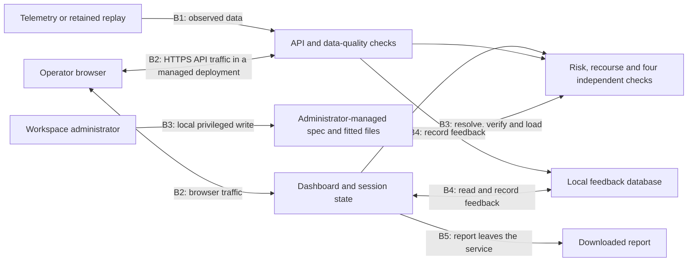

# Security-lite threat model

Scope is the advisory API and dashboard, the retained C-MAPSS replay and
fitted artifacts, and local feedback and exports. The application has no
machine-control write path. Industrial security principles guide this review.
This document is a working Phase 16 assessment.

## Data flow and trust boundaries

B1 accepts input as untrusted data. Validation can reject malformed or
implausible observations. A plausible value can still have a false source.
B2 separates browser and API clients from the service. B3 requires a
privileged, independently verified artifact source. B4 is a local persistence
boundary. B5 transfers labeled information to the person who downloads it.

## STRIDE assessment

| Threat | Boundary and class | Initial rating | Current mitigation and evidence | Residual risk and open verification |
| --- | --- | --- | --- | --- |
| Sensor spoofing within plausible ranges | B1, spoofing and tampering | High | Finite values and data-quality constraints are checked before scoring. Four independent checks can withhold a candidate. See the Phase 9 API edge tests and recourse validation tests. | High until the bounded adversarial sample is measured. Plausible forgeries can survive model-based checks. A deployment needs authenticated telemetry and independent review. |
| Replayed or stale data | B1 and B2, spoofing and tampering | High | A current prescription binds to the input hash. The Phase 17 keyboard and API checks exercise edited input and stale-result withholding. | High for replay of an otherwise valid observation by an upstream source. Input binding establishes consistency within the workflow. It does not establish acquisition time or source identity. |
| Poisoned training data | B3, tampering | High | Unit-separated fitting and leakage audits check partition identity. Scientific runs pin input and fitted-artifact hashes. | High when an administrator approves poisoned source data before pinning. Source approval and provenance checks remain required. Partition tests address leakage only. |
| Tampered model or validator | B3, tampering and elevation | High | The named loader checks file digests from the fitted-bundle manifest before decoding. Trusted roots, bundle compatibility and the legacy pickle boundary are documented in [artifact security](artifact_security.md). Phase 9 artifact tests exercise root and decode failures. | High if the artifact and its manifest are both replaced. Require an independently trusted checksum for deployed weights. Hashes do not make serialized objects safe. |
| Tampered or misattributed feedback | B4, tampering and repudiation | High | The service scopes feedback by machine, spec and protocol and recalculates the outcome. The simulator labels simulated-operator records. | High if an actor can write to the database or impersonate an operator. Role enforcement, provenance tests and operating-system permissions remain necessary. |
| Unauthorized user | B2, spoofing and elevation | High | Existing API-key handling compares configured keys without a direct equality check. The API uses explicit CORS origins and browser response headers. | High until service startup requires credentials, sessions expire, dashboard requests are CSRF-protected, and operator and administrator capabilities are verified. |
| Sensitive error or export disclosure | B2 and B5, information disclosure | High | API validation strips raw inputs from public errors. Unexpected API failures return a generic JSON response. API responses use no-store and deny framing. Scenario reports bind the current input and limits label. | Medium. Downloads leave the application's controls. Test ordinary errors, failure injection and both permitted and denied preflights. |
| Resource exhaustion through API requests | B1 and B2, denial of service | High | The guard limits streamed bytes before parsing. Machine windows and batches have configured row limits. The Phase 9 HTTP tests send an oversized body with a false length. | High for repeated valid requests or simultaneous solves. Enforce limits at ingress and test login throttling. |

## Phase 16 evidence still to collect

- Verify default authentication, role boundaries, password verification,
  session expiry, secure cookies, CSRF protection and login throttling.
- Run schema-based endpoint fuzzing, including nonfinite measurements and
  nested payloads.
- Register the bounded spoofing sample, run it and report attempts, outcomes
  and which checks withheld prescriptions.
- Run the dependency and source scans, produce the SBOM and verify deployment
  artifact checksums. Record the advisory database and dated exceptions.
- Complete the advisory safety case and the prescribed Phase 16 gates.

High residual risks remain visible until their mitigations and tests are
verified. The technical dashboard gate is recorded separately in the
[acceptance report](acceptance_report.md).
