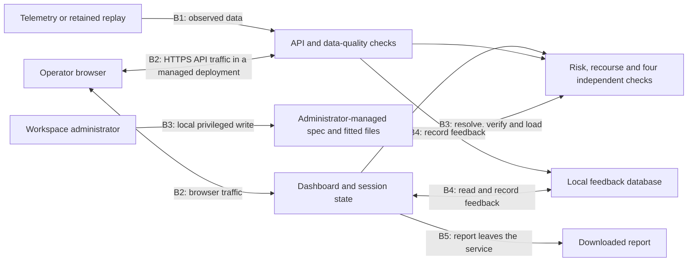

# Security-lite threat model

Scope is the advisory API and dashboard, the retained C-MAPSS replay and
fitted artifacts, and local feedback and exports. The application has no
machine-control write path. Industrial security principles guide this review.
The research Phase 16 gate passed with the deployment residuals below retained.

## Data flow and trust boundaries

B1 accepts input as untrusted data. Validation can reject malformed or
implausible observations. A plausible value can still have a false source.
B2 separates browser and API clients from the service. B3 requires a
privileged, independently verified artifact source. B4 is a local persistence
boundary. B5 transfers labeled information to the person who downloads it.

## STRIDE assessment

| Threat | Boundary and class | Initial rating | Current mitigation and evidence | Residual risk and open verification |
| --- | --- | --- | --- | --- |
| Sensor spoofing within plausible ranges | B1, spoofing and tampering | High | Finite values and data-quality constraints are checked before scoring. Four independent checks can withhold a candidate. See the Phase 9 API edge tests and recourse validation tests. | High. The bounded sample published two of 16 prescriptions that failed Tier 1 on the original recorded input. Deployment requires authenticated telemetry and independent review. See the [safety case](safety_case.md). |
| Replayed or stale data | B1 and B2, spoofing and tampering | High | A current prescription binds to the input hash. The Phase 17 keyboard and API checks exercise edited input and stale-result withholding. | High for replay of an otherwise valid observation by an upstream source. Input binding establishes consistency within the workflow. It does not establish acquisition time or source identity. |
| Poisoned training data | B3, tampering | High | Unit-separated fitting and leakage audits check partition identity. Scientific runs pin input and fitted-artifact hashes. | High when an administrator approves poisoned source data before pinning. Source approval and provenance checks remain required. Partition tests address leakage only. |
| Tampered model or validator | B3, tampering and elevation | High | The named loader checks file digests from the fitted-bundle manifest before decoding. Trusted roots, bundle compatibility and the legacy pickle boundary are documented in [artifact security](artifact_security.md). Phase 9 artifact tests exercise root and decode failures. | Medium while an independent administrator manifest and filesystem permissions hold. Hosted loaders refuse unregistered or altered artifacts before decode. A privileged replacement of both trust anchor and artifact remains a risk. |
| Tampered or misattributed feedback | B4, tampering and repudiation | High | The service scopes feedback by machine, spec and protocol and recalculates the outcome. The simulator labels simulated-operator records. | High if an actor can write to the database or impersonate an operator. Role enforcement, provenance tests and operating-system permissions remain necessary. |
| Unauthorized user | B2, spoofing and elevation | High | Hosted serving requires salted credentials and HTTPS. Tests exercise role checks, login throttling, cookie and CSRF controls, and socket expiry. The real dashboard HTTPS receipt verified sign-in, role denial and logout. | Medium in a controlled single-worker deployment. Shared role credentials, ingress configuration and operator access policy remain deployment responsibilities. |
| Sensitive error or export disclosure | B2 and B5, information disclosure | High | API validation strips raw inputs from public errors. Unexpected API failures return a generic JSON response. API responses use no-store and deny framing. Scenario reports bind the current input and limits label. | Medium. Downloads leave the application's controls. Test ordinary errors, failure injection and both permitted and denied preflights. |
| Resource exhaustion through API requests | B1 and B2, denial of service | High | The guard limits streamed bytes before parsing. Machine windows and batches have configured row limits. The Phase 9 HTTP tests send an oversized body with a false length. | High for repeated valid requests or simultaneous solves. Enforce limits at ingress and test login throttling. |

## Phase 16 gate

At source `ca3581a`, `make security` passed with 132 audited dependencies,
zero known advisories, zero high Bandit findings, 12 medium and 123 low
findings, and a 156-component CycloneDX SBOM. The secret scan resolved
17,535 candidates as 17,501 verified public digests and 34 dated scoped
exceptions. All 43 security tests passed in 41.15 seconds. The raw scans,
exceptions and receipt are in `artifacts/phase16/security-gate-20261110-v2`.

The recovered fixed-subset check passed 783 tests in 2,476.27 seconds,
with 68 warnings and one full-tier deselection. Make and wrapper native
exits were zero. All 15,525 cases matched exactly across 23 groups,
with 11,723 preserved records reused and 3,802 freshly computed. Both
retained coverage gates passed at 91.16548375046695% scoped lines,
91.23277536298899% package lines and 88.04982757407276% combined.
Strict docs passed at closeout.

The original segment stopped without a native exit or traceback. Its cause
is unverified. Original files, all result timings and the database including
WAL are preserved with hash and payload checks under
`artifacts/phase16/fixed-subset-recovery-20261111-v1`.
The final subset is `artifacts/regression-tiers/check-20261111T140415675674Z-13876`.
No full regression was run for this closeout. The
[safety case](safety_case.md) retains the high spoofing deployment residual.
The [dashboard acceptance report](acceptance_report.md) retains pending human tasks.
